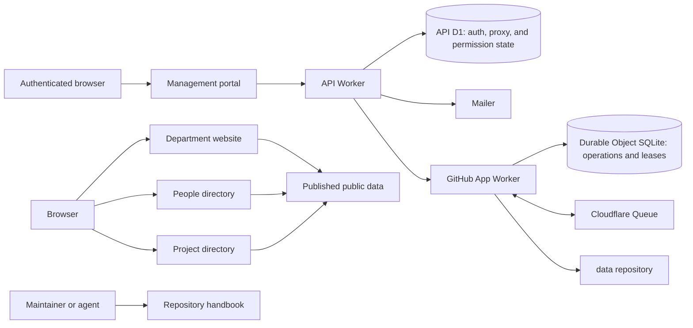

# SCS PDN Monorepo

Websites and services for the Department of Statistics and Computer Science,
University of Peradeniya. The repository uses Bun workspaces and Turborepo,
but every application and service remains independently deployable.

## Start Here

Install the pinned Bun version shown in `.bun-version`, then run:

```powershell
git clone https://github.com/csc3213-2026-group-b/scs-pdn-monorepo.git
Set-Location scs-pdn-monorepo
bun install --frozen-lockfile
bun --filter '@scs/web' dev
```

Open the URL printed by Next.js. Most public applications can start with their
checked-in defaults. Portal, API, GitHub automation, and mail delivery need the
environment files described in
[Environment Variables](docs/ENVIRONMENT_VARIABLES.md).

## What Runs Where



Read [Architecture](docs/ARCHITECTURE.md) before changing a boundary between
workspaces.

## Workspaces

| Path                     | Package              | Responsibility                                   |
| ------------------------ | -------------------- | ------------------------------------------------ |
| `apps/web`               | `@scs/web`           | Department website                               |
| `apps/docs`              | `@scs/docs`          | Repository handbook and agent-readable reference |
| `apps/people`            | `@scs/people`        | Public staff, student, alumni, and profile pages |
| `apps/projects`          | `@scs/projects`      | Public project discovery and project details     |
| `apps/portal`            | `@scs/portal`        | Authentication and management workflows          |
| `services/api`           | `@scs/api`           | Browser-facing API, Better Auth, and D1 state    |
| `services/github-app`    | `@scs/github-app`    | Durable Git-backed mutations and pull requests   |
| `services/mailer`        | `@scs/mailer`        | Authenticated templated email and SMTP delivery  |
| `packages/security`      | `@scs/security`      | Shared security.txt validation and generation    |
| `packages/schemas`       | `@scs/schemas`       | Shared Zod and transport contracts               |
| `packages/ui`            | `@scs/ui`            | Shared shadcn primitives and hooks               |
| `packages/eslint-config` | `@scs/eslint-config` | Shared lint policy                               |
| `packages/tsconfig`      | `@scs/tsconfig`      | Shared TypeScript presets                        |

The public data repository is a separate system. It is not a Bun workspace in
this repository.

## Daily Commands

```powershell
# Run every declared development task.
bun run dev

# Run one workspace.
bun --filter '@scs/portal' dev
bun --filter '@scs/api' test

# Complete local quality gate.
bun run docs:check
bun run test:repo
bun run knip
bun run format:check
bun run lint
bun run typecheck
bun run typecheck:test
bun run test
bun run build
```

`typecheck` covers production source. `typecheck:test` covers test-only aliases,
fixtures, and runner globals. A workspace without a test script has no test
coverage; Turbo does not treat it as a passing suite.

## Handover Boundaries

The repository is production-oriented, but source control cannot prove or
replace external provider state:

- the public-data repository is deployed and validated separately;
- OAuth applications, Cloudflare bindings, queues, D1, SMTP, DNS, hosting
  projects, protected environments, and repository rulesets require operator
  access;
- root commands verify code but do not deploy every workspace as one release;
- production validation must record the deployed commit and any checks that
  require real credentials or provider consoles.

Use [Operations](docs/OPERATIONS.md) for deployment, migration, recovery, and
the remaining provider-side checks. Use
[Environment Variables](docs/ENVIRONMENT_VARIABLES.md) for the complete
configuration inventory.

## Repository Rules

- Use Bun only. The lockfile and `.bun-version` are authoritative.
- Keep deployables independent; do not make an unrelated app a runtime
  dependency.
- Put shared runtime contracts in `@scs/schemas` and reusable shadcn primitives
  in `@scs/ui`.
- Keep product-specific components inside their application.
- Parse environment variables in typed config modules; do not scatter
  `process.env` access or operational constants through components.
- Put tests under `test` or `tests`, following the owning workspace.
- Use `@/` or package aliases for cross-directory imports when the workspace
  supports them.
- Use Conventional Commits. Husky validates staged files and commit messages.
- Docker is not part of the current development or verification workflow.

Automated contributors must also follow [AGENTS.md](AGENTS.md).

## Documentation

| Guide                                                      | Read it when you need to…                                             |
| ---------------------------------------------------------- | --------------------------------------------------------------------- |
| [Repository handbook](docs/INDEX.md)                       | choose the right guide for a task                                     |
| [Repository overview](docs/REPOSITORY_OVERVIEW.md)         | map every workspace and its ownership boundary                        |
| [Development](docs/DEVELOPMENT.md)                         | set up the repository, make a change, or diagnose local tooling       |
| [Architecture](docs/ARCHITECTURE.md)                       | understand boundaries, data ownership, and request flows              |
| [Authentication](docs/AUTHENTICATION.md)                   | change sessions, OAuth, permissions, or service trust                 |
| [Public data](docs/PUBLIC_DATA.md)                         | understand published data reads and Git-backed writes                 |
| [API Contracts](docs/API_CONTRACTS.md)                     | call or change HTTP endpoints and durable operations                  |
| [Schemas](docs/SCHEMAS.md)                                 | add or evolve shared domain contracts                                 |
| [UI system](docs/UI_SYSTEM.md)                             | build consistent, accessible application interfaces                   |
| [Web application](docs/APPLICATION_WEB.md)                 | change department content, feeds, or redirects                        |
| [People application](docs/APPLICATION_PEOPLE.md)           | change directory browsing or profile interpretation                   |
| [Projects application](docs/APPLICATION_PROJECTS.md)       | change showcase discovery or project details                          |
| [Portal application](docs/APPLICATION_PORTAL.md)           | change authenticated editing and administration                       |
| [Application internals](docs/APPLICATIONS/INDEX.md)        | trace application routing, state, rendering, and failure behavior     |
| [API service](docs/SERVICE_API.md)                         | change browser API, auth, D1 state, or orchestration                  |
| [GitHub App service](docs/SERVICE_GITHUB_APP.md)           | change durable Git-backed automation                                  |
| [Mailer service](docs/SERVICE_MAILER.md)                   | change email templates, validation, or SMTP delivery                  |
| [Service internals](docs/SERVICES/INDEX.md)                | trace backend request lifecycles, state, integrations, and failures   |
| [Schemas package](docs/PACKAGE_SCHEMAS.md)                 | maintain shared runtime and transport contracts                       |
| [Security package](docs/PACKAGE_SECURITY.md)               | maintain security.txt generation and discovery redirects              |
| [UI package](docs/PACKAGE_UI.md)                           | maintain shared shadcn primitives and theme tokens                    |
| [TypeScript config](docs/PACKAGE_TSCONFIG.md)              | change shared compiler policy                                         |
| [ESLint config](docs/PACKAGE_ESLINT_CONFIG.md)             | change shared lint and Tailwind policy                                |
| [Shared package internals](docs/PACKAGES/INDEX.md)         | maintain schema, UI, TypeScript, and ESLint package contracts         |
| [Testing](docs/TESTING.md)                                 | select and run the correct verification layers                        |
| [Dependency management](docs/DEPENDENCY_MANAGEMENT.md)     | add, update, audit, or remove dependencies                            |
| [Documentation authoring](docs/DOCUMENTATION_AUTHORING.md) | add or publish a handbook page                                        |
| [Environment Variables](docs/ENVIRONMENT_VARIABLES.md)     | configure local or deployed runtimes                                  |
| [Continuous Integration](docs/CI.md)                       | understand required checks and merge behavior                         |
| [Operations](docs/OPERATIONS.md)                           | deploy, migrate, observe, or recover a service                        |
| [Security](docs/SECURITY.md)                               | handle authentication, secrets, permissions, or incidents             |
| [UI quality assurance](docs/UI_QUALITY_ASSURANCE.md)       | review accessibility, responsiveness, themes, and interaction quality |
| [Troubleshooting](docs/TROUBLESHOOTING.md)                 | diagnose common local, runtime, and provider failures                 |
| [Route reference](docs/ROUTE_REFERENCE.md)                 | find application and service route families                           |
| [Glossary](docs/GLOSSARY.md)                               | understand shared repository terminology                              |

Documentation is maintained with the code. Run `bun run docs:check` after
adding, renaming, linking, or removing a Markdown file.

## Getting Help

Start with the relevant guide and the nearest workspace `package.json`. When
reporting a problem, include the workspace, command, error output, commit SHA,
and whether the failure is local or from GitHub Actions. Report suspected
security issues privately as described in [Security](docs/SECURITY.md).
