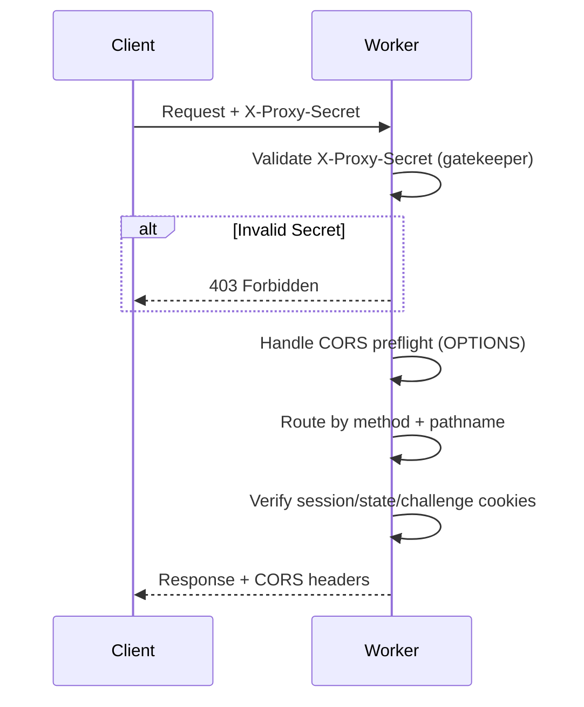

# API Reference

> Auto-generated comprehensive API documentation for the SCS Portal Auth Worker (`scs-portal-auth-app`).
> Base URL: `https://api.scs.pdn.ac.lk`

---

## Table of Contents

- [Architecture Overview](#architecture-overview)
- [Global Middleware & Conventions](#global-middleware--conventions)
- [Auth & Session Endpoints](#auth--session-endpoints)
  - [POST /auth/signup](#post-authsignup)
  - [POST /auth/magic-code](#post-authmagic-code)
  - [POST /auth/magic-code/verify](#post-authmagic-codeverify)
  - [GET /auth/verify](#get-authverify)
  - [GET /auth/logout](#get-authlogout)
  - [PATCH /auth/logout](#patch-authlogout)
- [OAuth Endpoints](#oauth-endpoints)
  - [GET /auth/google](#get-authgoogle)
  - [GET /auth/google/callback](#get-authgooglecallback)
  - [GET /auth/github](#get-authgithub)
  - [GET /auth/github/callback](#get-authgithubcallback)
- [Profile & Permission Endpoints](#profile--permission-endpoints)
  - [GET /api/me](#get-apime)
  - [PATCH /api/me/notifications](#patch-apimenotifications)
  - [DELETE /api/me/oauth/github](#delete-apimeoauthgithub)
  - [PATCH /api/user/permissions](#patch-apiuserpermissions)
- [Admin Endpoints](#admin-endpoints)
  - [GET /api/admin/users](#get-apiadminusers)
  - [GET /api/admin/users/:email](#get-apiadminusersemail)
  - [PATCH /api/admin/users/:email](#patch-apiadminusersemail)
- [Passkey (WebAuthn) Endpoints](#passkey-webauthn-endpoints)
  - [POST /auth/passkey/register/options](#post-authpasskeyregisteroptions)
  - [POST /auth/passkey/register/verify](#post-authpasskeyregisterverify)
  - [POST /auth/passkey/login/options](#post-authpasskeyloginoptions)
  - [POST /auth/passkey/login/verify](#post-authpasskeyloginverify)
  - [GET /auth/passkey/credentials](#get-authpasskeycredentials)
  - [PATCH /auth/passkey/credentials/:id](#patch-authpasskeycredentialsid)
  - [DELETE /auth/passkey/credentials/:id](#delete-authpasskeycredentialsid)
  - [POST /auth/passkey/revoke](#post-authpasskeyrevoke)
- [Proxy Endpoint](#proxy-endpoint)
  - [GET /user/proxy](#get-userproxy)
  - [POST /user/proxy](#post-userproxy)
  - [PATCH /user/proxy](#patch-userproxy)
- [Data Models](#data-models)
  - [Permission Object](#permission-object)
  - [PasskeyCredential Object](#passkeycredential-object)
  - [ProxyEntry Object](#proxyentry-object)
  - [UserData Object (Admin)](#userdata-object-admin)
- [Error Reference](#error-reference)

---

## Architecture Overview

This is a **Cloudflare Worker** (Hono-style manual router) that serves as the authentication backend for the SCS Portal. It uses:

- **KV Namespaces** (`PERMISSIONS`, `TOKEN_BLACKLIST`, `MAGIC_CODES`) for persistence.
- **JWT** (`jose` library, HS256) for session tokens and challenge cookies.
- **@simplewebauthn/server** for WebAuthn/Passkey support.
- **OAuth 2.0** flows for Google and GitHub.

### Request Flow



---

## Global Middleware & Conventions

### Gatekeeper Header

| Header           | Required         | Description                                                                               |
| ---------------- | ---------------- | ----------------------------------------------------------------------------------------- |
| `X-Proxy-Secret` | **All requests** | Must match `env.X_PROXY_SECRET`. Returns `403 {"error":"Forbidden"}` if missing or wrong. |

### Client Context Header

| Header        | Required For                                | Description                                                                                                         |
| ------------- | ------------------------------------------- | ------------------------------------------------------------------------------------------------------------------- |
| `X-Client-Id` | Auth, profile, passkey, proxy, admin routes | Must be `"portal"` (only allowed client). Returns `400 "Missing client context"` or `403 "Unauthorized client_id"`. |

### CORS

CORS headers are only added when the request `Origin` matches an allowed origin:

- `https://portal.scs.pdn.ac.lk`
- `https://portal.scs.pdn.ac.lk`

Allowed methods: `PATCH, POST, GET, OPTIONS, PUT, DELETE`
Allowed headers: `Content-Type, Authorization, X-Proxy-Secret, X-Client-Id`
Credentials are allowed (`Access-Control-Allow-Credentials: true`).

### Cookies Set by the API

| Cookie              | Type                                                            | Purpose                                        |
| ------------------- | --------------------------------------------------------------- | ---------------------------------------------- |
| `session`           | `HttpOnly; Secure; SameSite=Lax; Domain=.scs.pdn.ac.lk; Path=/` | Signed JWT session token (15 min TTL)          |
| `oauth_state`       | `HttpOnly; Secure; SameSite=Lax; Path=/`                        | CSRF state for OAuth flows (15 min TTL)        |
| `passkey_challenge` | `HttpOnly; Secure; SameSite=None; Path=/`                       | WebAuthn challenge for passkey ops (5 min TTL) |

### Email Domain Restrictions

Only `@pdn.ac.lk` and `@sci.pdn.ac.lk` emails are permitted. Any other domain returns:

```json
{
  "error": "Unauthorized email domain",
  "message": "...",
  "allowed_domains": ["pdn.ac.lk", "sci.pdn.ac.lk"]
}
```

---

## Auth & Session Endpoints

### `POST /auth/signup`

Creates a new user account and returns a JWT session token.

**Headers:**

- `X-Client-Id: portal`
- `Content-Type: application/json`

**Request Body:**

```json
{
  "email": "student@pdn.ac.lk",
  "name": "Optional Display Name",
  "picture": "https://example.com/avatar.png"
}
```

| Field     | Type   | Required | Constraints                                          |
| --------- | ------ | -------- | ---------------------------------------------------- |
| `email`   | string | **Yes**  | Must be `@pdn.ac.lk` or `@sci.pdn.ac.lk`             |
| `name`    | string | No       | Trimmed, max 100 chars                               |
| `picture` | string | No       | Must be a valid `http:`/`https:` URL, max 2048 chars |

**Behavior:**

1. Validates client ID and email domain.
2. Sanitizes `name` and `picture`.
3. Checks if user permission record already exists in KV.
4. If new user, creates a permission entry with `createdAt` timestamp.
5. Issues a HS256 JWT (`sub`, `email`, `name`, `picture`, `permission`, `iss`, `aud`, `jti`) with 15-minute expiry.

**Success Response (200):**

```json
{ "token": "eyJhbGciOiJIUzI1NiJ9..." }
```

**Error Responses:**

| Status | Body                                                                                                    |
| ------ | ------------------------------------------------------------------------------------------------------- |
| 400    | `Missing client context`                                                                                |
| 403    | `Unauthorized client_id`                                                                                |
| 400    | `{"error":"Email required"}`                                                                            |
| 400    | `{"error":"Unauthorized email domain","message":"...","allowed_domains":["pdn.ac.lk","sci.pdn.ac.lk"]}` |

---

### `POST /auth/magic-code`

Sends a 6-digit verification code to the user's email for passwordless login. The code is valid for **5 minutes** and is **one-time use**.

**Headers:**

- `X-Client-Id: portal`
- `Content-Type: application/json`

**Request Body:**

```json
{ "email": "student@pdn.ac.lk" }
```

| Field   | Type   | Required | Constraints                              |
| ------- | ------ | -------- | ---------------------------------------- |
| `email` | string | **Yes**  | Must be `@pdn.ac.lk` or `@sci.pdn.ac.lk` |

**Behavior:**

1. Validates client ID and allowed email domain.
2. Generates a cryptographically secure 6-digit code via `crypto.getRandomValues`.
3. Stores `code → email` in the `MAGIC_CODES` KV namespace (5 min TTL, one-time use).
4. Sends the code to the user's email via the mailer service.

**Success Response (200):**

```json
{ "message": "Magic code sent", "expiresIn": 300 }
```

**Error Responses:**

| Status | Body                                                                                             |
| ------ | ------------------------------------------------------------------------------------------------ |
| 400    | `Missing client context`                                                                         |
| 403    | `Unauthorized client_id`                                                                         |
| 400    | `{"error":"Email required"}`                                                                     |
| 400    | `{"error":"Unauthorized email domain","message":"Use your @pdn.ac.lk or @sci.pdn.ac.lk email."}` |
| 500    | `{"error":"Failed to send email. Please try again later."}`                                      |

---

### `POST /auth/magic-code/verify`

Verifies a 6-digit magic code and issues a session cookie.

**Headers:**

- `X-Client-Id: portal`
- `Content-Type: application/json`

**Request Body:**

```json
{ "email": "student@pdn.ac.lk", "code": "123456" }
```

| Field   | Type   | Required | Description                     |
| ------- | ------ | -------- | ------------------------------- |
| `email` | string | **Yes**  | The email the code was sent to  |
| `code`  | string | **Yes**  | The 6-digit code from the email |

**Behavior:**

1. Validates client ID.
2. Looks up `code` in the `MAGIC_CODES` KV namespace.
3. Verifies the stored email matches the claimed email.
4. Deletes the code from KV (one-time use).
5. Creates or retrieves the user's permission record.
6. Issues a signed session JWT and sets the `session` cookie.
7. Returns JSON with the redirect target.

**Success Response (200):**

```json
{
  "verified": true,
  "redirectTo": "https://portal.scs.pdn.ac.lk/dashboard"
}
```

Also sets `Set-Cookie: session=...`.

**Error Responses:**

| Status | Body                             |
| ------ | -------------------------------- |
| 400    | `{"error":"magic_code_missing"}` |
| 401    | `{"error":"magic_code_invalid"}` |

---

### `GET /auth/verify`

Verifies the `session` cookie and returns the authenticated user's email.

**Headers:**

- `X-Client-Id: portal`
- `Cookie: session=...`

**Behavior:**

1. Extracts `session` cookie.
2. Verifies the JWT (HS256, issuer, audience, expiry).
3. Checks if the token's `jti` is in the token blacklist.
4. Returns `{valid: true, email}`.

**Success Response (200):**

```json
{ "valid": true, "email": "student@pdn.ac.lk" }
```

**Error Responses:**

| Status | Body                     |
| ------ | ------------------------ |
| 401    | `Missing token`          |
| 400    | `Missing client context` |
| 403    | `Unauthorized client_id` |
| 401    | `Token revoked`          |
| 401    | `Invalid token`          |

---

### `GET /auth/logout`

Clears the session and OAuth cookies, revokes the JWT token.

**Headers:**

- `Cookie: session=...` (optional)

**Behavior:**

1. Best-effort: always returns `200` even if no session cookie is present.
2. If a valid JWT is found, calculates remaining TTL and adds the `jti` to the `TOKEN_BLACKLIST` KV namespace.
3. Clears `session` and `oauth_state` cookies.

**Success Response (200):** Empty body.

---

### `PATCH /auth/logout`

Identical behavior to `GET /auth/logout`. Both methods are registered.

---

## OAuth Endpoints

### `GET /auth/google`

Initiates the Google OAuth 2.0 authorization code flow.

**Query Parameters:**

| Parameter   | Required | Description                                          |
| ----------- | -------- | ---------------------------------------------------- |
| `client_id` | **Yes**  | Must be `"portal"`                                   |
| `signup`    | No       | Set to `"true"` for signup mode (new users only)     |
| `prompt`    | No       | Set to `"select_account"` to force account selection |

**Behavior:**

1. Validates `client_id`.
2. Creates a signed CSRF state JWT containing `{csrf, clientId, isSignup}`.
3. Sets `oauth_state` cookie with the signed state.
4. Redirects to `https://accounts.google.com/o/oauth2/v2/auth` with:
   - `scope=openid email profile`
   - `response_type=code`
   - `access_type=offline` (implicit)

**Success Response:** `302` redirect to Google.

**Error Responses:**

| Status | Body                |
| ------ | ------------------- |
| 400    | `Missing client_id` |
| 400    | `Invalid client_id` |

---

### `GET /auth/google/callback`

Handles the Google OAuth callback after user authorization.

**Inputs:**

- Query: `code`, `state`, or `error` from Google
- Cookie: `oauth_state` (signed JWT)

**Behavior:**

1. Validates `oauth_state` cookie (JWT signature, expiry).
2. If `error` query param present → redirects to portal login with `error=google_access_denied`.
3. Validates `state` param matches the CSRF token in the cookie.
4. Exchanges `code` for tokens at `https://oauth2.googleapis.com/token`.
5. Verifies the Google ID token using Google's JWKS endpoint.
6. Validates `email_verified` is `true`.
7. Checks email domain is in allowed list.
8. **Signup mode** (`signup=true`): creates user if not exists; errors if already exists.
9. **Login mode**: errors if user doesn't exist.
10. Checks user is not blacklisted and has Google OAuth enabled.
11. Issues session JWT via internal `login()` call.
12. Sets `session` cookie and clears `oauth_state` cookie.
13. Redirects to portal dashboard.

**Success Response:** `302` redirect to `https://portal.scs.pdn.ac.lk/dashboard`.

**Error Redirects (302 to portal login with `?error=`):**

| Error Code                   | Meaning                                 |
| ---------------------------- | --------------------------------------- |
| `google_access_denied`       | User declined at Google                 |
| `invalid_state`              | CSRF mismatch                           |
| `missing_code`               | No authorization code returned          |
| `token_exchange_failed`      | Code→token exchange HTTP error          |
| `invalid_id_token`           | Google ID token JWT verification failed |
| `invalid_google_account`     | Email missing or not verified           |
| `workspace_account_required` | Email domain not in allowed list        |
| `user_already_exists`        | Signup mode but user already registered |
| `user_not_registered`        | Login mode but user not found           |
| `user_blacklisted`           | User is blacklisted                     |
| `google_oauth_not_allowed`   | Google OAuth disabled for this user     |
| `session_creation_failed`    | Internal session JWT creation failed    |

**Non-redirect Errors:**

| Status | Body                       |
| ------ | -------------------------- |
| 400    | `Missing state`            |
| 403    | `Invalid or expired state` |
| 403    | `Invalid state payload`    |

---

### `GET /auth/github`

Initiates the GitHub OAuth flow.

**Query Parameters:**

| Parameter      | Required | Description                                                 |
| -------------- | -------- | ----------------------------------------------------------- |
| `redirect_uri` | **Yes**  | Error redirect target (used for client-side error handling) |
| `client_id`    | **Yes**  | Must be `"portal"`                                          |

**Behavior:**

1. Validates `redirect_uri` and `client_id`.
2. Creates a signed CSRF state JWT containing `{csrf, clientId}`.
3. Sets `oauth_state` cookie.
4. Redirects to `https://github.com/login/oauth/authorize` with `scope=read:user,user:email`.

**Success Response:** `302` redirect to GitHub.

**Error Responses:**

| Status | Body/Redirect                                              |
| ------ | ---------------------------------------------------------- |
| 400    | `Missing redirect_uri`                                     |
| 302    | Redirect to `redirect_uri` with `?error=missing_client_id` |
| 302    | Redirect to `redirect_uri` with `?error=invalid_client_id` |

---

### `GET /auth/github/callback`

Handles the GitHub OAuth callback.

**Inputs:**

- Query: `code`, `state` from GitHub
- Cookie: `oauth_state` (signed JWT)

**Behavior:**

1. Validates `oauth_state` cookie.
2. Validates CSRF `state` match.
3. Exchanges code for access token at `https://github.com/login/oauth/access_token`.
4. Fetches GitHub user profile (`https://api.github.com/user`).
5. Fetches GitHub user emails (`https://api.github.com/user/emails`).
6. Filters for verified university-domain emails (excludes `users.noreply.github.com`).
7. Requires exactly one valid university email — errors on 0 or multiple.
8. User must already exist in the permission system.
9. On first GitHub login, links the GitHub user ID to the permission record.
10. On subsequent logins, verifies the GitHub user ID matches.
11. Issues session JWT, sets `session` cookie, clears `oauth_state`.

**Success Response:** `302` redirect to `https://portal.scs.pdn.ac.lk/dashboard`.

**Error Redirects (302 to portal login with `?error=`):**

| Error Code                  | Meaning                                         |
| --------------------------- | ----------------------------------------------- |
| `missing_code`              | No authorization code                           |
| `invalid_state`             | CSRF mismatch                                   |
| `token_exchange_failed`     | Code→token exchange failed                      |
| `invalid_github_token`      | No access token in response                     |
| `github_user_fetch_failed`  | GitHub user API error                           |
| `github_email_fetch_failed` | GitHub email API error                          |
| `no_valid_email`            | No verified university email found              |
| `multiple_valid_emails`     | Multiple verified university emails found       |
| `google_account_required`   | User not registered in system                   |
| `user_blacklisted`          | User is blacklisted                             |
| `github_account_mismatch`   | Different GitHub account than previously linked |
| `failed_to_create_session`  | Session JWT creation failed                     |

---

## Profile & Permission Endpoints

### `GET /api/me`

Returns the current user's profile and permission flags.

**Headers:**

- `X-Client-Id: portal`
- `Cookie: session=...`

**Behavior:**

1. Verifies `session` JWT (issuer, audience, expiry).
2. Fetches the user's permission record from KV.
3. Returns 404 if no permission record exists.

**Success Response (200):**

```json
{
  "email": "student@pdn.ac.lk",
  "name": "Student Name",
  "picture": "https://example.com/avatar.png",
  "role": "USER",
  "blacklisted": false,
  "lastPasswordChanged": null,
  "googleOAuth": true,
  "githubOAuth": false,
  "githubUserID": 12345678,
  "pictureMode": "manual",
  "gravatarMail": null,
  "isEmailNotificationEnabled": true,
  "isPushNotificationEnabled": false
}
```

**Error Responses:**

| Status | Body                         |
| ------ | ---------------------------- |
| 401    | `Unauthorized`               |
| 400    | `Missing X-Client-Id header` |
| 401    | `Invalid token`              |
| 404    | `User not found`             |

---

### `PATCH /api/me`

Updates the current user's display name and profile picture source.

**Request Body:**

```json
{
  "name": "Student Name",
  "pictureMode": "manual",
  "picture": "https://example.com/avatar",
  "gravatarMail": null
}
```

**Profile Picture Notes:**

- `pictureMode` can be `google`, `github`, `manual`, or `gravatar`.
- Custom image URLs do not need a file extension.
- Custom image URLs are server-verified with `HEAD`, then a small ranged `GET` fallback when needed.
- Custom image content type must be `image/png`, `image/jpeg`, or `image/webp`.

---

### `PATCH /api/me/notifications`

Updates the current user's notification preferences.

**Headers:**

- `Cookie: session=...`
- `Content-Type: application/json`

**Request Body:**

```json
{
  "notifications": {
    "email": true,
    "push": false
  }
}
```

| Field                 | Type    | Required | Default        |
| --------------------- | ------- | -------- | -------------- |
| `notifications.email` | boolean | No       | existing value |
| `notifications.push`  | boolean | No       | existing value |

**Behavior:**

1. Verifies session JWT.
2. Fetches current permission record.
3. Returns 404 if user not found, 403 if blacklisted.
4. Merges notification preferences (only `email` and `push` fields are updated).
5. Saves updated permission to KV.

**Success Response (200):** `Permission updated`

**Error Responses:**

| Status | Body                               |
| ------ | ---------------------------------- |
| 401    | (propagated from JWT verification) |
| 401    | `Unauthorized`                     |
| 404    | `User not found`                   |
| 403    | `Forbidden`                        |
| 500    | `Internal Server Error`            |

---

### `DELETE /api/me/oauth/github`

Removes GitHub OAuth linkage from the current user's account.

**Headers:**

- `Cookie: session=...`

**Behavior:**

1. Verifies session JWT.
2. Sets `oAuthProviders.github` to `false` and deletes the `githubUserID` field.
3. Saves updated permission to KV.

**Success Response (200):** `GitHub OAuth removed`

**Error Responses:**

| Status | Body                               |
| ------ | ---------------------------------- |
| 401    | (propagated from JWT verification) |
| 401    | `Unauthorized`                     |
| 404    | `User not found`                   |
| 403    | `Forbidden`                        |
| 500    | `Internal Server Error`            |

---

### `PATCH /api/user/permissions`

Updates permission data for **any user**. Requires **super-admin** privileges.

**Headers:**

- `Cookie: session=...`
- `Content-Type: application/json`

**Request Body:**

```json
{
  "email": "target-user@pdn.ac.lk",
  "permission": {
    "role": "STUDENT",
    "blacklisted": false,
    "include": { "some-repo": "EDITOR" }
  }
}
```

| Field        | Type                                              | Required |
| ------------ | ------------------------------------------------- | -------- |
| `email`      | string                                            | **Yes**  |
| `permission` | object (partial [Permission](#permission-object)) | **Yes**  |

**Behavior:**

1. Verifies session JWT.
2. Checks the authenticated user is a non-blacklisted super-admin.
3. Fetches the target user's existing permission.
4. Returns 404 if target user not found.
5. Shallow-merges the provided `permission` fields onto the existing record.

**Success Response (200):** `Permission updated`

**Error Responses:**

| Status | Body                                         |
| ------ | -------------------------------------------- |
| 400    | `Bad Request`                                |
| 401    | `Unauthorized`                               |
| 403    | `Forbidden` (not super-admin or blacklisted) |
| 404    | `User not found`                             |
| 500    | `Internal Server Error`                      |

---

## Admin Endpoints

All admin endpoints require a valid session from a **non-blacklisted super-admin** user. Authorization is checked on every request by verifying the session JWT and reading the authenticated user's permission from KV.

### `GET /api/admin/users`

Returns all registered users.

**Headers:**

- `Cookie: session=...`

**Success Response (200):**

```json
[
  {
    "id": "student@pdn.ac.lk",
    "email": "student@pdn.ac.lk",
    "name": "Student Name",
    "picture": "https://example.com/avatar.png",
    "role": "STUDENT",
    "blacklisted": false,
    "createdAt": 1710000000000
  }
]
```

**Error Responses:**

| Status | Body                               |
| ------ | ---------------------------------- |
| 401    | (propagated from JWT verification) |
| 401    | `Unauthorized`                     |
| 403    | `Forbidden`                        |
| 500    | `Internal Server Error`            |

---

### `GET /api/admin/users/:email`

Returns the full permission record for a single user.

**Path Parameter:**

- `email` — URL-encoded email address (e.g., `student%40pdn.ac.lk`)

**Headers:**

- `Cookie: session=...`

**Success Response (200):** Full [Permission object](#permission-object).

**Error Responses:**

| Status | Body                               |
| ------ | ---------------------------------- |
| 401    | (propagated from JWT verification) |
| 401    | `Unauthorized`                     |
| 403    | `Forbidden`                        |
| 400    | `{"error":"Email required"}`       |
| 404    | `{"error":"User not found"}`       |

---

### `PATCH /api/admin/users/:email`

Merges a partial permission update into a user's record.

**Path Parameter:**

- `email` — URL-encoded email address

**Headers:**

- `Cookie: session=...`
- `Content-Type: application/json`

**Request Body:** Any partial [Permission](#permission-object) fields.

```json
{
  "blacklisted": false,
  "role": "ACADEMIC",
  "accessLevel": "SUPER_ADMIN"
}
```

**Behavior:**

1. Verifies session, checks super-admin.
2. Fetches existing permission; 404 if not found.
3. Shallow-merges the request body onto the existing record.
4. Saves to KV.

**Success Response (200):** Updated full [Permission object](#permission-object).

**Error Responses:**

| Status | Body                                             |
| ------ | ------------------------------------------------ |
| 401    | (propagated from JWT verification)               |
| 401    | `Unauthorized`                                   |
| 403    | `Forbidden`                                      |
| 400    | `{"error":"Email required"}`                     |
| 404    | `{"error":"User not found"}`                     |
| 400    | `{"error":"Invalid JSON body"}`                  |
| 400    | `{"error":"Request body must be a JSON object"}` |
| 500    | `Internal Server Error`                          |

---

## Passkey (WebAuthn) Endpoints

All passkey routes require an allowed `Origin` header and a valid `X-Client-Id`. The relying party (RP) configuration is origin-dependent:

| Origin                         | RP ID                  |
| ------------------------------ | ---------------------- |
| `https://portal.scs.pdn.ac.lk` | `scs.pdn.ac.lk`        |
| `https://portal.scs.pdn.ac.lk` | `portal.scs.pdn.ac.lk` |

The RP name is `"SCS Portal"`. Users can register up to **4 passkeys** per account.

---

### `POST /auth/passkey/register/options`

Generates WebAuthn registration options. Requires an active session (user must be logged in).

**Headers:**

- `X-Client-Id: portal`
- `Cookie: session=...`
- `Content-Type: application/json`

**Request Body (optional):**

```json
{ "name": "My Laptop Passkey" }
```

| Field  | Type   | Required | Description                         |
| ------ | ------ | -------- | ----------------------------------- |
| `name` | string | No       | Custom display name for the passkey |

**Behavior:**

1. Verifies session JWT, checks user is not blacklisted.
2. Enforces passkey limit (max 4).
3. Generates registration options via `@simplewebauthn/server`:
   - `residentKey: "preferred"`
   - `userVerification: "required"`
   - `attestationType: "none"`
   - Excludes already-registered credentials for the current RP ID.
4. Sets `passkey_challenge` cookie (5 min TTL, `SameSite=None`) containing a signed JWT with the challenge.

**Success Response (200):** WebAuthn `PublicKeyCredentialCreationOptions` JSON.

**Error Responses:**

| Status | Body                                                                                           |
| ------ | ---------------------------------------------------------------------------------------------- |
| 400    | `Missing client context`                                                                       |
| 403    | `Unauthorized client_id`                                                                       |
| 403    | `{"error":"Forbidden origin"}`                                                                 |
| 400    | `{"error":"Passkeys are not configured for this origin"}`                                      |
| 401    | `{"error":"Missing session"}`                                                                  |
| 401    | `{"error":"Invalid session"}`                                                                  |
| 401    | `{"error":"Token revoked"}`                                                                    |
| 403    | `{"error":"Forbidden"}`                                                                        |
| 409    | `{"code":"passkey_limit_reached","message":"You can save up to 4 passkeys for this account."}` |

---

### `POST /auth/passkey/register/verify`

Verifies a WebAuthn registration response and stores the new credential.

**Headers:**

- `X-Client-Id: portal`
- `Cookie: passkey_challenge=...`
- `Content-Type: application/json`

**Request Body:**

```json
{
  "response": {/* RegistrationResponseJSON */}
}
```

| Field      | Type                     | Required |
| ---------- | ------------------------ | -------- |
| `response` | RegistrationResponseJSON | **Yes**  |

**Behavior:**

1. Reads and validates `passkey_challenge` cookie.
2. Verifies the registration response against the stored challenge.
3. Checks passkey name uniqueness (409 conflict if duplicate).
4. If name is empty/omitted, auto-generates `"Passkey N"`.
5. Stores the credential in the user's `passkeys` array in KV.
6. Clears the challenge cookie.

**Success Response (200):**

```json
{ "verified": true }
```

**Error Responses:**

| Status | Body                                                                       |
| ------ | -------------------------------------------------------------------------- |
| 400    | `Missing client context`                                                   |
| 403    | `Unauthorized client_id`                                                   |
| 401    | `{"error":"Missing passkey challenge"}`                                    |
| 401    | `{"error":"Invalid passkey challenge"}`                                    |
| 401    | `{"error":"Invalid or expired passkey challenge"}`                         |
| 401    | `{"error":"Invalid client context"}`                                       |
| 400    | `{"error":"Passkey response required"}`                                    |
| 401    | `{"error":"Passkey registration failed"}`                                  |
| 403    | `{"error":"Forbidden"}`                                                    |
| 409    | `{"code":"passkey_name_conflict","message":"Passkey name already in use"}` |

---

### `POST /auth/passkey/login/options`

Generates WebAuthn authentication options. Supports both **discoverable** (emailless) and **non-discoverable** flows.

**Headers:**

- `X-Client-Id: portal`
- `Content-Type: application/json`

**Request Body (optional):**

```json
{ "email": "student@pdn.ac.lk" }
```

| Field   | Type   | Required | Description                                      |
| ------- | ------ | -------- | ------------------------------------------------ |
| `email` | string | No       | If omitted, enables discoverable credential flow |

**Behavior:**

- **With `email`:** Looks up the user's passkeys filtered by RP ID. Returns 403 if no passkeys are registered. Generates options with `allowCredentials`.
- **Without `email` (discoverable):** Generates options **without** `allowCredentials`, allowing the browser to present any resident credentials for the RP ID. The user is resolved later during verification.
- Sets `passkey_challenge` cookie.

**Success Response (200):** WebAuthn `PublicKeyCredentialRequestOptions` JSON.

**Error Responses:**

| Status | Body                                                      |
| ------ | --------------------------------------------------------- |
| 400    | `Missing client context`                                  |
| 403    | `Unauthorized client_id`                                  |
| 403    | `{"error":"Forbidden origin"}`                            |
| 400    | `{"error":"Passkeys are not configured for this origin"}` |
| 400    | `{"error":"Unauthorized email domain"}`                   |
| 403    | `{"error":"Passkey is not registered"}`                   |

---

### `POST /auth/passkey/login/verify`

Verifies a WebAuthn authentication response and issues a session cookie.

**Headers:**

- `X-Client-Id: portal`
- `Cookie: passkey_challenge=...`
- `Content-Type: application/json`

**Request Body:**

```json
{
  "response": {/* AuthenticationResponseJSON */}
}
```

| Field      | Type                       | Required |
| ---------- | -------------------------- | -------- |
| `response` | AuthenticationResponseJSON | **Yes**  |

**Behavior:**

1. Reads and validates `passkey_challenge` cookie.
2. **Discoverable flow** (no email in challenge): scans ALL users in KV to find the credential by ID and RP ID. Resolves the user.
3. **Non-discoverable flow**: looks up the user by email from the challenge.
4. Verifies the authentication response against the stored credential.
5. Updates the credential's counter, `backedUp`, `deviceType`, and `lastUsedAt`.
6. Issues a new session JWT and sets the `session` cookie.
7. Clears the `passkey_challenge` cookie.

**Success Response (200):**

```json
{ "verified": true }
```

Plus `Set-Cookie: session=...` header.

**Error Responses:**

| Status | Body                                               |
| ------ | -------------------------------------------------- |
| 400    | `Missing client context`                           |
| 403    | `Unauthorized client_id`                           |
| 401    | `{"error":"Missing passkey challenge"}`            |
| 401    | `{"error":"Invalid passkey challenge"}`            |
| 401    | `{"error":"Invalid or expired passkey challenge"}` |
| 401    | `{"error":"Invalid client context"}`               |
| 400    | `{"error":"Passkey response required"}`            |
| 403    | `{"error":"Passkey is not registered"}`            |
| 401    | `{"error":"Passkey authentication failed"}`        |

---

### `GET /auth/passkey/credentials`

Lists the current user's passkeys for the active RP ID.

**Headers:**

- `X-Client-Id: portal`
- `Cookie: session=...`

**Success Response (200):**

```json
{
  "credentials": [
    {
      "id": "credential-id",
      "publicKey": "base64url-encoded",
      "counter": 0,
      "transports": ["internal", "hybrid"],
      "backedUp": true,
      "deviceType": "multiDevice",
      "rpId": "scs.pdn.ac.lk",
      "createdAt": 1710000000000,
      "lastUsedAt": 1710000001000,
      "name": "My Passkey"
    }
  ]
}
```

**Error Responses:**

| Status | Body                           |
| ------ | ------------------------------ |
| 400    | `Missing client context`       |
| 403    | `Unauthorized client_id`       |
| 401    | `{"error":"Missing session"}`  |
| 401    | `{"error":"Invalid session"}`  |
| 401    | `{"error":"Token revoked"}`    |
| 404    | `{"error":"Not Found"}`        |
| 403    | `{"error":"Forbidden origin"}` |

---

### `PATCH /auth/passkey/credentials/:id`

Renames a passkey credential.

**Headers:**

- `X-Client-Id: portal`
- `Cookie: session=...`
- `Content-Type: application/json`

**Path Parameter:**

- `id` — the credential ID (base64url string)

**Request Body:**

```json
{ "name": "New Passkey Name" }
```

| Field  | Type   | Required | Description                                                      |
| ------ | ------ | -------- | ---------------------------------------------------------------- |
| `name` | string | **Yes**  | New display name. If empty string, auto-generates `"Passkey N"`. |

**Behavior:**

1. Verifies session, fetches user's passkeys.
2. Finds the credential by ID; 404 if not found.
3. Checks for name conflicts with other passkeys (409).
4. If name is empty, generates a unique `"Passkey N"` name.

**Success Response (200):**

```json
{ "success": true }
```

**Error Responses:**

| Status | Body                                                                       |
| ------ | -------------------------------------------------------------------------- |
| 400    | `Missing client context`                                                   |
| 403    | `Unauthorized client_id`                                                   |
| 401    | `{"error":"Missing session"}`                                              |
| 401    | `{"error":"Invalid session"}`                                              |
| 401    | `{"error":"Token revoked"}`                                                |
| 400    | `{"error":"Missing credential id"}`                                        |
| 400    | `{"error":"Missing name"}`                                                 |
| 404    | `{"error":"Not Found"}`                                                    |
| 409    | `{"code":"passkey_name_conflict","message":"Passkey name already in use"}` |

---

### `DELETE /auth/passkey/credentials/:id`

Deletes a passkey credential.

**Headers:**

- `X-Client-Id: portal`
- `Cookie: session=...`

**Path Parameter:**

- `id` — the credential ID to delete

**Success Response (200):**

```json
{ "success": true }
```

**Error Responses:**

| Status | Body                                |
| ------ | ----------------------------------- |
| 400    | `Missing client context`            |
| 403    | `Unauthorized client_id`            |
| 401    | `{"error":"Missing session"}`       |
| 401    | `{"error":"Invalid session"}`       |
| 401    | `{"error":"Token revoked"}`         |
| 400    | `{"error":"Missing credential id"}` |
| 404    | `{"error":"Not Found"}`             |

---

### `POST /auth/passkey/revoke`

Super-admin route for revoking passkeys or blacklisting users. The authenticated session **must belong to a super-admin**.

**Headers:**

- `X-Client-Id: portal`
- `Cookie: session=...`
- `Content-Type: application/json`

**Request Body:**

```json
{
  "userId": "student@pdn.ac.lk",
  "credentialId": "credential-id-to-remove"
}
```

| Field          | Type   | Required | Description                                                         |
| -------------- | ------ | -------- | ------------------------------------------------------------------- |
| `userId`       | string | No       | If provided, blacklists this user (`blacklisted: true`)             |
| `credentialId` | string | No       | If provided, removes this credential from **all** users who have it |

**Behavior:**

1. Verifies the authenticated user is a super-admin.
2. If `userId` given: sets `blacklisted: true` on that user's permission.
3. If `credentialId` given: iterates ALL users in KV and removes the credential from anyone's passkey list.
4. Both actions can be performed in a single request.

**Success Response (200):**

```json
{ "success": true }
```

**Error Responses:**

| Status | Body                                       |
| ------ | ------------------------------------------ |
| 400    | `Missing client context`                   |
| 403    | `Unauthorized client_id`                   |
| 401    | `{"error":"Missing session"}`              |
| 401    | `{"error":"Invalid session"}`              |
| 401    | `{"error":"Token revoked"}`                |
| 403    | `{"error":"Forbidden"}`                    |
| 404    | `{"error":"Not Found"}` (userId not found) |

---

## Proxy Endpoint

The proxy endpoint allows users to manage an outbound proxy configuration. Each user gets **3 editing attempts per 24-hour period**. Attempts reset automatically when 24 hours have passed since the last update.

### `GET /user/proxy`

Returns the current user's proxy record. Super-admins can view another user's proxy via query parameter.

**Headers:**

- `X-Client-Id: portal`
- `Cookie: session=...`

**Query Parameters:**

| Parameter | Required | Description                          |
| --------- | -------- | ------------------------------------ |
| `email`   | No       | Target user email (super-admin only) |

**Behavior:**

1. Verifies session JWT.
2. If `?email=` is provided and differs from session email:
   - Super-admin: allowed to view
   - Regular user: `403 Forbidden: only admin can view other user's proxy`
3. If the user has no proxy record, auto-creates one (for self only).
4. Returns `isAllowed` (whether a proxy record exists), `canEdit` (admin or self), and the `proxy` object.

**Success Response (200):**

```json
{
  "isAllowed": true,
  "canEdit": true,
  "proxy": {
    "proxyUrl": "https://proxy.example.com",
    "active": true,
    "availableAttempts": 2,
    "updatedAt": 1710000000000,
    "editedBy": "admin@pdn.ac.lk"
  }
}
```

| Field       | Type           | Description                                                  |
| ----------- | -------------- | ------------------------------------------------------------ |
| `isAllowed` | boolean        | Whether proxy feature is available for this user             |
| `canEdit`   | boolean        | Whether the authenticated user can modify this proxy         |
| `proxy`     | object \| null | The [ProxyEntry](#proxyentry-object), or null if none exists |

**Error Responses:**

| Status | Body                                                |
| ------ | --------------------------------------------------- |
| 401    | `Unauthorized`                                      |
| 400    | `Missing X-Client-Id header`                        |
| 401    | `Invalid token`                                     |
| 404    | `User not found`                                    |
| 403    | `Forbidden` (blacklisted user)                      |
| 403    | `Forbidden: only admin can view other user's proxy` |

---

### `POST /user/proxy`

Creates or updates a proxy record.

**Headers:**

- `X-Client-Id: portal`
- `Cookie: session=...`
- `Content-Type: application/json`

**Request Body:**

```json
{
  "email": "other-user@pdn.ac.lk",
  "active": true,
  "proxyUrl": "https://proxy.example.com",
  "isAllowed": true
}
```

| Field       | Type    | Required | Constraints                                                   |
| ----------- | ------- | -------- | ------------------------------------------------------------- |
| `email`     | string  | No       | Target user. Only super-admins can specify a different email. |
| `active`    | boolean | No       | Enable/disable the proxy                                      |
| `proxyUrl`  | string  | No       | The proxy URL                                                 |
| `isAllowed` | boolean | No       | **Super-admin only.** Controls whether proxy is allowed.      |

**Behavior:**

1. Verifies session, checks user exists and is not blacklisted.
2. **Non-admin editing another user:** 403.
3. **Non-admin changing `isAllowed`:** 403.
4. Auto-creates proxy entry for self if it doesn't exist.
5. Decrements `availableAttempts` by 1. If 0, returns `409 proxy_attempts_exhausted`.
6. Attempts reset if >24 hours since last update.
7. Sets `editedBy` to the authenticated user's email.

**Success Response (200):**

```json
{
  "success": true,
  "proxy": {
    "proxyUrl": "https://proxy.example.com",
    "active": true,
    "availableAttempts": 2,
    "updatedAt": 1710000000000,
    "editedBy": "student@pdn.ac.lk"
  }
}
```

**Error Responses:**

| Status | Body                                                                                                 |
| ------ | ---------------------------------------------------------------------------------------------------- |
| 401    | `Unauthorized`                                                                                       |
| 400    | `Missing X-Client-Id header`                                                                         |
| 401    | `Invalid token`                                                                                      |
| 404    | `User not found`                                                                                     |
| 403    | `Forbidden` (blacklisted)                                                                            |
| 403    | `Forbidden: only admin can edit other user's proxy`                                                  |
| 403    | `Forbidden: only admin can change isAllowed`                                                         |
| 403    | `Forbidden: only admin can edit other's proxy`                                                       |
| 404    | `Proxy entry not found`                                                                              |
| 400    | `Invalid JSON body`                                                                                  |
| 409    | `{"code":"proxy_attempts_exhausted","message":"You have used all your editing attempts for today."}` |
| 500    | `Internal Server Error`                                                                              |

---

### `PATCH /user/proxy`

Identical behavior to `POST /user/proxy`. Both methods are routed to the same handler.

---

## Data Models

### Permission Object

Stored in KV under key `permissions:{email}`.

`role` is required and represents the person category. Valid values are `USER`, `OTHER`, `STUDENT`, `ACADEMIC`, `NON_ACADEMIC`, and `ACADEMIC_SUPPORT`. `accessLevel` is the inherited management permission and can be `NONE`, `ADMIN`, or `SUPER_ADMIN`. New accounts default to `STUDENT` when the lowercase email username matches `sYYXXX` or `sYYspXXX`; all other allowed-domain usernames default to `ACADEMIC` for now.

```typescript
interface Permission {
  role: AppRole; // Person role
  accessLevel?: AccessLevel; // NONE | ADMIN | SUPER_ADMIN
  include?: Record<string, RepoRole>; // Repo allow rules (ADMIN | EDITOR | VIEWER)
  exclude?: string[]; // Repo deny rules (repo names)
  proxy?: ProxyEntry; // Proxy configuration
  blacklisted?: boolean; // Quick revocation flag
  githubUserID?: number; // Linked GitHub account ID
  notifications?: {
    email?: boolean;
    push?: boolean;
  };
  lastPasswordChanged?: number; // Unix ms timestamp
  oAuthProviders?: {
    google?: boolean;
    github?: boolean;
  };
  passkeys?: PasskeyCredential[]; // Registered WebAuthn credentials
  name?: string; // Display name
  picture?: string; // Avatar URL
  pictureMode?: 'google' | 'github' | 'manual' | 'gravatar'; // Avatar source rule
  gravatarMail?: string; // Custom Gravatar email
  createdAt?: number; // Registration timestamp (ms)
}
```

### PasskeyCredential Object

```typescript
interface PasskeyCredential {
  id: string; // Credential ID (base64url)
  publicKey: string; // Public key (base64url)
  counter: number; // Signature counter
  transports?: (
    'ble' | 'cable' | 'hybrid' | 'internal' | 'nfc' | 'smart-card' | 'usb'
  )[];
  backedUp: boolean; // Whether credential is backed up
  deviceType: 'singleDevice' | 'multiDevice';
  rpId: string; // Relying Party ID
  createdAt: number; // Unix ms timestamp
  lastUsedAt?: number; // Unix ms timestamp
  name?: string; // User-assigned display name
}
```

### ProxyEntry Object

```typescript
interface ProxyEntry {
  proxyUrl: string; // The proxy URL
  active: boolean; // Whether proxy is enabled
  availableAttempts: number; // Remaining edits today (max 3)
  updatedAt: number; // Last update timestamp (ms)
  editedBy: string | null; // Email of last editor
}
```

### UserData Object (Admin)

Returned by admin list endpoints (excludes sensitive fields):

```typescript
interface UserData {
  id: string; // Email
  email: string;
  name: string;
  picture: string;
  role: AppRole;
  blacklisted: boolean;
  createdAt?: number;
}
```

---

## Error Reference

### Common HTTP Status Codes

| Status | Meaning               | Typical Cause                                                          |
| ------ | --------------------- | ---------------------------------------------------------------------- |
| 200    | Success               | —                                                                      |
| 204    | No Content            | CORS preflight success                                                 |
| 302    | Redirect              | OAuth provider redirects                                               |
| 400    | Bad Request           | Missing required fields, invalid JSON, invalid client                  |
| 401    | Unauthorized          | Missing/invalid/expired/revoked session or challenge                   |
| 403    | Forbidden             | Invalid proxy secret, not super-admin, blacklisted, origin not allowed |
| 404    | Not Found             | Unknown route, user not found, credential not found                    |
| 409    | Conflict              | Passkey limit reached, name conflict, proxy attempts exhausted         |
| 500    | Internal Server Error | Unhandled exceptions, KV write failures                                |

### Response Format Patterns

| Pattern                   | Example                                                                         |
| ------------------------- | ------------------------------------------------------------------------------- |
| JSON error (simple)       | `{"error":"Forbidden"}`                                                         |
| JSON error (with code)    | `{"code":"passkey_limit_reached","message":"..."}`                              |
| JSON error (with details) | `{"error":"Unauthorized email domain","message":"...","allowed_domains":[...]}` |
| Plain text error          | `Missing token`, `Forbidden`, `Unauthorized`                                    |
| Empty body                | Logout success, some redirects                                                  |

### Global Error Triggers

| Condition                      | Response                                |
| ------------------------------ | --------------------------------------- |
| Missing/wrong `X-Proxy-Secret` | `403 {"error":"Forbidden"}`             |
| OPTIONS from disallowed origin | `403 {"error":"Forbidden"}`             |
| OPTIONS from allowed origin    | `204 No Content` + CORS headers         |
| Unmatched route (any method)   | `404 {"error":"Not Found"}`             |
| Unhandled exception            | `500 {"error":"Internal Server Error"}` |

Errors:

- `400` `Missing client_id`
- `400` `Invalid client_id`

### `GET /auth/google/callback`

Handles the Google OAuth callback.

Inputs:

- Query parameters from Google: `code`, `state`, or `error`
- `Cookie: oauth_state=...`

Success:

- `302` redirect back to the portal dashboard with a `session` cookie set.

Errors:

- `400` `Missing state`
- `403` `Invalid or expired state`
- `403` redirect with client error code `google_access_denied`
- `403` redirect with client error code `invalid_state`
- `403` redirect with client error code `missing_code`
- `403` redirect with client error code `token_exchange_failed`
- `403` redirect with client error code `invalid_id_token`
- `403` redirect with client error code `invalid_google_account`
- `403` redirect with client error code `workspace_account_required`
- `403` redirect with client error code `user_already_exists`
- `403` redirect with client error code `user_not_registered`
- `403` redirect with client error code `user_blacklisted`
- `403` redirect with client error code `google_oauth_not_allowed`
- `403` redirect with client error code `session_creation_failed`

### `GET /auth/github`

Starts the GitHub OAuth flow.

Query parameters:

- `redirect_uri` required. This is where the callback will send errors.
- `client_id` required. Must be a supported client, currently `portal`.

Success:

- `302` redirect to GitHub with an `oauth_state` cookie set.

Errors:

- `400` `Missing redirect_uri`
- `302` redirect to the supplied `redirect_uri` with `error=missing_client_id`
- `302` redirect to the supplied `redirect_uri` with `error=invalid_client_id`

### `GET /auth/github/callback`

Handles the GitHub OAuth callback.

Inputs:

- Query parameters from GitHub: `code`, `state`
- `Cookie: oauth_state=...`

Success:

- `302` redirect back to the portal dashboard with a `session` cookie set.

Errors:

- `400` `Missing state`
- `403` `Invalid or expired state`
- `403` redirect with client error code `missing_code`
- `403` redirect with client error code `invalid_state`
- `403` redirect with client error code `token_exchange_failed`
- `403` redirect with client error code `invalid_github_token`
- `403` redirect with client error code `github_user_fetch_failed`
- `403` redirect with client error code `github_email_fetch_failed`
- `403` redirect with client error code `no_valid_email`
- `403` redirect with client error code `multiple_valid_emails`
- `403` redirect with client error code `google_account_required`
- `403` redirect with client error code `user_blacklisted`
- `403` redirect with client error code `github_account_mismatch`
- `403` redirect with client error code `failed_to_create_session`

### `POST /auth/signup`

Creates a user account and issues a JWT session token.

Headers:

- `X-Client-Id: portal`
- `Content-Type: application/json`

Body:

```json
{
  "email": "student@pdn.ac.lk",
  "name": "Optional display name",
  "picture": "https://example.com/avatar.png"
}
```

Body fields:

- `email` required.
- `name` optional.
- `picture` optional.

Success:

- `200` `{ "token": "..." }`

Errors:

- `400` `Missing client context`
- `403` `Unauthorized client_id`
- `400` `{ "error": "Email required" }`
- `400` `{ "error": "Unauthorized email domain", "message": "...", "allowed_domains": ["pdn.ac.lk", "sci.pdn.ac.lk"] }`

### `POST /auth/magic-code`

Sends a 6-digit verification code to the user's email. The code expires in 5 minutes.

Headers:

- `X-Client-Id: portal`
- `Content-Type: application/json`

Body:

```json
{
  "email": "student@pdn.ac.lk"
}
```

Success:

- `200` `{ "message": "Magic code sent", "expiresIn": 300 }`

Errors:

- `400` `Missing client context`
- `403` `Unauthorized client_id`
- `400` `{ "error": "Email required" }`
- `400` `{ "error": "Unauthorized email domain", "message": "Use your @pdn.ac.lk or @sci.pdn.ac.lk email." }`
- `500` `{ "error": "Failed to send email. Please try again later." }`

### `POST /auth/magic-code/verify`

Verifies a 6-digit magic code and issues a session cookie.

Headers:

- `X-Client-Id: portal`
- `Content-Type: application/json`

Body:

```json
{
  "email": "student@pdn.ac.lk",
  "code": "123456"
}
```

Success:

- `200`

```json
{
  "verified": true,
  "redirectTo": "https://portal.scs.pdn.ac.lk/dashboard"
}
```

- `Set-Cookie: session=...`

Errors:

- `400` `{ "error": "magic_code_missing" }`
- `401` `{ "error": "magic_code_invalid" }`

### `GET /auth/verify`

Verifies the `session` cookie and returns the session email.

Headers:

- `X-Client-Id: portal`
- `Cookie: session=...`

Success:

- `200` `{ "valid": true, "email": "..." }`

Errors:

- `401` `Missing token`
- `400` `Missing client context`
- `403` `Unauthorized client_id`
- `401` `Token revoked`
- `401` `Invalid token`

### `GET /auth/logout`

Clears the session and OAuth cookies and revokes the session token when possible.

Headers:

- `Cookie: session=...`

Success:

- `200` no body

Notes:

- Logout is intentionally best-effort and returns `200` even when the cookie is missing or invalid.

### `PATCH /auth/logout`

Same behavior as `GET /auth/logout`.

## Profile And Permission Endpoints

### `GET /api/me`

Returns the current user profile and permission flags.

Headers:

- `X-Client-Id: portal`
- `Cookie: session=...`

Success response shape:

```json
{
  "email": "student@pdn.ac.lk",
  "name": "Student Name",
  "picture": "https://example.com/avatar.png",
  "role": "USER",
  "blacklisted": false,
  "lastPasswordChanged": null,
  "googleOAuth": true,
  "githubOAuth": false,
  "isEmailNotificationEnabled": true,
  "isPushNotificationEnabled": false
}
```

Errors:

- `401` `Unauthorized`
- `400` `Missing X-Client-Id header`
- `401` `Invalid token`
- `404` `User not found`

### `PATCH /api/me/notifications`

Updates the logged-in user notification preferences.

Headers:

- `Cookie: session=...`
- `Content-Type: application/json`

Body:

```json
{
  "notifications": {
    "email": true,
    "push": false
  }
}
```

Field rules:

- `notifications.email` optional, defaults to the stored value.
- `notifications.push` optional, defaults to the stored value.

Success:

- `200` `Permission updated`

Errors:

- `401` `Invalid token` or other verify failure response
- `401` `Unauthorized`
- `404` `User not found`
- `403` `Forbidden`
- `500` `Internal Server Error`

### `DELETE /api/me/oauth/github`

Removes GitHub OAuth from the logged-in user permission.

Behavior:

- Clears `oAuthProviders.github`.
- Removes the linked `githubUserID`.

Headers:

- `Cookie: session=...`

Success:

- `200` `GitHub OAuth removed`

Errors:

- `401` `Invalid token` or other verify failure response
- `401` `Unauthorized`
- `404` `User not found`
- `403` `Forbidden`
- `500` `Internal Server Error`

### `PATCH /api/user/permissions`

Updates permission data for the current user.

Headers:

- `Cookie: session=...`
- `Content-Type: application/json`

Body:

```json
{
  "email": "student@pdn.ac.lk",
  "permission": {
    "role": "STUDENT",
    "blacklisted": false
  }
}
```

Success:

- `200` `Permission updated`

Errors:

- `400` `Bad Request`
- `401` `Unauthorized`
- `403` `Forbidden`
- `404` `User not found`
- `500` `Internal Server Error`

## Admin Endpoints

These routes require a valid session and a non-blacklisted super-admin.

### `GET /api/admin/users`

Returns all registered users.

Success:

- `200` array of user records

User record shape:

```json
{
  "id": "student@pdn.ac.lk",
  "email": "student@pdn.ac.lk",
  "name": "Student Name",
  "picture": "https://example.com/avatar.png",
  "role": "STUDENT",
  "blacklisted": false,
  "createdAt": 1710000000000
}
```

Errors:

- `401` propagated session error from `GET /auth/verify`
- `401` `Unauthorized`
- `403` `Forbidden`
- `500` `Internal Server Error`

### `GET /api/admin/users/:email`

Returns permissions for one user.

Path parameter:

- `email` required and URL-encoded when necessary.

Success:

- `200` permission object

Permission object can include:

- `role`
- `include`
- `exclude`
- `proxy`
- `blacklisted`
- `githubUserID`
- `notifications`
- `lastPasswordChanged`
- `oAuthProviders`
- `passkeys`
- `name`
- `picture`
- `createdAt`

Errors:

- `401` propagated session error from `GET /auth/verify`
- `401` `Unauthorized`
- `403` `Forbidden`
- `400` `{ "error": "Email required" }`
- `404` `{ "error": "User not found" }`

### `PATCH /api/admin/users/:email`

Merges a partial permission update into the stored record.

Path parameter:

- `email` required and URL-encoded when necessary.

Body:

```json
{
  "blacklisted": false,
  "role": "ACADEMIC",
  "accessLevel": "SUPER_ADMIN"
}
```

Body rules:

- Must be a JSON object.
- Partial permission fields are merged onto the existing permission record.

Success:

- `200` updated permission object

Errors:

- `401` propagated session error from `GET /auth/verify`
- `401` `Unauthorized`
- `403` `Forbidden`
- `400` `{ "error": "Email required" }`
- `404` `{ "error": "User not found" }`
- `400` `{ "error": "Invalid JSON body" }`
- `400` `{ "error": "Request body must be a JSON object" }`
- `500` `Internal Server Error`

## Passkey Endpoints

Passkey routes require an allowed origin and a valid `X-Client-Id`.

### `POST /auth/passkey/register/options`

Creates WebAuthn registration options and stores a short-lived challenge cookie.

Headers:

- `X-Client-Id: portal`
- `Cookie: session=...`
- `Content-Type: application/json`

Optional body:

```json
{
  "name": "Laptop passkey"
}
```

Success:

- `200` WebAuthn registration options JSON from `@simplewebauthn/server`

Errors:

- `400` `Missing client context`
- `403` `Unauthorized client_id`
- `403` `{ "error": "Forbidden origin" }`
- `400` `{ "error": "Passkeys are not configured for this origin" }`
- `401` `{ "error": "Missing session" }`
- `401` `{ "error": "Invalid session" }`
- `401` `{ "error": "Token revoked" }`
- `403` `{ "error": "Forbidden" }`
- `409` `{ "code": "passkey_limit_reached", "message": "You can save up to 4 passkeys for this account." }`

### `POST /auth/passkey/register/verify`

Verifies a registration response and stores the new passkey.

Headers:

- `X-Client-Id: portal`
- `Cookie: passkey_challenge=...`
- `Content-Type: application/json`

Body:

```json
{
  "response": {}
}
```

`response` must be a valid `RegistrationResponseJSON` object from SimpleWebAuthn.

Success:

- `200` `{ "verified": true }`

Errors:

- `400` `Missing client context`
- `403` `Unauthorized client_id`
- `401` `{ "error": "Missing passkey challenge" }`
- `401` `{ "error": "Invalid passkey challenge" }`
- `401` `{ "error": "Invalid or expired passkey challenge" }`
- `401` `{ "error": "Invalid client context" }`
- `400` `{ "error": "Passkey response required" }`
- `401` `{ "error": "Passkey registration failed" }`
- `403` `{ "error": "Forbidden" }`
- `409` `{ "code": "passkey_name_conflict", "message": "Passkey name already in use" }`

### `POST /auth/passkey/login/options`

Creates WebAuthn authentication options and stores a short-lived challenge cookie.

Headers:

- `X-Client-Id: portal`
- `Content-Type: application/json`

Optional body:

```json
{
  "email": "student@pdn.ac.lk"
}
```

Behavior:

- If `email` is omitted, the route returns discoverable credentials options.
- If `email` is present, it only allows that user to authenticate if they have passkeys registered for the current RP ID.

Success:

- `200` WebAuthn authentication options JSON from `@simplewebauthn/server`

Errors:

- `400` `Missing client context`
- `403` `Unauthorized client_id`
- `403` `{ "error": "Forbidden origin" }`
- `400` `{ "error": "Passkeys are not configured for this origin" }`
- `400` `{ "error": "Unauthorized email domain" }`
- `403` `{ "error": "Passkey is not registered" }`

### `POST /auth/passkey/login/verify`

Verifies a passkey login response and issues a session cookie.

Headers:

- `X-Client-Id: portal`
- `Cookie: passkey_challenge=...`
- `Content-Type: application/json`

Body:

```json
{
  "response": {}
}
```

`response` must be a valid `AuthenticationResponseJSON` object from SimpleWebAuthn.

Success:

- `200` `{ "verified": true }`

Errors:

- `400` `Missing client context`
- `403` `Unauthorized client_id`
- `401` `{ "error": "Missing passkey challenge" }`
- `401` `{ "error": "Invalid passkey challenge" }`
- `401` `{ "error": "Invalid or expired passkey challenge" }`
- `401` `{ "error": "Invalid client context" }`
- `400` `{ "error": "Passkey response required" }`
- `403` `{ "error": "Passkey is not registered" }`
- `401` `{ "error": "Passkey authentication failed" }`

### `GET /auth/passkey/credentials`

Lists the signed-in user's passkeys for the current RP ID.

Headers:

- `X-Client-Id: portal`
- `Cookie: session=...`

Success:

- `200` `{ "credentials": [...] }`

Errors:

- `400` `Missing client context`
- `403` `Unauthorized client_id`
- `401` `{ "error": "Missing session" }`
- `401` `{ "error": "Invalid session" }`
- `401` `{ "error": "Token revoked" }`
- `404` `{ "error": "Not Found" }`
- `403` `{ "error": "Forbidden origin" }`

### `PATCH /auth/passkey/credentials/:id`

Renames one of the signed-in user's passkeys.

Headers:

- `X-Client-Id: portal`
- `Cookie: session=...`
- `Content-Type: application/json`

Body:

```json
{
  "name": "My new passkey name"
}
```

Rules:

- `name` is required and must be a string.
- Empty names are allowed and cause the server to generate a unique default name.

Success:

- `200` `{ "success": true }`

Errors:

- `400` `Missing client context`
- `403` `Unauthorized client_id`
- `401` `{ "error": "Missing session" }`
- `401` `{ "error": "Invalid session" }`
- `401` `{ "error": "Token revoked" }`
- `400` `{ "error": "Missing credential id" }`
- `400` `{ "error": "Missing name" }`
- `404` `{ "error": "Not Found" }`
- `409` `{ "code": "passkey_name_conflict", "message": "Passkey name already in use" }`

### `DELETE /auth/passkey/credentials/:id`

Deletes one of the signed-in user's passkeys.

Headers:

- `X-Client-Id: portal`
- `Cookie: session=...`

Success:

- `200` `{ "success": true }`

Errors:

- `400` `Missing client context`
- `403` `Unauthorized client_id`
- `401` `{ "error": "Missing session" }`
- `401` `{ "error": "Invalid session" }`
- `401` `{ "error": "Token revoked" }`
- `400` `{ "error": "Missing credential id" }`
- `404` `{ "error": "Not Found" }`

### `POST /auth/passkey/revoke`

Super-admin route for revoking a user or removing a credential from every user.

Headers:

- `X-Client-Id: portal`
- `Cookie: session=...`
- `Content-Type: application/json`

Body:

```json
{
  "userId": "student@pdn.ac.lk",
  "credentialId": "credential-id-to-remove"
}
```

Body fields:

- `userId` optional. If present, the user is blacklisted.
- `credentialId` optional. If present, the credential is removed from any user that has it.

Success:

- `200` `{ "success": true }`

Errors:

- `400` `Missing client context`
- `403` `Unauthorized client_id`
- `401` `{ "error": "Missing session" }`
- `401` `{ "error": "Invalid session" }`
- `401` `{ "error": "Token revoked" }`
- `403` `{ "error": "Forbidden" }`
- `404` `{ "error": "Not Found" }` when `userId` does not exist

## Proxy Endpoint

### `GET /user/proxy`

Returns the current user's proxy record, or a target user's proxy record for admins.

Headers:

- `X-Client-Id: portal`
- `Cookie: session=...`

Query parameters:

- `email` optional. Only super-admins can read another user's proxy.

Success:

```json
{
  "isAllowed": true,
  "canEdit": true,
  "proxy": {
    "proxyUrl": "https://...",
    "active": true,
    "availableAttempts": 3,
    "updatedAt": 1710000000000,
    "editedBy": "student@pdn.ac.lk"
  }
}
```

Errors:

- `400` `Missing X-Client-Id header`
- `401` `Unauthorized`
- `401` `Invalid token`
- `404` `User not found`
- `403` `Forbidden`
- `400` `Invalid JSON body`
- `409` `{ "code": "proxy_attempts_exhausted", "message": "You have used all your editing attempts for today." }`
- `500` `Internal Server Error`

### `POST /user/proxy`

Creates or updates the current user's proxy record. Admins can optionally target another user.

Headers:

- `X-Client-Id: portal`
- `Cookie: session=...`
- `Content-Type: application/json`

Body shape:

```json
{
  "email": "other-user@pdn.ac.lk",
  "active": true,
  "proxyUrl": "https://example.com",
  "isAllowed": true,
  "editedBy": "student@pdn.ac.lk",
  "updatedAt": 1710000000000
}
```

Notes:

- Non-admins cannot edit another user's proxy.
- Non-admins cannot change `isAllowed`.
- `active` and `proxyUrl` are the meaningful fields persisted by the current code path.

Success:

- `200` `{ "success": true, "proxy": ... }`

Errors:

- `400` `Missing X-Client-Id header`
- `401` `Unauthorized`
- `401` `Invalid token`
- `404` `User not found`
- `403` `Forbidden: only admin can edit other user's proxy`
- `403` `Forbidden: only admin can change isAllowed`
- `403` `Forbidden: only admin can edit other's proxy`
- `404` `Proxy entry not found`
- `409` `{ "code": "proxy_attempts_exhausted", "message": "You have used all your editing attempts for today." }`
- `500` `Internal Server Error`

### `PATCH /user/proxy`

Same behavior as `POST /user/proxy`.

## Default Router Responses

- `404` `{ "error": "Not Found" }` for unmatched routes in most methods.
- `405` `{ "error": "Method Not Allowed" }` when the path exists but the method is unsupported by the top-level router.
- `500` `{ "error": "Internal Server Error" }` for uncaught exceptions in the top-level router.

## Practical Frontend Notes

- Expect redirects, not JSON, for the OAuth entry and callback routes.
- Expect `session` to be set as an HttpOnly cookie on successful login.
- Passkey registration and login happen as a two-step flow: options first, then verify.
- Admin routes and passkey management routes depend on the current session role or passkey state.
- If you are building a frontend-only client, call these routes through the backend layer that injects `X-Proxy-Secret`.
