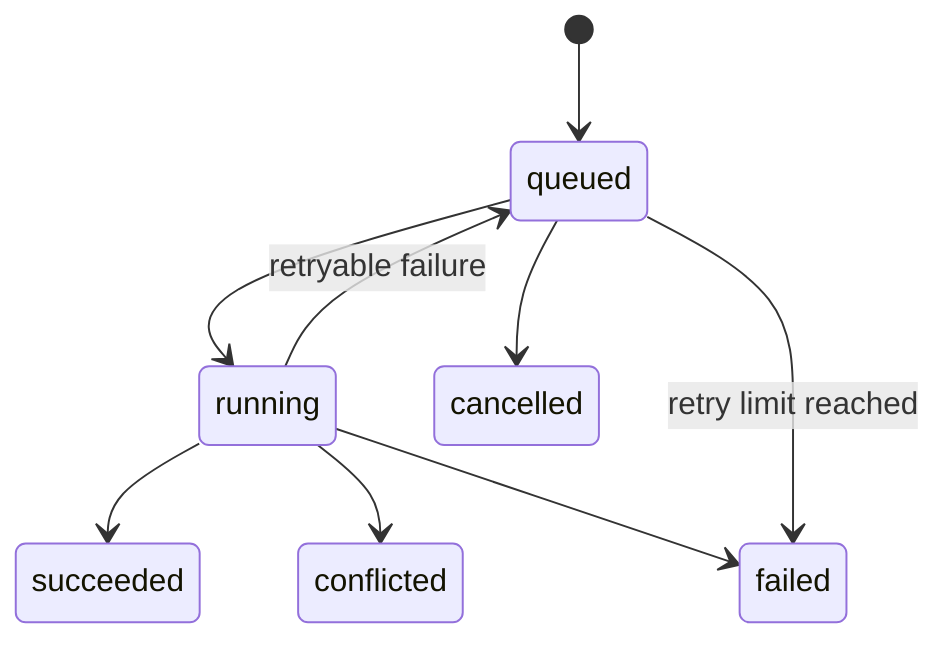

# API Contracts

This document is the human-readable HTTP reference. The route tables in
`services/api/src/routes/index.ts` and `services/github-app/src/app.ts`, plus
the schemas exported by `@scs/schemas`, remain the executable source of truth.

## Service Boundaries

| Service               | Audience                            | Authentication                                |
| --------------------- | ----------------------------------- | --------------------------------------------- |
| `services/api`        | Portal and approved browser clients | Better Auth session plus authorization checks |
| `services/github-app` | API Worker only                     | `X-Internal-Secret`                           |
| `services/mailer`     | trusted services only               | bearer `MAILER_API_KEY`                       |

The browser-facing API uses the `/api` namespace. The GitHub App and Mailer
routes are internal and must not be called directly from browser code.

Browser-facing editor responses, proxy updates, mailer requests and responses,
and API-to-GitHub-App mutation requests are defined by `@scs/schemas`. Producers
and consumers import those contracts directly so independently deployable
workspaces cannot drift behind parallel interfaces or validators.

Identity endpoints under `/api/admin/identity` use shared account, decision,
history, and suggestion schemas. Only super-admins may classify an existing
verified account. A decision includes the expected current role and returns
`409` when that role changed or the immutable student role is challenged.
If an identity or Honours history table from the required API migration is
absent, the API returns `503` with `code: DATABASE_MIGRATION_REQUIRED`. The
operator must verify the target database and apply the pending D1 or PostgreSQL
migration through the documented workflow; the client must not treat this as an
empty result.
Honours preview and apply use shared schemas under
`/api/admin/academic-rules/honours`. Preview reads published profiles and
verified student accounts without mutating them. Apply requires the matching
preview, a reason, explicit confirmation, and an idempotency key; it returns a
stable operation ID and an API history state. Department-scoped academic users may
submit only where both the chosen programme and published student evidence
support their assigned department.
The API persists the intent before GitHub App acceptance. A `202` response can
mean `pending_acceptance`; the API's scheduled recovery uses the stored request
and key, even if the browser disconnects. Once accepted, clients may poll
`/api/operations/{operationId}` for GitHub App status. The history endpoint
returns at most 20 submissions per page with a
cursor. Super-admins can inspect all entries; admins and scoped academic users
see their own submissions. Each row includes the submitted changes, operation
ID, and one of `pending_acceptance`, `accepted`, `processing`,
`awaiting_publication`, `published`, or `failed`. A failed intent requires a new
preview and idempotency key. Repeating the same active request with a new key
returns the existing operation ID, preventing a duplicate publication.

## Common Browser API Rules

- Send session cookies with protected requests.
- Send `X-Client-Id: portal` where client validation is required.
- Send JSON bodies with `Content-Type: application/json`.
- Treat cursor and operation identifiers as opaque strings.
- Do not parse human-readable error messages for program logic.
- Validate responses with the matching schema when crossing a trust boundary.

Common status meanings:

| Status | Meaning                                                 |
| ------ | ------------------------------------------------------- |
| `200`  | request completed synchronously                         |
| `202`  | durable mutation accepted; poll the operation URL       |
| `400`  | malformed input, invalid cursor, or unsupported payload |
| `401`  | missing or invalid authentication                       |
| `403`  | authenticated but not authorized                        |
| `404`  | route or resource does not exist                        |
| `405`  | route exists but does not support the method            |
| `409`  | revision, idempotency, or state conflict                |
| `429`  | request was rate-limited                                |
| `502`  | an upstream service failed or returned invalid data     |

## Versioned Errors

New contracts use `ApiErrorEnvelopeSchema` from `@scs/schemas`:

```json
{
  "version": 1,
  "error": {
    "code": "entity_revision_conflict",
    "message": "The project changed after it was loaded.",
    "correlationId": "req_01JAA2V8M7X4G9NK2QF6D3P1ZT",
    "conflict": {
      "resourceType": "project",
      "resourceId": "example-project",
      "expectedRevision": "blob-41",
      "actualRevision": "blob-42"
    }
  }
}
```

`code` is stable and machine-readable. `message` is bounded prose for people.
`correlationId` connects the response to structured logs. Conflict details may
contain resource identity and revisions, but never credentials or provider
payloads.

## Pagination

Page routes accept `limit` and optional `cursor` query parameters. The default
limit is 25 and the maximum is 100. A cursor is scoped to one route and cannot
be reused with another collection.

```json
{
  "version": 1,
  "items": [],
  "page": {
    "nextCursor": null,
    "hasMore": false,
    "total": 0
  }
}
```

Clients must follow `nextCursor` rather than constructing cursors or assuming
offset pagination. `total` is optional and must not be required by a generic
pagination component.

## Durable Mutations

Portal sends `Prefer: respond-async` for profile, project, course, and offering
changes. The request body includes `MutationControl`:

```json
{
  "idempotencyKey": "01JAA2V8M7X4G9NK2QF6D3P1ZT",
  "expectedRevision": "blob-42"
}
```

Use `missing` as the expected revision for a new entity. The same logical user
action must reuse its idempotency key when retried. Reusing a key for different
input returns a conflict.

A successful submission returns `MutationAcceptedSchema` with `202 Accepted`:

```json
{
  "version": 1,
  "operationId": "op_01JAA2V8M7X4G9NK2QF6D3P1ZT",
  "status": "queued",
  "statusUrl": "/api/operations/op_01JAA2V8M7X4G9NK2QF6D3P1ZT",
  "retryAfterMs": 1000
}
```



Read or request cancellation of the caller's operation with:

| Method   | Route                          |
| -------- | ------------------------------ |
| `GET`    | `/api/operations/:operationId` |
| `DELETE` | `/api/operations/:operationId` |

The API owns actor authorization. Emails, provider tokens, and private request
bodies are not exposed in operation resources.

## Authentication and Current Account

Better Auth is mounted at `/api/auth/*` and owns email OTP, Google, GitHub,
passkey, account-linking, session, and sign-out endpoints. Email/password auth
and parallel custom JWT/WebAuthn routes are not enabled.

| Method  | Route                   | Purpose                                            |
| ------- | ----------------------- | -------------------------------------------------- |
| `GET`   | `/api/me`               | read the current account and permission projection |
| `PATCH` | `/api/me`               | update allowed current-account fields              |
| `PATCH` | `/api/me/notifications` | update notification preferences                    |

Session validation alone is not authorization. Protected requests also check
the current permission record so blacklisting and role changes take effect.

## Public Profile Management

| Method                 | Route                                       | Purpose                                 |
| ---------------------- | ------------------------------------------- | --------------------------------------- |
| `GET`                  | `/api/people/v2/me`                         | read the current user's public profile  |
| `GET`                  | `/api/people/v2/me/schema`                  | read editable profile schema metadata   |
| `GET`                  | `/api/people/v2/me/pr`                      | read current profile pull-request state |
| `POST`, `PUT`          | `/api/people/v2/me/pr`                      | create or update a profile mutation     |
| `POST`                 | `/api/people/v2/me/student-placement`       | submit placement metadata               |
| `GET`                  | `/api/people/v2/admin/student-placement`    | read placement source data              |
| `GET`, `PUT`, `DELETE` | `/api/people/v2/admin/student-placement/pr` | manage the placement pull request       |
| varies                 | `/api/people/v2/admin/users/:identity/...`  | manage another user's public profile    |

Public avatar calls are separate from GitHub-backed profile mutations:

| Method           | Route                                           | Purpose                                                             |
| ---------------- | ----------------------------------------------- | ------------------------------------------------------------------- |
| `GET`            | `/api/people/v2/avatars/me`                     | owner identity, published URL, pending candidate, and upload quota  |
| `POST`, `DELETE` | `/api/people/v2/avatars/me`                     | upload (consumes an attempt) or remove the image                    |
| `GET`            | `/api/people/v2/avatars/me/pending`             | read the signed-in owner's private pending image                    |
| `DELETE`         | `/api/people/v2/avatars/me/pending`             | withdraw the pending candidate without removing the published image |
| `GET`, `HEAD`    | `/api/people/v2/avatars/:username`              | resolve the current approved image                                  |
| `GET`, `HEAD`    | `/api/people/v2/avatars/:username/:sha256.webp` | read only the currently approved version                            |

The authenticated `GET` is read-only and does not consume an upload attempt.
`POST` consumes one attempt before validation and moderation, and returns the
refreshed quota with success or failure responses. Rate-limited responses use
HTTP 429 with `Retry-After` and the current quota. Moderation failures include a
structured `moderation` object plus a distinct error code so Portal can separate
policy rejections from unavailable analysis. The owner pending-image route
requires the same session as the canonical owner route and returns `no-store`;
withdrawal keeps the current published pointer intact.

See [public avatars](PUBLIC_AVATARS.md) for validation, moderation, quota, and
cache behavior.

Admin profile suffixes include `/schema`, `/pr`, and `/student-placement`.
Unknown suffixes are rejected rather than interpreted as repository paths.

For undergraduate honours profiles, `honoursProgramme` is required and is the
only source used to derive the owning department and special-directory path.
Profile mutation requests do not accept an independently selected directory
stream.

## Projects and Academics

| Methods                        | Route                                            | Purpose                               |
| ------------------------------ | ------------------------------------------------ | ------------------------------------- |
| `GET`                          | `/api/projects/v2/projects/page`                 | list a bounded project page           |
| `GET`                          | `/api/projects/v2/schemas/index.json`            | public schema for `.docs/index.json`  |
| `GET`                          | `/api/projects/v2/projects/:slug`                | read one project                      |
| `GET`                          | `/api/projects/v2/projects/:slug/schema`         | read project schema metadata          |
| `POST`                         | `/api/projects/v2/projects/:slug/source-preview` | compare a draft with its GitHub index |
| `GET`, `POST`, `PUT`, `DELETE` | `/api/projects/v2/projects/:slug/pr`             | manage a project mutation             |
| `GET`                          | `/api/academic/v2/courses`                       | read the course reference array       |
| `GET`                          | `/api/academic/v2/courses/page`                  | list a bounded course page            |
| `GET`                          | `/api/academic/v2/courses/:id`                   | read one course                       |
| `GET`                          | `/api/academic/v2/courses/:id/schema`            | read course schema metadata           |
| `GET`, `PUT`, `DELETE`         | `/api/academic/v2/courses/:id/pr`                | manage a course mutation              |
| `GET`                          | `/api/academic/v2/offerings`                     | read the offering reference array     |
| `GET`                          | `/api/academic/v2/offerings/page`                | list a bounded offering page          |
| `GET`                          | `/api/academic/v2/offerings/:id`                 | read one offering                     |
| `GET`                          | `/api/academic/v2/offerings/:id/schema`          | read offering schema metadata         |
| `GET`, `PUT`, `DELETE`         | `/api/academic/v2/offerings/:id/pr`              | manage an offering mutation           |

The unbounded project collection route is intentionally unavailable. Course
and offering arrays remain because Portal editors currently use them as
reference data; new collection UIs should use page routes.

## Administration and Personal-Site Redirect Settings

| Method                   | Route                                 | Purpose                                       |
| ------------------------ | ------------------------------------- | --------------------------------------------- |
| `GET`                    | `/api/admin/users/page`               | list a bounded page of users                  |
| `GET`, `PATCH`, `DELETE` | `/api/admin/users/:email`             | manage one permission record                  |
| `GET`, `DELETE`          | `/api/admin/users/:email/avatar`      | inspect or remove a public picture            |
| `POST`                   | `/api/admin/avatar-rate/reset`        | reset one member's hourly avatar upload count |
| `GET`                    | `/api/admin/avatar-reviews/page`      | list pending public-picture reviews           |
| `GET`                    | `/api/admin/avatar-reviews/:id/image` | preview a pending picture                     |
| `POST`                   | `/api/admin/avatar-reviews/:id`       | approve or reject a pending picture           |
| `GET`                    | `/api/admin/proxies/page`             | list personal-site redirect settings from D1  |
| `POST`                   | `/api/admin/proxies/reset-attempts`   | reset one user's edit attempts                |
| `GET`, `POST`            | `/api/me/proxy`                       | read or edit the current user's redirect      |
| `GET`                    | `/api/internal/proxies/:username`     | resolve one active mapping for Web            |

These routes require a non-blacklisted super-admin except `/api/me/proxy`.
Users cannot reset their own attempt counter. Redirect edits use one atomic D1
statement to enforce the attempt limit. Avatar review decisions require the
review to still be pending; approval records the acting administrator in both
the review row and the append-only avatar audit history.

The internal resolver requires `X-Internal-Secret`, returns only a validated
HTTPS destination URL, and makes missing and inactive usernames indistinguishable.
It is a server-to-server route and is not a browser API.

## Internal GitHub App API

Every route requires `X-Internal-Secret`. Operation reads also require
`X-Actor-Subject-Id`; trusted admin reads set `X-Actor-Admin: true`.

| Route group                    | Responsibility                                         |
| ------------------------------ | ------------------------------------------------------ |
| `/operations/:operationId`     | read or request cancellation of durable work           |
| `/people/public-profile*`      | read profile state and manage profile PRs/operations   |
| `/people/student-placement/pr` | manage placement metadata PRs                          |
| `/projects/public-project*`    | read project state and manage project PRs/operations   |
| `/academic/public-course*`     | read academic state and manage academic PRs/operations |

The `POST .../operations` routes are the durable mutation entry points. The
documented PR routes are also active trusted-service contracts. Do not remove
either contract without tracing production callers and coordinating the API,
Worker, Portal, and deployment rollout.

## Mailer API

`POST /send` requires `Authorization: Bearer <MAILER_API_KEY>`. Existing
callers can provide a raw message:

```json
{
  "to": ["user@pdn.ac.lk"],
  "subject": "Sign in to SCS Portal",
  "html": "<p>Optional HTML body</p>",
  "text": "Optional plain-text body"
}
```

For supported transactional messages, callers should provide a named template
instead of presentation markup. The Portal sign-in request is:

```json
{
  "to": "user@pdn.ac.lk",
  "template": {
    "name": "portal-sign-in-otp",
    "origin": "https://portal.scs-pdn.space",
    "props": {
      "otp": "123456",
      "expiresInMinutes": 5
    }
  }
}
```

The mailer owns the template subject and renders both HTML and plain text with
React Email before SMTP delivery. `to` contains 1–50 valid addresses. Raw
requests require a non-empty `subject` and at least one of `html` or `text`;
the OTP template requires a six-digit code, an expiry from 1–60 minutes, and
the canonical Portal origin bound to the code. The API selects that origin from
its configured trusted origins before calling the Mailer.
Success returns `{ "ok": true }`; validation, authentication, and upstream
SMTP failures return `400`, `401`, and `502`.

## Changing a Contract

1. Find every producer and consumer, including tests and separate repositories.
2. Change or add the `@scs/schemas` contract first when it is shared.
3. Prefer additive versioned changes over silently changing existing meaning.
4. Add boundary tests for success, invalid input, authorization, conflict, and
   retry behavior.
5. Update Portal/API/GitHub App clients together when the contract spans them.
6. Update this document, [Schemas](SCHEMAS.md), and
   [Operations](OPERATIONS.md) when applicable.
