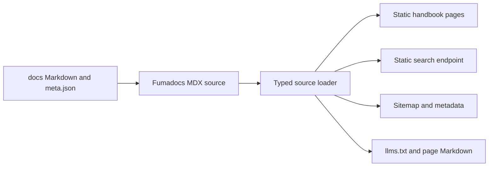

# Docs application internals

`apps/docs` publishes the repository handbook. The authored source remains the
Markdown under the root `docs` directory; the application does not maintain a
second content copy or a database-backed content model.

The application owns the presentation and publication pipeline. The repository
documentation rules remain in
[Documentation authoring](../../DOCUMENTATION_AUTHORING.md), and the content's
technical truth remains owned by the workspace being documented.

Read [Content pipeline](CONTENT_PIPELINE.md) before adding a content feature or
changing routes. Read [Discovery and rendering](DISCOVERY_AND_RENDERING.md)
before changing search, metadata, agent-readable feeds, Markdown components, or
Mermaid behavior.
