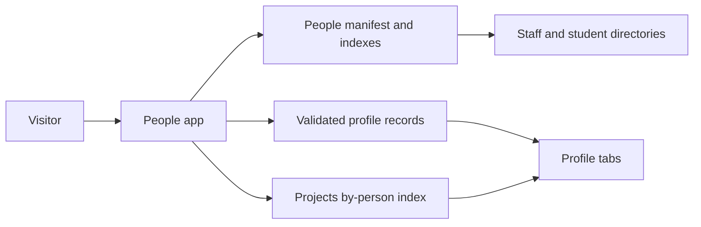

# People application internals

`apps/people` is a read-only public directory. It loads published JSON from the
configured People and Projects data origins, validates records, and converts
domain codes into explicit human-facing labels. Editing remains in Portal.

Directory pages and profile details use client loaders behind route-specific
skeletons. Empty published collections, a missing profile, and a failed data
request are separate states. See
[Published data and directories](PUBLISHED_DATA_AND_DIRECTORIES.md) and
[Profile interpretation](PROFILE_INTERPRETATION.md).
