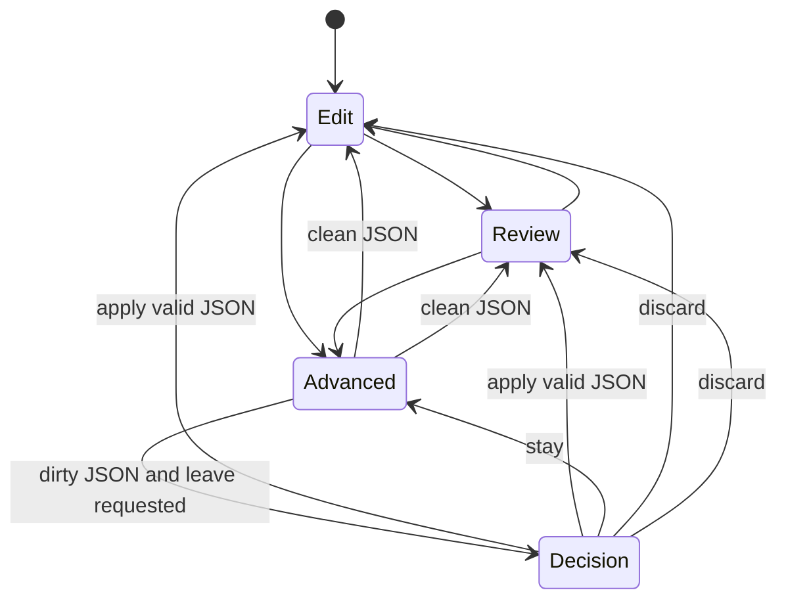

# Portal editor state and mutations

Profile, project, and course editors share one interaction model so users do
not have to learn a different save flow for each record type. Domain editors
provide their sections, review rendering, validation, and submit action to the
shared editor workspace.

## One draft, three surfaces

| Surface        | Audience and purpose                                        |
| -------------- | ----------------------------------------------------------- |
| Edit details   | default guided form grouped into domain sections            |
| Review changes | compare the working draft with the published record         |
| Advanced JSON  | inspect or edit the same draft as validated structured data |

The editor state keeps the working `draft` and immutable `published` value
separate. It also tracks the active surface, JSON text, dirty state, parse
errors, schema issues, and a requested next surface. Changing `?view=` in the
browser URL records the active presentation without creating a second source
of editor truth.

Entering Advanced JSON serializes the current draft. Editing JSON does not
change the draft until the user chooses **Apply JSON** and the domain validator
accepts the parsed value. Invalid syntax produces a JSON error; structurally
invalid data produces field issues. Leaving with unapplied JSON requires an
explicit apply, discard, or stay decision.

The CodeMirror editor and JSON preview are client-only dynamic imports. This
keeps those heavier interactive dependencies out of the initial server render
while retaining a bounded loading skeleton.

## Submission lifecycle

Record submission is usually asynchronous:

1. The domain editor validates and sends the draft to `services/api`.
2. The API returns a `MutationAccepted` contract containing a status URL and
   retry delay.
3. Portal polls that URL with credentials and the configured client ID.
4. Queued and running operations continue with bounded exponential backoff.
5. A succeeded terminal result exposes the mutation outcome; a failed or
   conflicted result becomes a user-facing error.

Polling defaults to 40 attempts. The delay starts from the server-provided
`retryAfterMs`, doubles for the first bounded steps, and never exceeds ten
seconds. Starting another poll or unmounting the owning component aborts the
previous request. Do not replace this flow with an unbounded interval or assume
that HTTP acceptance means the repository mutation has succeeded.

The canonical operation shapes live in `@scs/schemas`. The API contract and
Git-backed execution are explained in
[API contracts](../../API_CONTRACTS.md) and
[Durable operations](../../SERVICES/GITHUB_APP/DURABLE_OPERATIONS.md).
