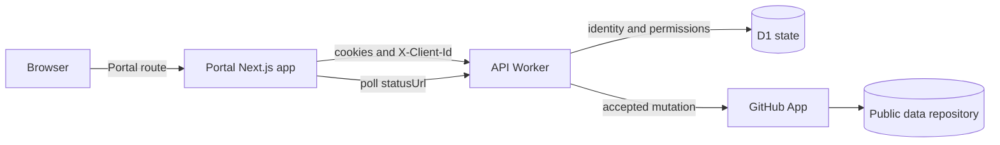

# Portal internals

`apps/portal` is the authenticated management application. It presents
human-friendly workflows for account settings, public profiles, projects,
courses, proxy relationships, and administration. It does not own identity,
permissions, or published records: those decisions belong to
[`services/api`](../../SERVICES/API/INDEX.md) and its downstream services.

## Ownership boundaries

| Concern                  | Portal responsibility                             | Authoritative owner        |
| ------------------------ | ------------------------------------------------- | -------------------------- |
| session-aware navigation | show the appropriate entry or account actions     | API and Better Auth        |
| route prefiltering       | avoid obviously invalid navigation                | Portal proxy               |
| authorization            | render only after API-backed permission checks    | API                        |
| working edits            | maintain and validate a local draft               | Portal editor              |
| published record         | display separately from the draft                 | public data repository     |
| mutation progress        | poll and explain accepted asynchronous operations | GitHub App operation state |

Read [Routing and access](ROUTING_AND_ACCESS.md) before changing protected
routes, [Editor state and mutations](EDITOR_STATE_AND_MUTATIONS.md) before
changing an editor, and [Data loading and failures](DATA_LOADING_AND_FAILURES.md)
before changing server fetches, redirects, or error behavior.

Shared transport and domain types must be imported directly from
`@scs/schemas`. Portal-specific composed components remain in `apps/portal`;
only reusable shadcn primitives belong in `@scs/ui`.
