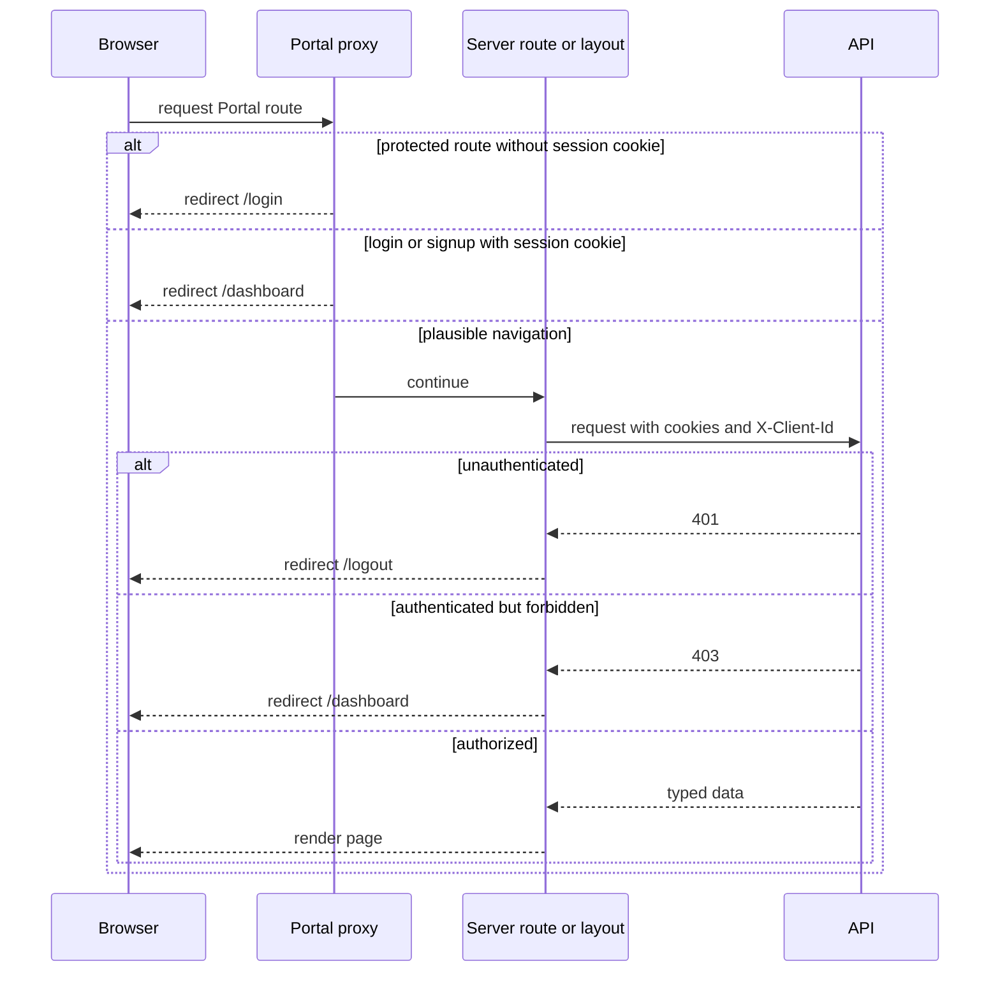

# Portal routing and access

Portal access control is layered. A session cookie can improve navigation, but
only an API-backed identity and permission decision can authorize data or an
administrative surface.

## Route families

| Route family               | Purpose                                             |
| -------------------------- | --------------------------------------------------- |
| `/login`, `/signup`        | email-code, OAuth, and passkey entry flows          |
| `/dashboard`, `/account/*` | signed-in landing page and current account settings |
| `/user/me/*`               | current member profile and publishing workflows     |
| `/user/projects/*`         | member project editing and submission               |
| `/user/proxy`              | delegated profile-management settings               |
| `/academic/courses/*`      | course and offering editing                         |
| `/admin/users/*`           | user inspection and administration                  |
| `/admin/avatar-reviews`    | pending public-picture moderation                   |
| `/admin/projects/*`        | administrative project editing                      |
| `/admin/proxies`           | proxy relationship administration                   |
| `/admin/academic-rules`    | student placement metadata                          |
| `/privacy`, `/tos`         | public policy pages                                 |

## Guard sequence

`src/proxy.ts` only checks for the Better Auth session-token cookie. It does
not validate that cookie, load a user, or inspect a role. Treat it as an
optimistic routing filter, never as an authorization boundary.

The `/admin` layout performs an additional server-side `/api/me` request and
requires the super-admin role before it renders children. Individual API
endpoints still enforce their own permissions. A hidden navigation item or a
successful proxy check must never be treated as permission to read or mutate a
resource.

## Session navigation and logout

The shared Portal header renders signed-out entry actions or signed-in account
actions from the current session state. The responsive menu carries the same
destinations rather than creating a second navigation model.

`GET` and `POST /logout` expire every supported Portal session cookie at the
host and configured cookie domain, then redirect to
`/login?error=invalid_session`. Server fetches use this route when the API
returns `401`, ensuring stale cookies are cleared before another login attempt.

Better Auth client requests target `NEXT_PUBLIC_BASE_API_URL`, use the
`/api/auth` base path, and include credentials. Public runtime configuration is
safe for the browser; provider secrets and cookie-domain configuration remain
server-side as documented in
[Environment variables](../../ENVIRONMENT_VARIABLES.md).
