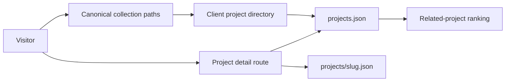

# Projects application internals

`apps/projects` is a public showcase, not an editor. It turns published project
records into stable path-based browse, type, category, topic, search, and detail
routes. Portal owns changes to those records.

The server route validates path shape and builds metadata; interactive
directories and detail views fetch their published data in the browser. Read
[Collection routes and search](COLLECTION_ROUTES_AND_SEARCH.md) before changing
URLs or filters, and [Data and details](DATA_AND_DETAILS.md) before changing
fetching, validation, record presentation, or related projects.
