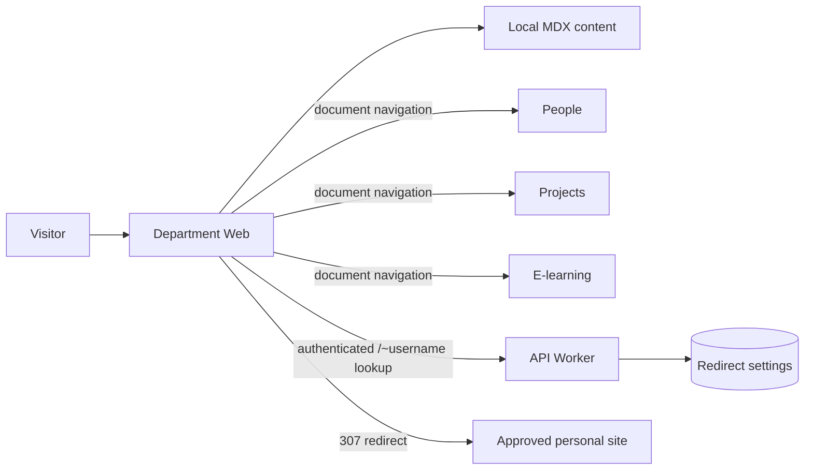

# Department Web internals

`apps/web` is the public departmental website. Its content is editorial and
institutional; public people records, project discovery, authenticated editing,
and repository documentation remain in their owning applications.

The application has no privileged content database. Its browser-visible origins
and server-only routing integration are parsed in separate typed configuration
modules. See [Content and navigation](CONTENT_AND_NAVIGATION.md) for the local
site and [Routing and redirects](ROUTING_AND_PROXYING.md) for cross-origin and
personal-site behavior.
