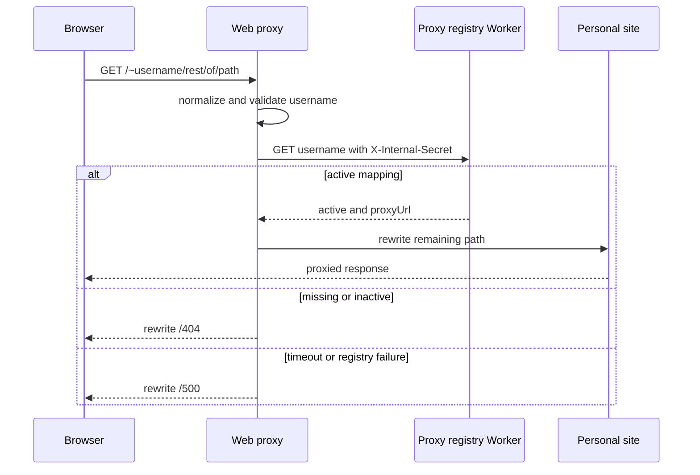

# Web routing and proxying

Web owns two kinds of routing that are not ordinary editorial pages: stable
cross-product entry routes and `~username` personal-site proxying.

## Cross-product entry routes

`/people` and its staff and student subpaths return permanent redirects to the
configured People origin. `/projects` redirects to the Projects origin, and
`/e-learning` redirects to the configured Moodle origin. Their `OPTIONS`
handlers allow `GET` and `OPTIONS` from any origin.

Navigation components link directly to configured product origins, while the
route handlers preserve stable inbound Web URLs. Because these are different
origins, callers must use document navigation rather than expect a cross-origin
RSC fetch to succeed.

Requests ending in `.php` are normalized by removing that suffix before normal
route handling. This is a URL normalization rule only; the application does not
execute PHP or keep a second PHP content implementation.

## Personal-site proxy sequence

Usernames accept lowercase letters, digits, underscores, and hyphens after the
path is normalized. The registry lookup has a three-second abort timeout and
uses the server-only `CF_SECRET`. Browser code must never receive that secret
or call the registry directly.

The registry response controls only whether an active proxy target exists and
where the Web proxy rewrites the request. The remaining path after the username
is resolved against the returned base URL. Changes to this boundary require
tests for invalid usernames, inactive mappings, registry failures, timeouts,
and nested paths, plus a security review of the target validation performed by
the registry service.
