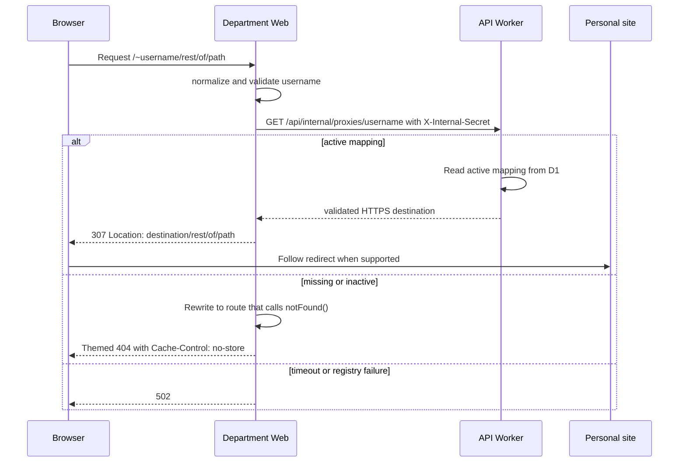

# Web routing and redirects

Web owns two kinds of routing that are not ordinary editorial pages: stable
cross-product entry routes and `~username` personal-site redirects.

## Cross-product entry routes

`/people` and its staff and student subpaths return permanent redirects to the
configured People origin. `/projects` redirects to the Projects origin, and
`/moodle` redirects to the Moodle origin. Their
`OPTIONS` handlers allow `GET` and `OPTIONS` from any origin.

Navigation components link directly to configured product origins. The route
handlers provide entry URLs for People, Projects, and Moodle. Because these are
different origins, callers must use document navigation rather than expect a cross-origin
RSC fetch to succeed.

Requests ending in `.php` are normalized by removing that suffix before normal
route handling. This is a URL normalization rule only; the application does not
execute PHP or keep a second PHP content implementation.

## Personal-site redirect sequence

Usernames accept lowercase letters, digits, underscores, and hyphens after the
path is normalized. The API lookup has a three-second abort timeout and uses
the server-only `WEB_PROXY_INTERNAL_SECRET`. Browser code must never receive
that secret or call the internal resolver directly. Web and API must receive
the same secret from their deployment providers.

The API response contains only the validated HTTPS URL for an active mapping.
Missing and inactive mappings are indistinguishable. For `GET`, Web rewrites
them to an internal page that calls Next.js `notFound()`, so visitors receive
the themed HTML fallback instead of an empty `404`. `HEAD` and mutation methods
retain a plain empty `404` response. Both forms remain non-cacheable.
The remaining encoded path after the username is appended to the returned base
path without lowercasing it, and the original query string is preserved. Every
successful response is a `307 Temporary Redirect` with `Cache-Control:
no-store`; GET, HEAD, POST, PUT, PATCH, DELETE, and OPTIONS therefore retain
their method and body at the HTTP redirect level.

Web does not fetch the destination, forward bodies or headers, rewrite HTML,
proxy assets, or support WebSocket tunneling. A client can refuse to follow a
307, and the destination remains subject to its own CORS, authentication, and
credential rules. This redirect is therefore not a transparent reverse proxy.
Changes to this boundary require tests for supported methods, invalid
usernames, inactive mappings, API failures, destination changes, encoded
nested paths, and unsafe target URLs.
