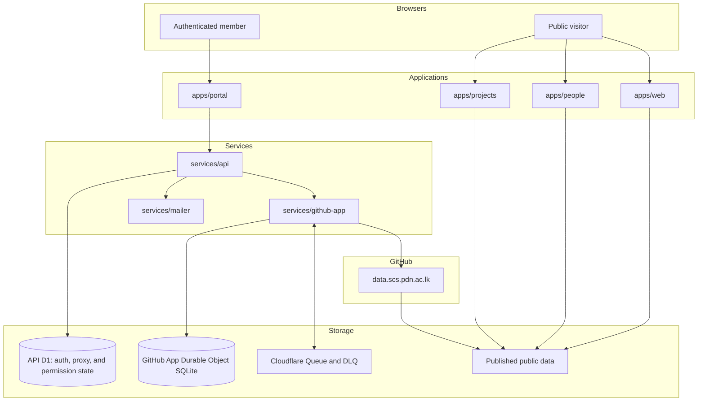
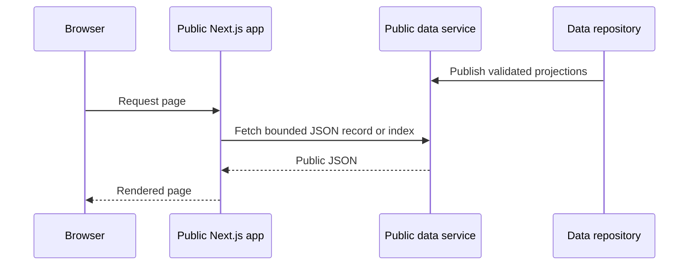
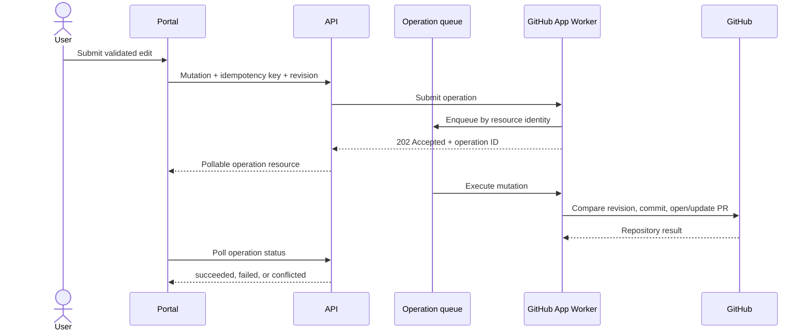
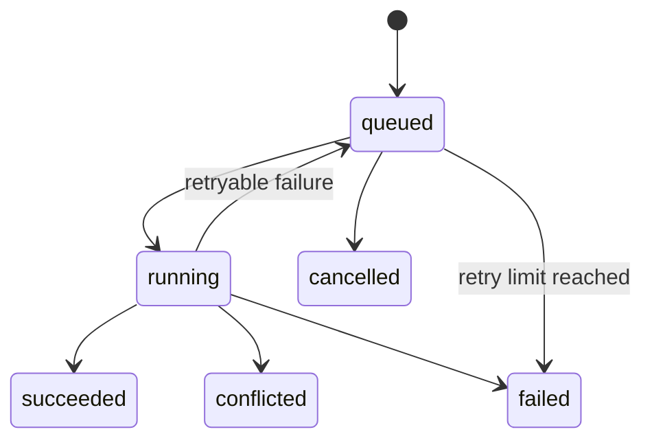
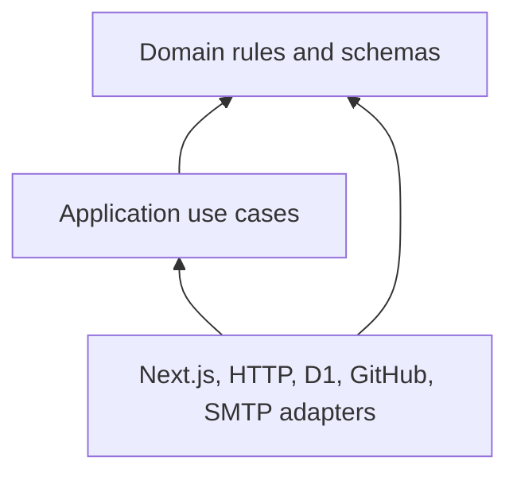

# Architecture

This guide explains the system boundaries and the reasons behind them. New
contributors should read the system map and ownership tables first. Maintainers
changing an API, data model, or deployment boundary should also read the flow
and dependency sections.

## System Context

The repository contains four Next.js applications, two Cloudflare Workers, one
Bun mail service, and four shared packages. Public records are published from a
separate Git repository.

The key trust boundary is deliberate: browser applications never receive
GitHub App credentials. Portal calls the API Worker, and the API calls the
private GitHub App Worker through a service binding or authenticated HTTP
fallback.

## Workspace Responsibilities

| Workspace                | Owns                                                                                 | Must not own                                  |
| ------------------------ | ------------------------------------------------------------------------------------ | --------------------------------------------- |
| `apps/web`               | department content, public navigation, external learning links                       | authenticated administration                  |
| `apps/people`            | staff, student, alumni, and individual public profiles                               | profile mutation credentials                  |
| `apps/projects`          | project discovery, filtering, and public project details                             | project write workflows                       |
| `apps/portal`            | sign-in UI and authorized management experiences                                     | provider secrets or direct repository writes  |
| `services/api`           | Better Auth, sessions, authorization, D1 state, public API contracts                 | GitHub installation credentials               |
| `services/github-app`    | installation authentication, durable mutations, branches, commits, and pull requests | browser sessions or UI authorization state    |
| `services/mailer`        | authenticated mail requests and SMTP delivery                                        | application permissions                       |
| `packages/schemas`       | shared Zod schemas and transport types                                               | provider-specific runtime configuration       |
| `packages/ui`            | reusable shadcn primitives and shared UI hooks                                       | product workflows or page compositions        |
| `packages/tsconfig`      | compiler presets                                                                     | workspace file lists and runtime entry points |
| `packages/eslint-config` | shared lint policy                                                                   | product-specific exceptions without evidence  |

## Read and Write Paths

Public applications read published projections. They do not call GitHub for
page rendering.

Authenticated writes are durable operations. A logical mutation is identified
by an idempotency key and guarded by the last known entity revision.

## State Ownership

| State                                                                 | Authoritative owner        | Notes                                           |
| --------------------------------------------------------------------- | -------------------------- | ----------------------------------------------- |
| users, accounts, sessions, verification, passkeys                     | API D1 database            | managed through Better Auth and API migrations  |
| proxy settings and edit-attempt state                                 | API D1 database            | updates consume attempts atomically             |
| application roles, access levels, blacklist, notification preferences | API D1 database            | checked on protected requests                   |
| person, project, course, and offering entity records                  | data repository            | individual entity files are authoritative       |
| aggregate arrays, manifests, search indexes, `by-person` files        | generated projections      | reproducible from authoritative records         |
| durable mutation status                                               | GitHub App Durable Objects | keyed by operation and resource identity        |
| same-resource mutation leases                                         | GitHub App Durable Objects | keyed by resource identity for serialization    |
| queued delivery and retry state                                       | Cloudflare Queues          | exhausted retries move to the dead-letter queue |

Never introduce a second writable owner for the same state. Caches and
projections must be disposable and reproducible.

### Cloudflare Storage Boundaries

The API D1 database and GitHub App Durable Object storage are independent
resources:

- `AUTH_DB` D1 stores Better Auth tables, rate limits, proxy settings, and one
  permission record per user. Permission records include role, access level,
  blacklist state, repository include/exclude rules, notification preferences,
  and display metadata.
- `OPERATION_STATE` creates one Durable Object per operation ID. Its private
  SQLite database stores that operation record.
- `MUTATION_COORDINATOR` creates one Durable Object per resource key. Its
  private SQLite database stores the current mutation lease.

Durable Object SQLite is not a table or schema inside `AUTH_DB`. A D1 migration
does not migrate or modify Durable Object storage, and rolling back Worker code
does not roll back either resource's persisted data.

## Durable Operation Lifecycle

Operations for the same logical resource are serialized. Unrelated resources
may proceed concurrently. Reusing an idempotency key with different input is a
contract error, not a second mutation.

## Dependency Direction

Domain modules do not import Next.js, Hono, Cloudflare bindings, Octokit, or UI
frameworks. Adapters translate external input into validated domain values.
Create a shared abstraction only when it has a stable owner and more than a
visual resemblance to another file.

## Application UI Ownership

The four Next.js applications share a visual system, not one universal shell.
Web keeps an institutional navigation model, People and Projects keep
discovery-oriented navigation, and Portal keeps an authenticated workspace
shell. Each deployable owns the composition, labels, destinations, and
permission-aware behavior appropriate to its users.

Reusable shadcn primitives, theme initialization, semantic theme tokens,
feedback surfaces, and primitive-level hooks belong in `packages/ui`. Product
components that combine primitives with application routes, data, copy, or
permissions remain in their owning application. Do not move a composed header,
editor, dashboard, or domain workflow into `packages/ui` merely because another
application has a visually similar surface.

Within a Next.js application, use these ownership rules:

- `app` owns routes, layouts, metadata, server orchestration, and Next.js
  special files such as `error.tsx`, `global-error.tsx`, `not-found.tsx`, and
  `global-not-found.tsx`;
- a route's private composition belongs in its colocated `_components` folder;
- UI reused by multiple routes belongs in `components/<responsibility>`, such
  as `components/layout`, `components/editor`, or a named domain folder;
- `lib` owns non-visual helpers, data access, and client or server adapters;
- use `@/` and package exports for cross-directory imports rather than creating
  path-dependent component trees.

This is an incremental convention. Move a legacy `components/custom` or
route-shaped `views` module when the owning feature is being changed and all of
its consumers can be updated atomically. Do not perform unrelated bulk moves,
and delete an old path only after repository search confirms that it has no
remaining callers.

### Portal Editor State

Project, course, offering, and public-profile editors use one canonical draft
across Edit, Review, and Advanced JSON surfaces. Published data is a read-only
comparison source, never an editable mode. Changing surfaces must not replace
the draft, selected record, revision, or permission context.

Advanced JSON is secondary to the guided form. If its text differs from the
canonical draft, leaving it requires an explicit Apply, Discard, or Stay
decision. Apply parses and validates the domain record before updating the
canonical draft. Final submission continues to use the existing authorized,
revision-protected, idempotent operation flow; the UI state machine does not
change API payloads or grant permissions.

## Configuration and Contracts

- Runtime variables are parsed in each workspace's `src/config` modules.
- Cross-workspace domain and transport contracts come from `@scs/schemas`.
- TypeScript and ESLint policy comes from the shared config packages.
- Browser-safe configuration is explicitly prefixed `NEXT_PUBLIC_`.
- Cloudflare bindings remain request-scoped; they are not copied into
  `process.env`.

See [Environment Variables](ENVIRONMENT_VARIABLES.md),
[API Contracts](API_CONTRACTS.md), and [Schemas](SCHEMAS.md) for implementation
details.

## Deployment Boundaries

Every app and service builds and deploys independently. Root Turbo commands are
verification orchestration, not a combined release. A shared-package change may
require several deployables to rebuild; a service-only change should not force
an unrelated app deployment.

The public data repository has separate validation, publication, and deployment
workflows. Changes to that repository require their own review and must not be
hidden inside a monorepo deployment.

## Changing the Architecture

Before changing a boundary:

1. identify the current owner of the data or behavior;
2. trace every producer and consumer;
3. update the shared schema or API contract first when the shape changes;
4. preserve idempotency, authorization, and deployment independence;
5. add tests at the boundary, not only inside an implementation module;
6. update this guide and the relevant operations/security documentation;
7. run the complete root gate.
