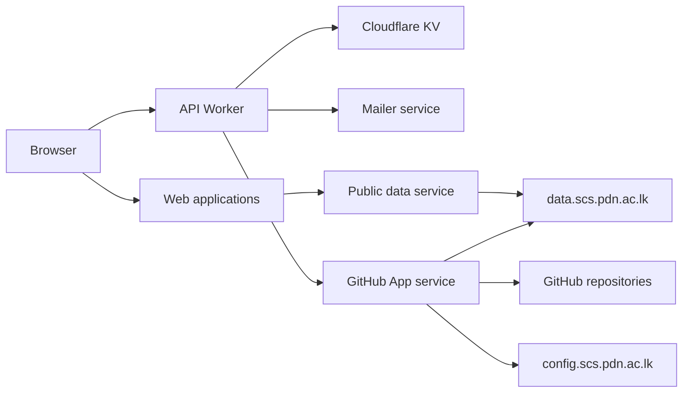

# Architecture

## System Boundaries

The monorepo contains four Next.js applications, two Cloudflare-compatible
edge services, one Bun mail service, and shared TypeScript packages. Each app
or service remains independently deployable.



`data.scs.pdn.ac.lk` publishes people, project, course, and offering records.
`config.scs.pdn.ac.lk` publishes access and proxy configuration. They remain
external repositories rather than monorepo workspaces.

## Applications

### Web

`apps/web` is the main department site. It consumes public data and uses shared
UI primitives but has no authenticated administration role.

### People

`apps/people` renders public profiles. Canonical routes include:

- `/people/[identity]`
- `/staff`, `/staff/academic`, `/staff/academic-support`, `/staff/non-academic`
- `/students/[subject]`
- `/students/[subject]/[batch]`

Student subjects are `computer-science`, `data-science`, and `statistics`.
Alumni use the same subject/batch route; the data manifest determines whether a
batch is current or alumni.

### Projects

`apps/projects` renders the public project registry and individual project
details from the public data service.

### Portal

`apps/portal` provides authentication, profiles, projects, academic records,
proxy configuration, and administrative workflows. It calls `services/api`;
it must not hold GitHub credentials or call private GitHub automation routes
directly.

## Services

### API

`services/api` is a Cloudflare Worker. It owns Better Auth, sessions,
permissions, passkeys, user/admin APIs, validation, and the public gateway used
by Portal. D1 stores authentication state; KV stores application permissions
and profile preferences.

### GitHub App

`services/github-app` applies validated changes to Git-backed data and config
repositories. Its routes are internal and require the shared internal secret.
It runs as a Worker in production and retains a Bun adapter for local use.

### Mailer

`services/mailer` is a Bun/Hono service. It validates authenticated `POST
/send` requests and delegates delivery to its SMTP adapter.

## Shared Packages

`packages/schemas` is the source of truth for cross-workspace runtime schemas
and inferred TypeScript types. `packages/ui` owns reusable shadcn primitives,
while composed product components remain within applications.

Every TypeScript workspace extends the applicable preset from
`packages/tsconfig`. ESLint presets live in `packages/eslint-config`.

## Dependency Direction

Adapters depend on application use cases; application use cases depend on
domain contracts. Domain modules do not import UI frameworks, HTTP routers,
Cloudflare bindings, or Octokit.

```text
Next.js / Hono / Worker / GitHub / KV adapters
                     |
             application use cases
                     |
          domain rules and schemas
```

New sharing follows evidence. Do not create a shared package merely because
two files look similar; extract only stable behavior with a real shared owner.

## Data Ownership

Individual entity files are authoritative. Aggregate arrays, manifests, search
indexes, `by-person` lists, and paginated snapshots are derived projections and
must be reproducible. The long-term concurrency and projection design is in
[Repository Optimization Design](REPOSITORY_OPTIMIZATION_DESIGN.md).

## Deployment Independence

Apps and services build separately. Root Turbo commands coordinate quality
checks but do not create a combined runtime. A change to a shared package may
affect multiple workspaces; a service-specific change must not require
deploying unrelated apps.
