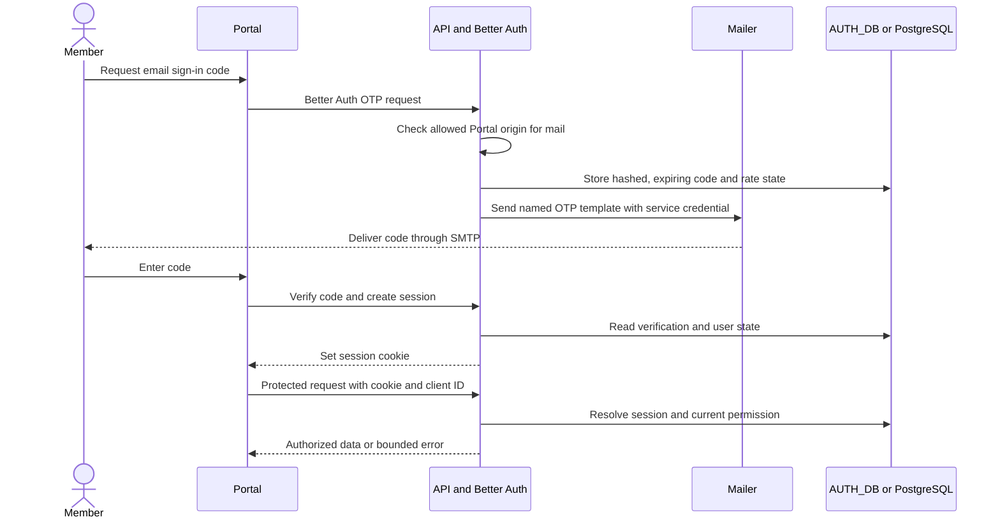

# Authentication and authorization

`services/api` owns user authentication and authorization. `apps/portal` is the
browser client. Public applications do not require a session to read published
data.

## User authentication

Better Auth runs in `services/api`. The Cloudflare Worker persists its state in
the `AUTH_DB` D1 binding; the departmental Bun entry point uses PostgreSQL.
Google and GitHub OAuth are configured server-side in either runtime. The Portal
calls the API origin configured by `NEXT_PUBLIC_BASE_API_URL`; it does not handle
provider client secrets. See [database portability](DATABASE_PORTABILITY.md)
before moving state between runtimes.

The Mailer confirms SMTP acceptance, not inbox delivery. Better Auth limits
OTP attempts and expiry; the API reads current permission and blacklist state
for protected requests. Google, GitHub, and passkey sign-in use the same
session and permission boundary but have their own provider or relying-party
checks. See [Mailer delivery](SERVICES/MAILER/DELIVERY_PIPELINE.md) and
[API identity and state](SERVICES/API/IDENTITY_AND_STATE.md).

Sessions identify a user, but identity alone is not authorization. API route
handlers enforce the permission required for profile, project, academic, proxy,
or administrative actions. Admin interfaces must remain protected at the API
boundary even when the Portal also hides unavailable actions.

Student-pattern addresses such as `s21513@sci.pdn.ac.lk` and
`s21sp513@sci.pdn.ac.lk` receive the immutable `STUDENT` academic role.
Other registered accounts start as `OTHER` and can still use private Portal
profiles and account settings. Only verified accounts can be classified by an
administrator on the Portal's Account Classifications page.
Academic roles and administrative access levels remain separate. Review notes,
sources, and role changes are recorded in `identity_review` and
`identity_audit` by the D1/PostgreSQL identity migrations. Jev analysis is an
optional administrator action using supplied evidence; it never assigns a role.

The Needs Review view starts with verified `OTHER` accounts that have no
recorded decision. In account listings, `PENDING` means an `OTHER` role still
needs review; accounts with an existing non-`OTHER` role and no review record
show `NOT_REQUIRED`. This is a derived display state, not a value saved to the
review table. The account list uses bounded cursor pages and includes only
registered Portal accounts. It does not represent the full public student
directory or an admission queue.

### ORCID linking

ORCID is an optional verified researcher identifier for an existing signed-in
university account. It is not a Portal sign-in provider. The owner starts the
flow from Portal account settings; the API records a one-time intent bound to
the current session and completes the ORCID `/authenticate` code exchange on
its callback. A replacement takes effect only after a successful callback.
Disconnect removes the account association. The API stores the identifier,
not ORCID access or refresh tokens. See
[API identity and state](SERVICES/API/IDENTITY_AND_STATE.md#orcid-association)
for the flow and [Operations](OPERATIONS.md#orcid-research-identity-and-output-migration)
for migration and deployment requirements.

## Service authentication

The API authenticates requests to the mailer with `MAILER_API_KEY` and requests
to the GitHub App with `GITHUB_APP_INTERNAL_SECRET`. The GitHub App receives
trusted actor headers only from that authenticated service boundary. Never call
private automation routes from browser code or expose these credentials through
`NEXT_PUBLIC_*` variables.

## Change checklist

1. Update the shared request/response schema in `@scs/schemas` when a contract
   changes.
2. Enforce the permission in the API handler, not only in UI navigation.
3. Test unauthenticated, authenticated-but-forbidden, and permitted cases.
4. Review cookie, CORS, redirect-origin, and OAuth callback behavior together.
5. Update [Environment variables](ENVIRONMENT_VARIABLES.md) and
   [Security](SECURITY.md) when credentials or trust boundaries change.

Do not log session tokens, OAuth secrets, internal bearer tokens, or submitted
one-time codes. See [API contracts](API_CONTRACTS.md) for endpoint behavior.
