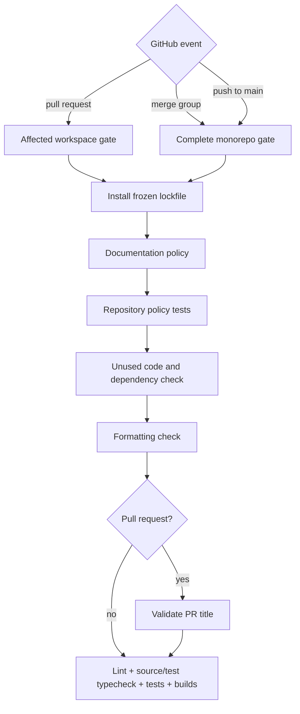

# Continuous Integration

The monorepo uses `.github/workflows/ci.yml` as its required verification
workflow. It runs for pull requests, merge-queue entries, and pushes to `main`.
There are no path filters because shared packages and repository policy can
affect any workspace.

## Workflow



Pull requests use Turbo's `--affected` selection. Merge groups and `main` run
the complete gate against the integrated repository state.

## Checks and Their Purpose

| Check                           | What it catches                                                    |
| ------------------------------- | ------------------------------------------------------------------ |
| `bun install --frozen-lockfile` | manifest/lockfile drift and unavailable dependencies               |
| `bun run docs:check`            | misplaced docs, invalid filenames, and broken local Markdown links |
| `bun run test:repo`             | CI, dependency, documentation, and env-template policy regressions |
| `bun run knip`                  | unused files, exports, dependencies, and workspace entry points    |
| `bun run format:check`          | files not formatted by repository Prettier policy                  |
| `bun run lint`                  | correctness, security, imports, and unused-code issues             |
| `bun run typecheck`             | production-source TypeScript errors                                |
| `bun run typecheck:test`        | test aliases, fixtures, and runner type errors                     |
| `bun run test`                  | declared workspace behavior suites                                 |
| `bun run build`                 | Next.js, schema, and Worker production compilation                 |

`typecheck:test` currently exists in API, GitHub App, Projects, and Schemas.
Add it when another workspace gains test-only compiler requirements.

## Caching and Concurrency

CI caches Bun downloads and `.turbo` output. Cache keys include the lockfile
hash and commit SHA; restore keys allow reuse without making stale output
authoritative. Installation still uses the frozen lockfile.

The root `turbo.json` owns shared build dependencies and artifact outputs.
Each Next.js app extends that configuration from its local `turbo.json` and
declares only its build-time environment inputs. Keep this inheritance intact:
a root `package#build` override replaces the shared task instead of composing
with it, which prevents `.next` artifacts from being restored on a cache hit.

Superseded pull-request runs are cancelled. Merge-group and `main` runs are not
cancelled because they prove a specific integration state. The workflow uses
Node 24-compatible `actions/checkout@v7` and `actions/cache@v6`.

## Local Reproduction

For repository policy failures:

```powershell
bun run docs:check
bun run test:repo
bun run knip
bun run format:check
```

For a complete CI-equivalent workspace gate:

```powershell
bun install --frozen-lockfile
bun run lint
bun run typecheck
bun run typecheck:test
bun run test
bun run build
git diff --check
```

Preview Turbo's task graph without executing it:

```powershell
bunx turbo run lint typecheck typecheck:test test build --dry=json
```

## Diagnosing Failures

| Failure                  | First action                                                                                    |
| ------------------------ | ----------------------------------------------------------------------------------------------- |
| install                  | compare `package.json`, `bun.lock`, `.bun-version`, and `bunfig.toml`                           |
| documentation            | run `bun run docs:check`, then inspect the exact path/link violation                            |
| repository policy        | run only the named test under `test/repository`                                                 |
| Knip                     | trace the reported entry point, export, or dependency before removing or ignoring it            |
| lint                     | run the owning workspace lint without `--fix`, understand the rule, then use `lint:fix` if safe |
| source typecheck         | run the workspace `typecheck` and inspect its production TSConfig                               |
| test typecheck           | run `typecheck:test` and inspect aliases/types in the test TSConfig                             |
| tests                    | use the workspace runner and reproduce the focused test locally                                 |
| build                    | distinguish compile failure from unavailable external build-time data                           |
| affected set looks wrong | inspect Turbo's dry JSON and package dependency graph                                           |

Do not weaken a rule or add a Knip/ESLint ignore merely to make CI green. First
determine whether the code is dead, dynamically loaded, a framework entry
point, or incorrectly configured.

## Pull Requests and Merge Queue

- Use a Conventional Commit-style pull-request title.
- Keep the branch current enough to resolve known conflicts before queueing.
- Treat the merge-group run as the final integration authority.
- Never force-push a shared branch over another contributor's work.
- Required-check and merge-queue settings live in GitHub and need operator
  verification; repository code cannot prove those settings are enabled.

## Production Migration Workflow

`.github/workflows/migrate-api-d1.yml` is a separate manual workflow. It uses a
protected `production` environment, exact confirmation text, serialized
execution, API verification, a pending-migration listing, and then remote D1
application. It is not part of ordinary pull-request CI and requires production
Cloudflare credentials. See [Operations](OPERATIONS.md).

## Changing CI

When changing a workflow:

1. keep permissions least-privileged;
2. preserve pull-request, merge-group, and `main` coverage;
3. update repository policy tests with the workflow;
4. avoid write credentials when running untrusted pull-request code;
5. update this guide;
6. observe the next real GitHub Actions run before claiming remote success.
