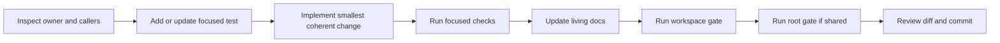

# Development

This guide takes a new contributor from clone to verified change and gives
experienced contributors the repository conventions needed for larger work.

## Prerequisites

- Git
- Bun 1.4.4, matching `.bun-version` and root `package.json`
- provider credentials only for integrations you intend to run

Docker is not part of the current setup. Do not install dependencies with npm,
pnpm, or Yarn inside a workspace.

## First Setup

```powershell
git clone <repository-url>
Set-Location scs-pdn-monorepo
bun --version
bun install --frozen-lockfile
bun run docs:check
```

If `bun --version` does not match `.bun-version`, switch Bun before installing.
The root `bun.lock` is authoritative for every workspace.

## Run a Workspace

Use one filtered development task while learning the system:

```powershell
bun --filter '@scs/web' dev
bun --filter '@scs/people' dev
bun --filter '@scs/projects' dev
bun --filter '@scs/portal' dev
bun --filter '@scs/api' dev
bun --filter '@scs/github-app' dev
bun --filter '@scs/mailer' dev
```

`bun run dev` starts every declared development task through Turbo and is most
useful after each workspace has valid local configuration. Public apps can use
checked-in defaults; Portal and services usually need copied environment
templates. See [Environment Variables](ENVIRONMENT_VARIABLES.md).

## Choose the Right Workspace

| Change                                                      | Start in                                        |
| ----------------------------------------------------------- | ----------------------------------------------- |
| department content or navigation                            | `apps/web`                                      |
| public people/profile rendering                             | `apps/people`                                   |
| public project discovery                                    | `apps/projects`                                 |
| authenticated page or form                                  | `apps/portal`                                   |
| session, authorization, D1, or browser API                  | `services/api`                                  |
| repository branch, commit, PR, operation, or retry behavior | `services/github-app`                           |
| SMTP request or delivery                                    | `services/mailer`                               |
| shared domain/transport shape                               | `packages/schemas`                              |
| reusable shadcn primitive                                   | `packages/ui`                                   |
| shared compiler/lint behavior                               | `packages/tsconfig` or `packages/eslint-config` |

Read [Architecture](ARCHITECTURE.md) before moving behavior between these
owners.

## Development Loop



For behavior changes, confirm that a new test fails for the intended reason
before implementing. For a pure documentation or configuration correction,
use the most relevant policy or load check instead of inventing a behavior test.

## Commands

Root commands coordinate only tasks declared by workspaces:

```powershell
bun run docs:check
bun run test:repo
bun run knip
bun run format:check
bun run lint
bun run typecheck
bun run typecheck:test
bun run test
bun run build
git diff --check
```

Run a focused task with a package filter:

```powershell
bun --filter '@scs/api' lint
bun --filter '@scs/api' typecheck
bun --filter '@scs/api' typecheck:test
bun --filter '@scs/api' test
bun --filter '@scs/api' build
```

Not every workspace declares every task. Check its `package.json`; do not treat
an omitted test or build task as a passing check.

## Code Organization

### Imports

Use `@/` inside applications and services when the workspace alias is
available. Use public workspace exports such as `@scs/schemas` and
`@scs/ui/components/button` across package boundaries. Avoid long `../../..`
paths. A short relative import is acceptable for tightly coupled files in the
same folder or a tool config that cannot resolve application aliases.

### Configuration

Put runtime parsing and operational values under `src/config`:

- `*.env.config.ts` parses environment variables;
- focused config files own timeouts, limits, routes, and feature settings;
- components consume typed configuration instead of reading `process.env` or
  declaring deployment values inline.

Function-local constants and schema-derived view options stay near the code
that owns them; not every constant is configuration.

### TypeScript and ESLint

Workspace TypeScript files extend `packages/tsconfig`. Workspace ESLint files
compose `packages/eslint-config`. Keep local overrides small and tied to a real
runtime or file-class difference.

Source typechecks and test typechecks are separate because Worker and Next.js
production types should not accidentally depend on Bun/Vitest globals.

### Tests

Put tests under the workspace's `test` or `tests` directory. Use the runner
declared by the workspace:

- API, GitHub App, Mailer, People, Portal, Schemas, UI, and ESLint config use
  Bun tests;
- Projects uses Vitest.

Do not run `bun test` as evidence for a Vitest suite. Use
`bun --filter '@scs/projects' test`.

### UI

Reusable shadcn primitives live in `packages/ui`:

```tsx
import { Button } from '@scs/ui/components/button';
```

Keep page sections and product workflows in their owning app. Use `cn` from the
`cn` package or the shared UI re-export; do not recreate local
`clsx`/`tailwind-merge` helpers. Preserve the shared design tokens when updating
registry primitives.

### Comments

Comment invariants, security decisions, provider constraints, and surprising
behavior. Do not narrate syntax. Use `/* ... */` for a multi-line explanation
and `//` for one short local clarification.

## Dependencies

Use caret ranges for registry dependencies and `workspace:*` for internal
packages. Root `bunfig.toml` holds newly published packages for seven days,
except the narrow compatibility exclusion recorded there.

Before removing or ignoring a Knip finding, search dynamic imports, framework
entry points, config loading, and deployment adapters. Run a workspace scan:

```powershell
bun --filter '@scs/portal' knip
bun --filter '@scs/portal' knip:depcheck
```

## Documentation

Living documentation belongs in root `README.md`, root `AGENTS.md`, or `docs`.
Files under `docs` use `UPPER_SNAKE_CASE.md`. Update a guide with the code when
a command, route, environment variable, workflow, deployment step, or ownership
boundary changes.

```powershell
bun run docs:check
bun run test:docs
```

Completed plans, generated assistant notes, and migration diaries are not
living product documentation.

## Commits and Collaboration

Use Conventional Commits:

```text
feat(api): add bounded audit pagination
fix(portal): stop duplicate operation polling
docs: explain D1 recovery
```

Husky runs staged formatting/linting and commit-message validation. Before
editing in a shared checkout, inspect `git status`. Preserve unrelated changes,
keep commits coherent, and never force-push over another contributor.

## Common Problems

| Symptom                                     | Check                                                                                           |
| ------------------------------------------- | ----------------------------------------------------------------------------------------------- |
| module alias is unresolved in the editor    | use the workspace TypeScript version and confirm the file is included by the correct `tsconfig` |
| `bun:test` types are missing                | run the workspace `typecheck:test` and confirm its test TSConfig includes Bun types             |
| Worker binding is undefined                 | start through Wrangler and configure the binding or `.dev.vars` file                            |
| browser env value is undefined              | confirm it is intentionally public and begins with `NEXT_PUBLIC_`                               |
| a Turbo task is absent                      | confirm the workspace declares that script; absence is not success                              |
| formatting passes locally but CI fails      | run root `bun run format:check` with the pinned Bun/lockfile state                              |
| a Next.js build reads unavailable live data | verify the app's documented local fallback or provide the required public data URL              |

For CI-only failures, continue with [Continuous Integration](CI.md). For
runtime deployment failures, use [Operations](OPERATIONS.md).
