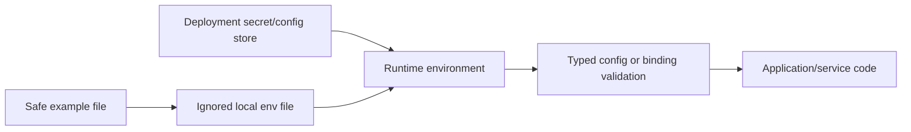

# Environment Variables

This is the canonical configuration catalog. Each deployable owns its template
and typed validator so it can run and deploy independently.

## Configuration Model



There are three kinds of configuration:

| Kind                   | Example                | Rule                                                             |
| ---------------------- | ---------------------- | ---------------------------------------------------------------- |
| public browser value   | `NEXT_PUBLIC_SITE_URL` | may be included in client bundles; never put a secret here       |
| server value or secret | `BETTER_AUTH_SECRET`   | available only to server/Worker code and deployment stores       |
| Cloudflare binding     | `AUTH_DB`              | configured by Wrangler and passed through the Worker environment |

Next.js apps use `@t3-oss/env-nextjs`. Bun processes use
`@t3-oss/env-core`. Worker bindings are request-scoped and typed; do not copy
them into `process.env`.

## Workspace Index

| Workspace  | Local template                     | Validation source                                   | Deployment source                      |
| ---------- | ---------------------------------- | --------------------------------------------------- | -------------------------------------- |
| Web        | `apps/web/.env.example`            | `apps/web/src/config/*.env.config.ts`               | app hosting environment                |
| People     | `apps/people/.env.example`         | `apps/people/src/config/public.env.config.ts`       | app hosting environment                |
| Projects   | `apps/projects/.env.example`       | `apps/projects/src/config/public.env.config.ts`     | app hosting environment                |
| Portal     | `apps/portal/.env.example`         | `apps/portal/src/config/*.env.config.ts`            | app hosting environment                |
| API        | `services/api/.dev.vars.example`   | `services/api/src/types/env.ts` and runtime modules | Wrangler config, bindings, and secrets |
| GitHub App | `services/github-app/.env.example` | `services/github-app/src/config/runtime.config.ts`  | Wrangler config and secrets            |
| Mailer     | `services/mailer/.env.example`     | `services/mailer/src/config/env.ts`                 | service hosting environment            |

## Local Files

Copy only what you need. These destinations are ignored and must remain
untracked:

```powershell
Copy-Item apps/portal/.env.example apps/portal/.env.local
Copy-Item services/api/.dev.vars.example services/api/.dev.vars
Copy-Item services/github-app/.env.example services/github-app/.env
Copy-Item services/mailer/.env.example services/mailer/.env
```

Do not reuse production secrets locally. Empty strings are treated as missing
by the typed config packages.

## Web

| Variable               | Visibility | Default / requirement             |
| ---------------------- | ---------- | --------------------------------- |
| `NEXT_PUBLIC_SITE_URL` | browser    | `https://scs.pdn.ac.lk`           |
| `BASE_DOMAIN`          | server     | `scs.pdn.ac.lk`                   |
| `MOODLE_URL`           | server     | `https://scilms.pdn.ac.lk`        |
| `WORKER_URL`           | server     | proxy Worker URL                  |
| `CF_SECRET`            | secret     | shared proxy authentication value |

`CF_SECRET` has a development fallback so the app can load, but production must
override it with a secret value shared only with the proxy Worker.

## People

| Variable                             | Visibility | Default                                  |
| ------------------------------------ | ---------- | ---------------------------------------- |
| `NEXT_PUBLIC_SITE_URL`               | browser    | `https://people.scs-pdn.space`           |
| `NEXT_PUBLIC_PEOPLE_DATA_BASE_URL`   | browser    | `https://data.scs-pdn.space/people/v2`   |
| `NEXT_PUBLIC_PROJECTS_DATA_BASE_URL` | browser    | `https://data.scs-pdn.space/projects/v2` |
| `NEXT_PUBLIC_PROJECTS_SITE_URL`      | browser    | `https://projects.scs-pdn.space`         |

## Projects

| Variable                             | Visibility | Default                                  |
| ------------------------------------ | ---------- | ---------------------------------------- |
| `NEXT_PUBLIC_SITE_URL`               | browser    | `https://projects.scs-pdn.space`         |
| `NEXT_PUBLIC_PROJECTS_DATA_BASE_URL` | browser    | `https://data.scs-pdn.space/projects/v2` |
| `NEXT_PUBLIC_PEOPLE_SITE_URL`        | browser    | `https://people.scs-pdn.space`           |

The projects data base may use the workspace's documented local fixture mode
where supported; production uses a valid public data URL.

## Portal

| Variable                                   | Visibility | Default                                |
| ------------------------------------------ | ---------- | -------------------------------------- |
| `NEXT_PUBLIC_SITE_URL`                     | browser    | `https://portal.scs-pdn.space`         |
| `NEXT_PUBLIC_BASE_API_URL`                 | browser    | `https://api.scs-pdn.space`            |
| `NEXT_PUBLIC_PEOPLE_DATA_BASE_URL`         | browser    | `https://data.scs-pdn.space/people/v2` |
| `NEXT_PUBLIC_VERIFICATION_CODE_MAX_LENGTH` | browser    | positive integer, `6`                  |
| `NEXT_PUBLIC_API_CLIENT_ID`                | browser    | `portal`                               |
| `COOKIE_DOMAIN`                            | server     | `.scs-pdn.space`                       |

The local Portal and API origins must agree with Better Auth trusted origins,
CORS policy, passkey relying-party rules, and cookie domain behavior.

## API Worker

### Wrangler Variables

`services/api/wrangler.jsonc` defines non-secret runtime values:

- `BETTER_AUTH_URL`
- `GOOGLE_CLIENT_ID`
- `GITHUB_CLIENT_ID`
- `MAILER_API_URL`
- `GITHUB_APP_API_URL`
- `DATA_PUBLIC_BASE_URL`

### Secrets

Local names are listed in `services/api/.dev.vars.example`:

- `BETTER_AUTH_SECRET`
- `GOOGLE_CLIENT_SECRET`
- `GITHUB_CLIENT_SECRET`
- `MAILER_API_KEY`
- `GITHUB_APP_INTERNAL_SECRET`

Configure production secrets from `services/api`:

```powershell
wrangler secret put BETTER_AUTH_SECRET
wrangler secret put GOOGLE_CLIENT_SECRET
wrangler secret put GITHUB_CLIENT_SECRET
wrangler secret put MAILER_API_KEY
wrangler secret put GITHUB_APP_INTERNAL_SECRET
```

### Bindings

| Binding      | Type            | Ownership                                            |
| ------------ | --------------- | ---------------------------------------------------- |
| `AUTH_DB`    | D1              | auth, rate limits, permissions, and proxy settings   |
| `GITHUB_APP` | service binding | preferred private call path to the GitHub App Worker |

`GITHUB_APP_API_URL` is the independently deployable HTTP fallback.

## GitHub App

| Variable                          | Kind          | Requirement                                 |
| --------------------------------- | ------------- | ------------------------------------------- |
| `GITHUB_APP_ID`                   | configuration | GitHub App identifier                       |
| `GITHUB_PRIVATE_KEY`              | secret        | required; escaped newlines are normalized   |
| `GITHUB_INSTALLATION_ID`          | configuration | installation identifier                     |
| `GITHUB_OWNER`                    | configuration | repository owner                            |
| `GITHUB_PEOPLE_DATA_REPOSITORY`   | configuration | people data repository name                 |
| `GITHUB_PROJECTS_DATA_REPOSITORY` | configuration | project data repository name                |
| `X_INTERNAL_SECRET`               | secret        | must match API `GITHUB_APP_INTERNAL_SECRET` |
| `PORT`                            | Bun adapter   | integer 1–65535; default `3000`             |

Production non-secrets and Cloudflare resources are defined in
`services/github-app/wrangler.jsonc`. Configure secrets from that workspace:

```powershell
wrangler secret put GITHUB_PRIVATE_KEY
wrangler secret put X_INTERNAL_SECRET
```

Never store a PEM file in the repository.

## Mailer

| Variable                       | Kind                 | Default / requirement          |
| ------------------------------ | -------------------- | ------------------------------ |
| `MAILER_API_KEY`               | secret               | required                       |
| `SMTP_HOST`                    | configuration        | `smtp.example.com`             |
| `SMTP_PORT`                    | configuration        | `587`                          |
| `SMTP_SECURE`                  | configuration        | `false`                        |
| `SMTP_USER`                    | secret/configuration | empty by default               |
| `SMTP_PASS`                    | secret               | empty by default               |
| `SMTP_FROM`                    | configuration        | falls back to `SMTP_USER`      |
| `PORT`                         | Bun adapter          | `3000`                         |
| `VERCEL_EXPERIMENTAL_BACKENDS` | deployment adapter   | optional; not read by app code |

The Mailer refuses to start without `MAILER_API_KEY`.

## Adding or Changing Configuration

Update all relevant layers in one change:

1. typed schema or Worker environment type;
2. runtime config module;
3. safe example file;
4. Wrangler or hosting configuration for non-secret values;
5. deployment secret store for secrets;
6. repository environment-policy tests;
7. this catalog and any affected operations guide;
8. focused config tests, typecheck, and build.

Never print a secret to confirm it exists. Validate presence, length, or a
provider response without echoing the value.
