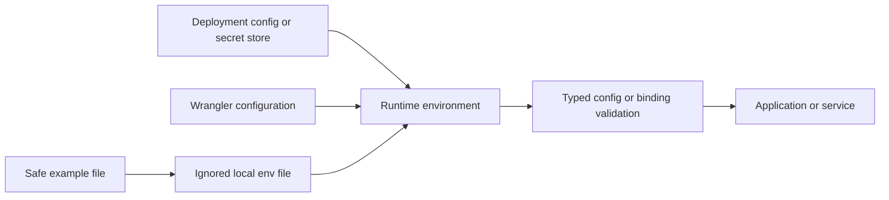

# Environment Variables

## Performance tooling

The local-first `@scs/performance` workspace parses its settings in
`packages/performance/src/config`. These values are never application build
inputs or browser-public configuration. See
[Performance testing](PERFORMANCE_TESTING.md) for authorization and examples.

| Variable                   | Purpose and supply                                                                          |
| -------------------------- | ------------------------------------------------------------------------------------------- |
| `PERF_K6_BINARY`           | Optional absolute k6 2.3.0 executable; defaults to `k6` on PATH                             |
| `PERF_BROWSER_EXECUTABLE`  | Optional compatible Chromium executable for the browser probe                               |
| `PERF_ENVIRONMENTS_FILE`   | Local-only reviewed allowlist override; forbidden in CI                                     |
| `PERF_DEPLOYMENT_REVISION` | Required full deployed commit SHA for hosted targets                                        |
| `PERF_AUTHORIZATION_JSON`  | Bounded operator/provider approval record; protected environment variable in CI             |
| `PERF_APPROVAL_ID`         | Identifier matching that authorization record                                               |
| `PERF_SESSIONS_JSON`       | Synthetic session array; secret for authenticated workloads; never real student credentials |
| `PERF_SESSIONS_FILE`       | Alternative local secret file for larger account pools; mutually exclusive with JSON input  |
| `PERF_ENABLED`             | GitHub protected-environment enablement variable, checked by hosted workflows               |
| `PERF_SMOKE_APPROVAL_ID`   | Protected-environment identifier used by the dedicated staging smoke workflow               |

Workflow inputs are passed through `PERF_ENVIRONMENT`, `PERF_PROFILE` and
`PERF_CONFIGURATION` into validated CLI arguments. They cannot supply arbitrary
target URLs. `CI` disables local allowlist overrides. The supervisor supplies
`PERF_PLAN_FILE` and a minimal environment to k6; unrelated secrets and `K6_*`
overrides are not inherited. Generated evidence and local JSON files are ignored.

This is the canonical configuration catalog. Each deployable owns a safe local
template and runtime validator so applications and services remain
independently deployable.

## Configuration Model



| Kind                   | Rule                                                          |
| ---------------------- | ------------------------------------------------------------- |
| public browser value   | may enter client bundles; must never contain a secret         |
| server value or secret | available only to server or Worker code                       |
| Cloudflare binding     | configured by Wrangler and passed on the request/runtime env  |
| deployment adapter     | consumed by the hosting platform rather than application code |

Next.js applications use `@t3-oss/env-nextjs`, and Bun services use
`@t3-oss/env-core`. Cloudflare bindings are request-scoped; do not copy them
into `process.env`.

## Workspace Index

| Workspace  | Local template                     | Validation source                                   | Deployment source                      |
| ---------- | ---------------------------------- | --------------------------------------------------- | -------------------------------------- |
| Web        | `apps/web/.env.example`            | `apps/web/src/config/*.env.config.ts`               | app hosting environment                |
| Docs       | `apps/docs/.env.example`           | `apps/docs/src/config/public.env.config.ts`         | app hosting environment                |
| People     | `apps/people/.env.example`         | `apps/people/src/config/public.env.config.ts`       | app hosting environment                |
| Projects   | `apps/projects/.env.example`       | `apps/projects/src/config/public.env.config.ts`     | app hosting environment                |
| Portal     | `apps/portal/.env.example`         | `apps/portal/src/config/*.env.config.ts`            | app hosting environment                |
| API        | `services/api/.dev.vars.example`   | `services/api/src/types/env.ts` and runtime modules | Wrangler config, bindings, and secrets |
| GitHub App | `services/github-app/.env.example` | `services/github-app/src/config/runtime.config.ts`  | Wrangler config and secrets            |
| Mailer     | `services/mailer/.env.example`     | `services/mailer/src/config/env.ts`                 | service hosting environment            |

## Audited Configuration Matrix

Each row records the supported name, exposure kind, source, runtime status,
and owner. `runtime` means application or adapter code reads the value;
`binding` means Cloudflare injects and consumes the resource; and
`deployment-only` means the hosting adapter owns it. No listed value is known
to be unused.

### Docs

| Name                        | Kind      | Supply     | Status    | Purpose                            |
| --------------------------- | --------- | ---------- | --------- | ---------------------------------- |
| `NEXT_PUBLIC_DOCS_SITE_URL` | `browser` | `template` | `runtime` | canonical URL and generated routes |

### Web

Production uses `https://scs-pdn.space` for `NEXT_PUBLIC_SITE_URL` and
`scs-pdn.space` for `BASE_DOMAIN`. The Web app's `.env.example` uses local
development hosts; do not copy those values into Vercel Production or Preview.

| Name                            | Kind      | Supply     | Status    | Purpose                         |
| ------------------------------- | --------- | ---------- | --------- | ------------------------------- |
| `NEXT_PUBLIC_SITE_URL`          | `browser` | `template` | `runtime` | canonical URL and metadata      |
| `NEXT_PUBLIC_PEOPLE_SITE_URL`   | `browser` | `template` | `runtime` | People app destinations         |
| `NEXT_PUBLIC_PROJECTS_SITE_URL` | `browser` | `template` | `runtime` | Projects app destinations       |
| `NEXT_PUBLIC_MOODLE_URL`        | `browser` | `template` | `runtime` | Moodle link and redirect        |
| `BASE_DOMAIN`                   | `server`  | `template` | `runtime` | application domain construction |
| `PROXY_API_URL`                 | `server`  | `template` | `runtime` | API proxy-resolution requests   |
| `WEB_PROXY_INTERNAL_SECRET`     | `secret`  | `template` | `runtime` | API proxy-resolution trust      |

### People

| Name                                 | Kind      | Supply     | Status    | Purpose                    |
| ------------------------------------ | --------- | ---------- | --------- | -------------------------- |
| `NEXT_PUBLIC_SITE_URL`               | `browser` | `template` | `runtime` | canonical URL and metadata |
| `NEXT_PUBLIC_API_BASE_URL`           | `browser` | `template` | `runtime` | public avatar API          |
| `NEXT_PUBLIC_PEOPLE_DATA_BASE_URL`   | `browser` | `template` | `runtime` | people records             |
| `NEXT_PUBLIC_PROJECTS_DATA_BASE_URL` | `browser` | `template` | `runtime` | related project records    |
| `NEXT_PUBLIC_PROJECTS_SITE_URL`      | `browser` | `template` | `runtime` | Projects app destinations  |

### Projects

| Name                                 | Kind      | Supply     | Status    | Purpose                    |
| ------------------------------------ | --------- | ---------- | --------- | -------------------------- |
| `NEXT_PUBLIC_SITE_URL`               | `browser` | `template` | `runtime` | canonical URL and metadata |
| `NEXT_PUBLIC_PROJECTS_DATA_BASE_URL` | `browser` | `template` | `runtime` | project records            |
| `NEXT_PUBLIC_PEOPLE_SITE_URL`        | `browser` | `template` | `runtime` | People app destinations    |
| `NEXT_PUBLIC_DEPARTMENT_SITE_URL`    | `browser` | `template` | `runtime` | department course indexes  |

### Portal

| Name                                       | Kind      | Supply     | Status    | Purpose                                  |
| ------------------------------------------ | --------- | ---------- | --------- | ---------------------------------------- |
| `NEXT_PUBLIC_SITE_URL`                     | `browser` | `template` | `runtime` | canonical URL and metadata               |
| `NEXT_PUBLIC_BASE_API_URL`                 | `browser` | `template` | `runtime` | browser API client                       |
| `NEXT_PUBLIC_PEOPLE_DATA_BASE_URL`         | `browser` | `template` | `runtime` | public profiles and playground data host |
| `NEXT_PUBLIC_VERIFICATION_CODE_MAX_LENGTH` | `browser` | `template` | `runtime` | verification input constraints           |
| `NEXT_PUBLIC_API_CLIENT_ID`                | `browser` | `template` | `runtime` | API client identification                |
| `COOKIE_DOMAIN`                            | `server`  | `template` | `runtime` | authentication cookie scope              |

### API Worker

| Name                          | Kind      | Supply     | Status    | Purpose                                                                 |
| ----------------------------- | --------- | ---------- | --------- | ----------------------------------------------------------------------- |
| `BETTER_AUTH_SECRET`          | `secret`  | `template` | `runtime` | Better Auth signing                                                     |
| `BETTER_AUTH_URL`             | `server`  | `wrangler` | `runtime` | Better Auth base URL                                                    |
| `GOOGLE_CLIENT_ID`            | `server`  | `wrangler` | `runtime` | Google OAuth                                                            |
| `GOOGLE_CLIENT_SECRET`        | `secret`  | `template` | `runtime` | Google OAuth                                                            |
| `GITHUB_CLIENT_ID`            | `server`  | `wrangler` | `runtime` | GitHub OAuth                                                            |
| `GITHUB_CLIENT_SECRET`        | `secret`  | `template` | `runtime` | GitHub OAuth                                                            |
| `ORCID_CLIENT_ID`             | `secret`  | `operator` | `runtime` | ORCID public API OAuth client identifier; required to enable linking    |
| `ORCID_CLIENT_SECRET`         | `secret`  | `operator` | `runtime` | ORCID OAuth code exchange; required to enable linking                   |
| `MAILER_API_URL`              | `server`  | `wrangler` | `runtime` | Mailer service endpoint                                                 |
| `MAILER_API_KEY`              | `secret`  | `template` | `runtime` | Mailer service authentication                                           |
| `GITHUB_APP_API_URL`          | `server`  | `wrangler` | `runtime` | GitHub App HTTP fallback                                                |
| `GITHUB_APP_INTERNAL_SECRET`  | `secret`  | `template` | `runtime` | GitHub App HTTP authentication                                          |
| `WEB_PROXY_INTERNAL_SECRET`   | `secret`  | `template` | `runtime` | Web proxy-resolution authentication                                     |
| `DATA_PUBLIC_BASE_URL`        | `server`  | `wrangler` | `runtime` | public data URL construction                                            |
| `AUTH_DB`                     | `binding` | `wrangler` | `binding` | D1 auth and settings store                                              |
| `GITHUB_APP`                  | `binding` | `wrangler` | `binding` | private GitHub App service transport                                    |
| `PROFILE_PICTURES`            | `binding` | `wrangler` | `binding` | public avatar R2 bucket                                                 |
| `IMAGES`                      | `binding` | `wrangler` | `binding` | avatar decode and normalization                                         |
| `TYPESAFE_API_KEY`            | `secret`  | `template` | `runtime` | Jev image moderation                                                    |
| `IDENTITY_JEV_ENABLED`        | `server`  | `optional` | `runtime` | Set `true` to enable administrator-requested identity evidence analysis |
| `AVATAR_STORAGE_DRIVER`       | `server`  | `wrangler` | optional  | `r2` (default) or `s3`                                                  |
| `AVATAR_S3_BUCKET`            | `server`  | `wrangler` | S3 only   | private avatar bucket                                                   |
| `AVATAR_S3_REGION`            | `server`  | `wrangler` | S3 only   | S3 region (`auto` for R2 S3 API)                                        |
| `AVATAR_S3_ENDPOINT`          | `server`  | `wrangler` | S3 only   | S3-compatible endpoint                                                  |
| `AVATAR_S3_ACCESS_KEY_ID`     | `secret`  | `template` | S3 only   | S3 access key                                                           |
| `AVATAR_S3_SECRET_ACCESS_KEY` | `secret`  | `template` | S3 only   | S3 secret key                                                           |

See [Binary object storage](STORAGE.md) before switching providers. Existing
objects are not copied by changing these variables.

### API Bun runtime

The Bun API uses the shared API secrets and URLs above as process environment
variables. It additionally requires `POSTGRES_URL` and `POSTGRES_SCHEMA` for
its migrated PostgreSQL database and all five `AVATAR_S3_*` values above for
its private object store. `API_PORT` defaults to 3001. D1, R2, and Images
bindings are not used by this entry point; it injects PostgreSQL, S3, and
Sharp. See [self-hosted runtimes](SELF_HOSTED_RUNTIMES.md) for startup and
deployment requirements.

### GitHub App

| Name                              | Kind      | Supply     | Status    | Purpose                             |
| --------------------------------- | --------- | ---------- | --------- | ----------------------------------- |
| `GITHUB_APP_ID`                   | `server`  | `template` | `runtime` | GitHub App authentication           |
| `GITHUB_PRIVATE_KEY`              | `secret`  | `template` | `runtime` | GitHub App authentication           |
| `GITHUB_INSTALLATION_ID`          | `server`  | `template` | `runtime` | installation selection              |
| `GITHUB_OWNER`                    | `server`  | `template` | `runtime` | repository owner                    |
| `GITHUB_PEOPLE_DATA_REPOSITORY`   | `server`  | `template` | `runtime` | people data repository              |
| `GITHUB_PROJECTS_DATA_REPOSITORY` | `server`  | `template` | `runtime` | projects data repository            |
| `X_INTERNAL_SECRET`               | `secret`  | `template` | `runtime` | internal request authentication     |
| `PORT`                            | `adapter` | `template` | `runtime` | local Bun listener                  |
| `POSTGRES_URL`                    | `secret`  | `template` | Bun only  | PostgreSQL connection URL           |
| `POSTGRES_SCHEMA`                 | `server`  | `template` | Bun only  | migrated operation schema           |
| `PGBOSS_SCHEMA`                   | `server`  | `template` | Bun only  | distinct pg-boss schema             |
| `OPERATION_STATE`                 | `binding` | `wrangler` | `binding` | durable operation state             |
| `MUTATION_COORDINATOR`            | `binding` | `wrangler` | `binding` | per-resource mutation serialization |
| `OPERATION_QUEUE`                 | `binding` | `wrangler` | `binding` | durable operation dispatch          |

### Mailer

| Name                           | Kind      | Supply     | Status            | Purpose                              |
| ------------------------------ | --------- | ---------- | ----------------- | ------------------------------------ |
| `MAILER_API_KEY`               | `secret`  | `template` | `runtime`         | bearer authentication                |
| `SMTP_HOST`                    | `server`  | `template` | `runtime`         | SMTP connection                      |
| `SMTP_SECURE`                  | `server`  | `template` | `runtime`         | SMTP transport and port selection    |
| `SMTP_USER`                    | `secret`  | `template` | `runtime`         | SMTP authentication                  |
| `SMTP_PASS`                    | `secret`  | `template` | `runtime`         | SMTP authentication                  |
| `SMTP_FROM`                    | `server`  | `template` | `runtime`         | sender address                       |
| `PORT`                         | `adapter` | `template` | `runtime`         | Bun listener                         |
| `VERCEL_EXPERIMENTAL_BACKENDS` | `adapter` | `provider` | `deployment-only` | Vercel backend routing during deploy |

## Local Setup

Copy only the templates needed for the workspaces you will run. Next.js apps
use `.env.local`; Wrangler uses `.dev.vars`; Bun services use `.env`.

```powershell tab="PowerShell" tab-group="terminal"
Copy-Item apps/web/.env.example apps/web/.env.local
Copy-Item apps/docs/.env.example apps/docs/.env.local
Copy-Item apps/people/.env.example apps/people/.env.local
Copy-Item apps/projects/.env.example apps/projects/.env.local
Copy-Item apps/portal/.env.example apps/portal/.env.local
Copy-Item services/api/.dev.vars.example services/api/.dev.vars
Copy-Item services/github-app/.env.example services/github-app/.env
Copy-Item services/mailer/.env.example services/mailer/.env
```

```bash tab="Bash" tab-group="terminal"
cp apps/web/.env.example apps/web/.env.local
cp apps/docs/.env.example apps/docs/.env.local
cp apps/people/.env.example apps/people/.env.local
cp apps/projects/.env.example apps/projects/.env.local
cp apps/portal/.env.example apps/portal/.env.local
cp services/api/.dev.vars.example services/api/.dev.vars
cp services/github-app/.env.example services/github-app/.env
cp services/mailer/.env.example services/mailer/.env
```

```cmd tab="Command Prompt" tab-group="terminal"
copy apps\web\.env.example apps\web\.env.local
copy apps\docs\.env.example apps\docs\.env.local
copy apps\people\.env.example apps\people\.env.local
copy apps\projects\.env.example apps\projects\.env.local
copy apps\portal\.env.example apps\portal\.env.local
copy services\api\.dev.vars.example services\api\.dev.vars
copy services\github-app\.env.example services\github-app\.env
copy services\mailer\.env.example services\mailer\.env
```

These destinations are ignored. Never reuse production secrets locally or
commit populated files. Empty strings are treated as missing by typed config.
Defaults and safe local examples live in the validator and template; avoid
duplicating them in another guide.

The Portal and API origins must agree with Better Auth trusted origins, CORS,
passkey relying-party settings, and cookie-domain behavior. The API and GitHub
App internal secrets must match, as must `WEB_PROXY_INTERNAL_SECRET` in the Web
and API deployments.

## Production Configuration

Non-secret API and GitHub App values, resource bindings, and required secret
names are declared in their `wrangler.jsonc` files. Store values in the
provider, never in Wrangler configuration:

```powershell tab="PowerShell" tab-group="terminal"
Set-Location services/api
bunx wrangler secret put BETTER_AUTH_SECRET
bunx wrangler secret put GOOGLE_CLIENT_SECRET
bunx wrangler secret put GITHUB_CLIENT_SECRET
bunx wrangler secret put MAILER_API_KEY
bunx wrangler secret put GITHUB_APP_INTERNAL_SECRET
bunx wrangler secret put WEB_PROXY_INTERNAL_SECRET

Set-Location ../github-app
bunx wrangler secret put GITHUB_PRIVATE_KEY
bunx wrangler secret put X_INTERNAL_SECRET
```

```bash tab="Bash" tab-group="terminal"
cd services/api
bunx wrangler secret put BETTER_AUTH_SECRET
bunx wrangler secret put GOOGLE_CLIENT_SECRET
bunx wrangler secret put GITHUB_CLIENT_SECRET
bunx wrangler secret put MAILER_API_KEY
bunx wrangler secret put GITHUB_APP_INTERNAL_SECRET
bunx wrangler secret put WEB_PROXY_INTERNAL_SECRET

cd ../github-app
bunx wrangler secret put GITHUB_PRIVATE_KEY
bunx wrangler secret put X_INTERNAL_SECRET
```

```cmd tab="Command Prompt" tab-group="terminal"
cd services\api
bunx wrangler secret put BETTER_AUTH_SECRET
bunx wrangler secret put GOOGLE_CLIENT_SECRET
bunx wrangler secret put GITHUB_CLIENT_SECRET
bunx wrangler secret put MAILER_API_KEY
bunx wrangler secret put GITHUB_APP_INTERNAL_SECRET
bunx wrangler secret put WEB_PROXY_INTERNAL_SECRET

cd ..\github-app
bunx wrangler secret put GITHUB_PRIVATE_KEY
bunx wrangler secret put X_INTERNAL_SECRET
```

`AUTH_DB` and `GITHUB_APP` belong to the API Worker. `OPERATION_STATE`,
`MUTATION_COORDINATOR`, and `OPERATION_QUEUE` belong to the GitHub App Worker.
Durable Object state is independent of API D1 migrations.

The GitHub private key may contain escaped newlines but must never be stored as
a tracked PEM file. The Mailer refuses to start without `MAILER_API_KEY`; verify
its SMTP sender and delivery in a non-production mailbox. Vercel owns
`VERCEL_EXPERIMENTAL_BACKENDS`; application code does not read it.

## Adding or Changing Configuration

Update all affected layers in one change:

1. typed schema or Worker environment type;
2. runtime config module;
3. safe example file;
4. Wrangler or hosting configuration for non-secret values;
5. deployment secret store for secrets;
6. repository environment-policy tests;
7. this catalog and [Operations](OPERATIONS.md) when deployment changes;
8. focused config tests, typecheck, and build.

Never print a secret to prove it exists. Validate presence, length, or a
provider response without echoing the value.
