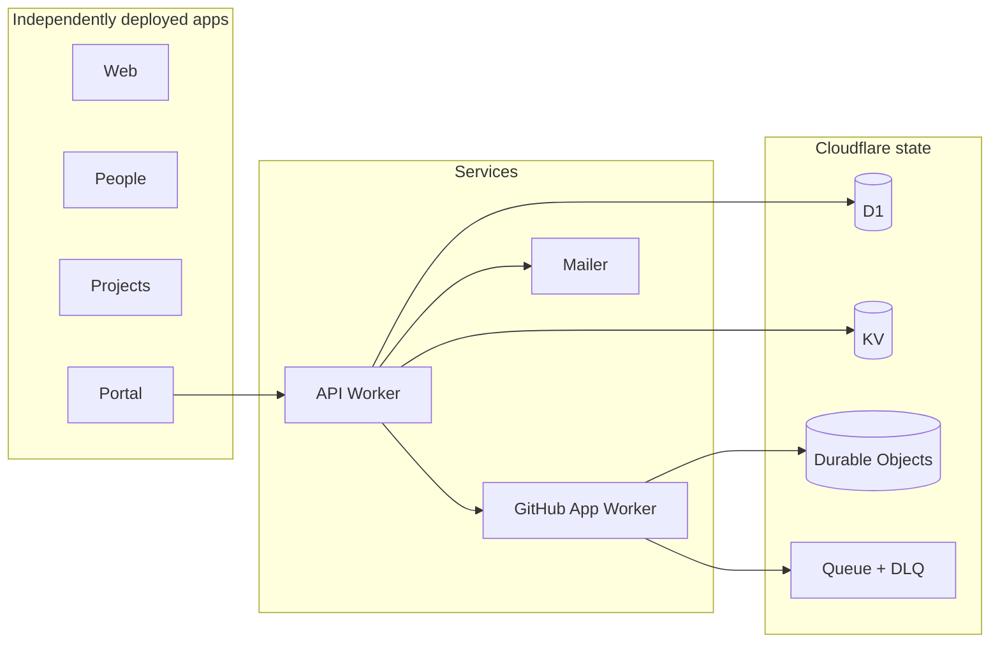
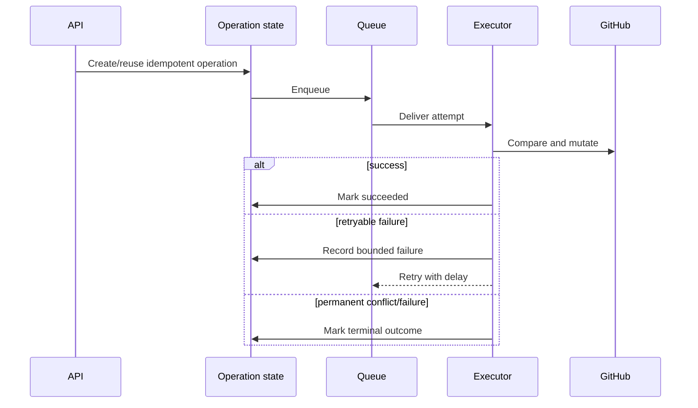

# Operations

This runbook covers verification, deployment boundaries, migrations,
observability, and recovery. Commands are examples; production actions still
require the target provider credentials and repository/environment approvals.

## Deployment Topology



Root commands verify the repository; they do not deploy all units together.
Docker is not part of the current build or deployment process.

## Deployment Units

| Unit              | Runtime           | Local production check         | Deployment owner           |
| ----------------- | ----------------- | ------------------------------ | -------------------------- |
| four apps         | Next.js           | workspace `build`              | app hosting platform       |
| `@scs/api`        | Cloudflare Worker | `wrangler build`               | `wrangler deploy`          |
| `@scs/github-app` | Cloudflare Worker | `wrangler build`               | `wrangler deploy`          |
| `@scs/mailer`     | Bun/Hono          | `typecheck` and `check`        | service hosting platform   |
| public data       | Cloudflare assets | separate repository validation | data repository workflow   |
| access config     | Cloudflare assets | separate repository validation | config repository workflow |

## Pre-Deployment Checklist

1. Confirm the exact commit and a clean working tree.
2. Review the diff for configuration, migrations, bindings, and secrets.
3. Run the owning workspace gate.
4. For shared changes, run the complete root gate.
5. Confirm required provider secrets and bindings without printing values.
6. Apply database or Durable Object migrations before code that requires them.
7. Deploy only affected units in dependency order.
8. Check health, logs, queue depth, and one representative user flow.
9. Record any production-only validation that was not possible locally.

Complete root gate:

```powershell
bun install --frozen-lockfile
bun run docs:check
bun run format:check
bun run lint
bun run typecheck
bun run typecheck:test
bun run test
bun run build
git diff --check
```

## API Worker

The API Worker owns Better Auth, D1 migrations, KV permissions, browser API
routes, and the private calls to Mailer and GitHub App.

From `services/api`:

```powershell
bun run lint
bun run typecheck
bun run typecheck:test
bun run test
bun run build
wrangler deploy
```

Configure the secrets listed in [Environment Variables](ENVIRONMENT_VARIABLES.md)
before deployment. `AUTH_DB`, `PERMISSIONS`, and `GITHUB_APP` bindings must point
to the intended environment.

### D1 Migrations

The preferred production path is the manual `Migrate API D1` GitHub workflow.
It is serialized, requires the protected `production` environment and exact
confirmation input, verifies the API, lists pending migrations, and applies
them remotely.

Required production environment secrets:

- `CLOUDFLARE_API_TOKEN`
- `CLOUDFLARE_ACCOUNT_ID`

For inspection from `services/api`:

```powershell
bunx wrangler d1 migrations list scs-portal-auth --remote
```

Do not edit an applied migration. Add the next numbered migration, test it, and
apply it through the serialized workflow.

### One-Time Data Migrations

Two confirmation-gated Portal admin actions remain:

| Action                   | Run after                                                          | Remove after                                                     |
| ------------------------ | ------------------------------------------------------------------ | ---------------------------------------------------------------- |
| `migrate-legacy-auth`    | Better Auth tables and Better Auth-only API are deployed           | identities/passkeys are reviewed and conflicts resolved          |
| `migrate-proxy-settings` | `0003_proxy_settings.sql` and the D1-backed proxy API are deployed | imported counts/conflicts and Portal proxy behavior are verified |

Both actions are idempotent and conflict-reporting. They do not justify blind
retries: review conflicts and existing target records first. Remove the action
and migration-only inputs only after production confirmation.

## GitHub App Worker

The GitHub App requires minimum repository permissions for contents, branches,
pull requests, controlled labels/comments, and configured repository-access
updates. Do not grant organization-wide administration for convenience.

From `services/github-app`:

```powershell
bun run lint
bun run typecheck
bun run typecheck:test
bun run test
bun run build
wrangler deploy
```

The Worker uses:

- `OPERATION_STATE` for operation records;
- `MUTATION_COORDINATOR` to serialize one logical resource;
- `OPERATION_QUEUE` for execution;
- `scs-github-operations-dlq` after three exhausted queue retries.



Same-resource mutations are serialized; different resources can run in
parallel. Never edit Durable Object state manually.

## Mailer

The Mailer validates an authenticated request before passing it to SMTP. It
must have a unique `MAILER_API_KEY`, valid sender identity, and provider-specific
SMTP settings.

```powershell
bun --filter '@scs/mailer' lint
bun --filter '@scs/mailer' typecheck
bun --filter '@scs/mailer' check
```

Verify delivery in a non-production mailbox before enabling a new provider.
Do not log message bodies, bearer tokens, or SMTP credentials.

## Public Data and Config Repositories

These repositories are deployed separately from the monorepo.

The data repository generates deterministic people, project, academic,
manifest, search, and `by-person` projections from authoritative entity files.
Its pull-request validation checks projection freshness without mutating the
branch. A serialized recovery workflow may open or refresh one automation PR
when `main` projections are stale. Deployment must use the exact commit that
passed data validation.

The config repository validates configuration without formatting or committing
inside validation jobs. Its update workflow is serialized to reduce conflicts
between concurrent contributors.

Repository rulesets, required checks, merge queue, auto-merge, and permission
to create automation PRs are provider settings. Verify them with a real
pull-request/merge-group run before claiming they are enforced.

## Observability

Wrangler enables invocation logs for both Workers. Structured logs should
include:

- correlation ID and operation ID;
- bounded action and resource identifiers;
- status transition and attempt number;
- duration and provider request ID where available;
- bounded error category and retry decision.

Never log tokens, cookies, private keys, raw OAuth payloads, complete private
profiles, email bodies, or full mutation payloads.

Monitor at minimum:

- Worker error and latency rates;
- authentication and rate-limit failures;
- queue backlog, retries, and dead-letter count;
- D1 migration state and database errors;
- GitHub API rate limits and repository conflicts;
- SMTP delivery failures.

## Recovery Matrix

| Failure                      | Safe response                                                                                           |
| ---------------------------- | ------------------------------------------------------------------------------------------------------- |
| app regression               | roll back only that app deployment                                                                      |
| API or GitHub App regression | roll back the affected Worker version and verify binding compatibility                                  |
| failed D1 migration          | stop deployment, preserve evidence, and add a corrective migration; do not edit applied SQL             |
| dead-lettered operation      | inspect correlation ID, attempts, and GitHub ref/PR state before replaying the original idempotency key |
| stale repository revision    | refresh the entity and submit a new mutation; do not force-push                                         |
| incorrect public data        | revert through a reviewed repository commit and regenerate projections                                  |
| exposed secret               | revoke/rotate at the provider, update stores, invalidate affected sessions/tokens, then investigate     |
| SMTP outage                  | retain authoritative application state and retry only through an explicitly idempotent delivery path    |

## Post-Deployment Verification

- Confirm the deployed commit and environment.
- Exercise health and one representative read flow.
- For auth changes, test session creation, protected access, and sign-out.
- For mutation changes, test submission, polling, final outcome, and conflict.
- Check that unrelated apps/services were not redeployed unnecessarily.
- Review logs and queue state without exposing sensitive data.
- Record remaining production-only checks instead of describing them as passed.

See [Security](SECURITY.md) for incident response and
[Continuous Integration](CI.md) for repository verification.
