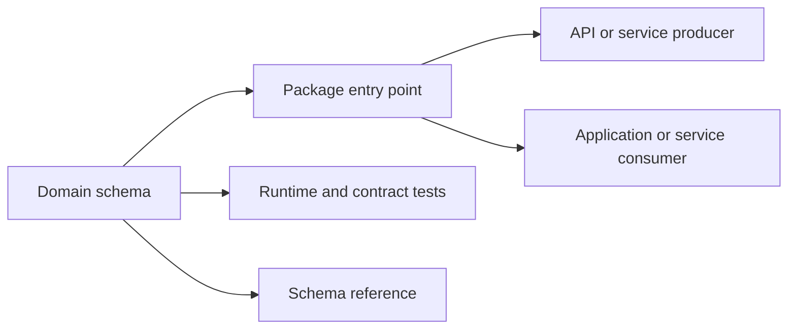

# Schemas package internals

`packages/schemas` is the repository's shared runtime-contract package. Each
Zod schema defines executable boundary validation and exports its inferred
TypeScript type from the same source.



The [schema reference](../../SCHEMA_REFERENCE/INDEX.md) describes the fields and
relationships. These pages describe how to own and change the package itself:
[Ownership and exports](OWNERSHIP_AND_EXPORTS.md) and
[Evolution and verification](EVOLUTION_AND_VERIFICATION.md).

## Private package publication

The workspace name `@scs/schemas` remains the internal monorepo import. A
verified push to `main` that changes `packages/schemas/**` automatically
publishes a private `@csc3213-2026-group-b/scs-schemas` version to GitHub
Packages. Versions use `0.<workflow run number>.<run attempt>` so every normal
run and retry is immutable and unique. The publishing workflow uses the
repository `GITHUB_TOKEN`; no PAT or long-lived registry credential is stored.

Publication runs the package lint, source and test typechecks, tests, and build
before preparing the artifact. The prepared package contains compiled
JavaScript, declarations, package metadata, and the repository license. It does
not publish the monorepo source tree or grant consumers repository access. A
manual workflow dispatch is available for recovery, but normal releases are
path-triggered from `main` and require no version commit.

After the first version is published, grant the consuming repository explicit
read access under the package's **Manage Actions access** settings. Consumers
authenticate to `https://npm.pkg.github.com` with their own workflow
`GITHUB_TOKEN`. Do not expose that token to fork-controlled install scripts.

### Consumer contract

Consumers must:

1. Configure the `@csc3213-2026-group-b` scope for
   `https://npm.pkg.github.com`.
2. Request `packages: read` in the install job and pass `github.token` only to
   the dependency-install step.
3. Install with lifecycle scripts disabled when validating untrusted changes.
4. Pin an exact published version in `package.json` and the lockfile.
5. Upgrade only after the publish workflow for the schema change succeeds.

The retired `@csc3213-2026-group-b/academic-domain-schemas` package is not a
compatibility path. External consumers use the compiled package, not a Git
submodule, so they cannot inspect or depend on unrelated monorepo workspaces.

For local development, authenticate with a token that can read the package:

PowerShell:

```powershell
$env:NODE_AUTH_TOKEN = gh auth token
bun install
Remove-Item Env:NODE_AUTH_TOKEN
```

Bash, Zsh, or Git Bash:

```bash
export NODE_AUTH_TOKEN="$(gh auth token)"
bun install
unset NODE_AUTH_TOKEN
```

Windows Command Prompt (interactive):

```batch
for /f "delims=" %i in ('gh auth token') do set "NODE_AUTH_TOKEN=%i"
bun install
set "NODE_AUTH_TOKEN="
```

If installation returns `401` or `404`, confirm that the token has
`read:packages`, the package owner is configured in the registry scope, and the
repository has package Actions access. A missing version means publication did
not complete; do not substitute a branch, tarball, or deprecated package.
