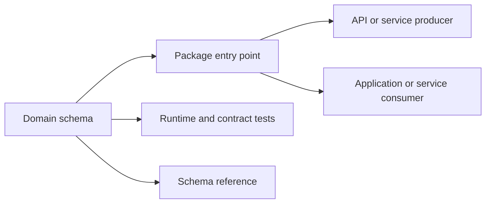

# Schemas package internals

`packages/schemas` is the repository's shared runtime-contract package. Each
Zod schema defines executable boundary validation and exports its inferred
TypeScript type from the same source.

The [schema reference](../../SCHEMA_REFERENCE/INDEX.md) describes the fields and
relationships. These pages describe how to own and change the package itself:
[Ownership and exports](OWNERSHIP_AND_EXPORTS.md) and
[Evolution and verification](EVOLUTION_AND_VERIFICATION.md).
