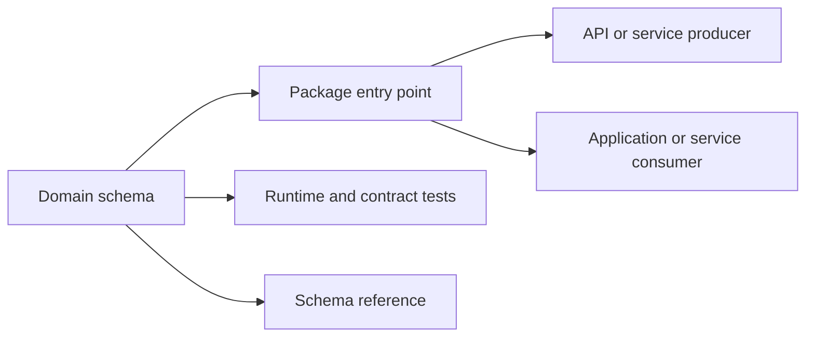

# Schemas package internals

`packages/schemas` is the repository's shared runtime-contract package. Each
Zod schema defines executable boundary validation and exports its inferred
TypeScript type from the same source.

The [schema reference](../../SCHEMA_REFERENCE/INDEX.md) describes the fields and
relationships. These pages describe how to own and change the package itself:
[Ownership and exports](OWNERSHIP_AND_EXPORTS.md) and
[Evolution and verification](EVOLUTION_AND_VERIFICATION.md).

## Private package publication

The workspace name `@scs/schemas` remains the internal monorepo import. A
verified push to `main` that changes `packages/schemas/**` automatically
publishes a private `@csc3213-2026-group-b/scs-schemas` version to GitHub
Packages. Versions use `0.<workflow run number>.<run attempt>` so every normal
run and retry is immutable and unique. The publishing workflow uses the
repository `GITHUB_TOKEN`; no PAT or long-lived registry credential is stored.

After the first version is published, grant the consuming repository explicit
read access under the package's **Manage Actions access** settings. Consumers
authenticate to `https://npm.pkg.github.com` with their own workflow
`GITHUB_TOKEN`. Do not expose that token to fork-controlled install scripts.
