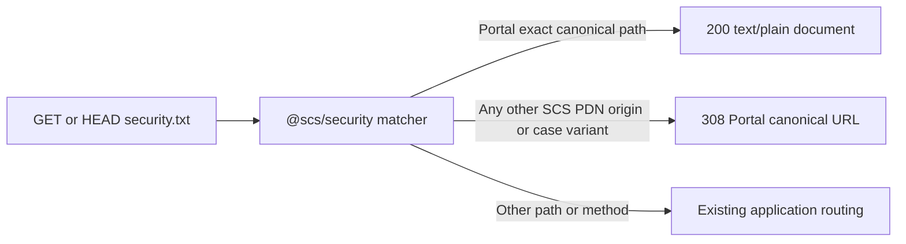

# Security package internals

`@scs/security` provides one framework-neutral RFC 9116 implementation. Its
public exports are:

- `SecurityTxtConfigSchema` and `SecurityTxtConfig` for typed Zod 4 validation;
- `generateSecurityTxt()` for deterministic field capitalization, repeated
  fields, comma-separated preferred languages, and a trailing newline;
- `SECURITY_TXT_CANONICAL_URL` for the Portal-owned authoritative endpoint;
- `isSecurityTxtPath()` and `getSecurityTxtRedirectTarget()` for exact,
  case-insensitive discovery matching and method-limited redirects.

The schema requires at least one `Contact` and a future RFC 3339 `Expires`.
Supported optional fields are `Canonical`, `Policy`, `Encryption`,
`Acknowledgments`, `Hiring`, and `Preferred-Languages`. Values reject CR and LF
characters. Web references require HTTPS; contacts allow HTTPS, `mailto`, or
`tel`; encryption also allows `dns` and `openpgp4fpr`.

Language tags are canonicalized with `Intl.getCanonicalLocales()`. This is a
portable platform validation boundary, not exhaustive RFC 5646 validation.

## Discovery flow



Portal defines the document configuration directly in its route. Web, People,
Projects, Docs, API, GitHub App, and Mailer use the shared redirect helper at
their earliest practical request boundary. The redirect always discards the
original query string and never enables POST or another unsupported method.

## Verification

```powershell
bun --filter '@scs/security' lint
bun --filter '@scs/security' typecheck
bun --filter '@scs/security' typecheck:test
bun --filter '@scs/security' test
bun --filter '@scs/security' build
```

Consumer tests cover lowercase, uppercase, and mixed-case discovery paths,
GET/HEAD behavior, exact status and location, the Portal loop exception, query
strings, unsupported methods, and representative existing routes.
