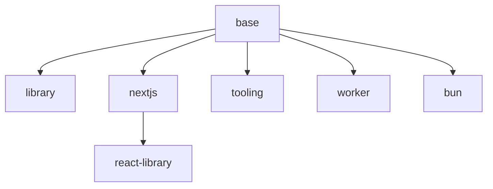

# TypeScript presets

Every preset extends `base.json`, which owns strict mode, library-check policy,
and consistent file-name casing. Workspaces select the closest runtime preset
and add only local paths, files, generated types, output directories, or test
runner types.

| Preset          | Intended environment and important choices                            |
| --------------- | --------------------------------------------------------------------- |
| `library`       | ES2020 library output with bundler resolution and JSON modules        |
| `nextjs`        | DOM, React JSX, Next plugin, Bun types, no emit, incremental          |
| `react-library` | Next-compatible JSX without JavaScript or Next plugin state           |
| `tooling`       | no-emit ESNext scripts and configuration executed by Bun              |
| `worker`        | ESNext modules, isolated bundler compilation, Cloudflare types        |
| `bun`           | preserved modules, ESNext library, forced module detection, Bun types |

Production configurations exclude test-only source where a workspace has a
separate `tsconfig.test.json`. That test configuration adds runner globals,
fixtures, or aliases without leaking them into production compilation.

Do not add Node, DOM, Bun, or Cloudflare globals to `base`; choose the owning
runtime preset or a local override. Before changing a preset, search every
`extends` consumer and run both production and test typechecks where declared.
A configuration package with no local test command is not verified merely by
parsing its JSON—the consumer matrix is its effective test surface.
