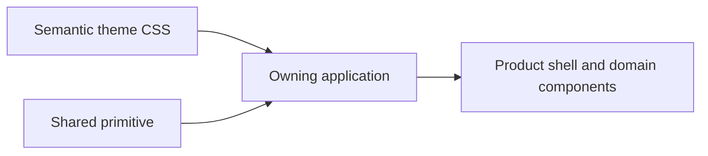

# UI package internals

`packages/ui` supplies product-neutral shadcn-style primitives and the semantic
visual foundation used across applications. It deliberately does not supply a
unified product shell.

Read [Primitives and exports](PRIMITIVES_AND_EXPORTS.md) before adding or
changing a component and [Theme and accessibility](THEME_AND_ACCESSIBILITY.md)
before changing tokens, color modes, focus, or motion behavior.
