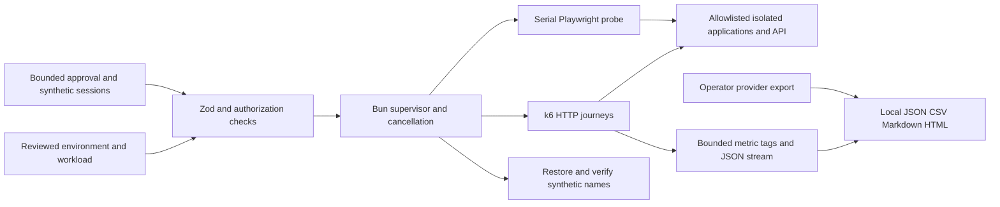

# Performance and load testing

`packages/performance` (`@scs/performance`) is an independent Bun tooling
workspace. It provides k6 HTTP workloads, small Playwright browser probes,
synthetic fixtures, guarded execution, and JSON, CSV, Markdown and static HTML
reports. No load test runs as part of ordinary `lint`, `test` or `build`.
Those commands check the framework itself. No application behavior is changed.

Only the loopback fixture is enabled in the checked-in environment allowlist.
It is a contract simulator, not the applications, Workers, D1 or providers.
Its throughput must never be reported as SCS PDN capacity. There is no
production environment or production stress-test command.

## Architecture and research



The design uses the official documentation reviewed on 2 November 2026:

- [k6 documentation](https://grafana.com/docs/k6/latest/),
  [scenarios](https://grafana.com/docs/k6/latest/using-k6/scenarios/), and
  [thresholds](https://grafana.com/docs/k6/latest/using-k6/thresholds/) inform
  the executor, custom metrics and nonzero failure exit behavior.
- [Open and closed models](https://grafana.com/docs/k6/latest/using-k6/scenarios/concepts/open-vs-closed/)
  explain why a closed workload slows its own arrivals as responses slow
  (coordinated omission). Open arrivals schedule journeys independently.
  Arrival rate is **journeys per second**, not HTTP RPS; journeys issue up to
  four requests. Attempted, completed and successful HTTP RPS are measured
  separately.
- [Dropped iterations](https://grafana.com/docs/k6/latest/using-k6/scenarios/concepts/dropped-iterations/)
  can indicate inadequate VU allocation or SUT slowdown. Drops invalidate a
  capacity run by default; the report does not automatically blame the server.
- [Large tests](https://grafana.com/docs/k6/latest/testing-guides/running-large-tests/)
  require generator resource monitoring. The supervisor samples host CPU,
  available memory and timer delay. Sustained high CPU, low memory or large
  timer delay invalidates the run. Network, descriptors and disk still need
  operator monitoring.
- [k6 browser](https://grafana.com/docs/k6/latest/using-k6-browser/) was
  considered. This framework uses [Playwright](https://playwright.dev/docs/intro)
  for a separate, bounded browser diagnostic, preserving the primary HTTP
  generator's resources. It does not run thousands of browsers.
- [Workers limits](https://developers.cloudflare.com/workers/platform/limits/)
  distinguish CPU from wall time and include memory, subrequest and connection
  limits. [D1 limits](https://developers.cloudflare.com/d1/platform/limits/)
  describe single-database serialization, query duration limits and overload
  behavior. Record the deployed account plan and configured limits before a
  capacity campaign; platform maximums are not application capacity estimates.
- [Vercel load-testing policy](https://vercel.com/kb/guide/what-s-vercel-s-policy-regarding-load-testing-deployments)
  directs customers to coordinate testing with their Vercel representative.
  Every Vercel target, including smoke, requires a recorded provider approval
  reference in this framework.
- [GitHub Actions](https://docs.github.com/en/actions) and its
  [secure-use guidance](https://docs.github.com/en/actions/reference/security/secure-use)
  inform protected environments, trusted-branch execution, least-privilege
  permissions and secret handling.

No Prometheus, hosted observability subscription, Docker or external database
is required. The k6 scripts use native
[TypeScript support](https://grafana.com/docs/k6/latest/using-k6/javascript-typescript-compatibility-mode/).
k6 strips types at runtime; the workspace's `tsc` gate checks them using
`@types/k6`. Runtime imports between k6 files use relative paths because k6
does not resolve TypeScript path aliases. Bun handles configuration,
supervision and reporting; no bundling step is needed for the k6 scripts.

## Install and verify locally

Use the repository's pinned Bun and frozen lockfile. Install
[k6 2.3.0](https://github.com/grafana/k6/releases/tag/v2.3.0) from the official
release, verifying its published checksum. Put it on `PATH` or set
`PERF_K6_BINARY` to its absolute executable path. k6 is intentionally a separate
binary, not an npm package. The runner checks its version before execution.

The `bun run` commands below work in PowerShell, Bash/Zsh/Git Bash and
interactive CMD. Set optional executable and session-file paths in the shell
that launches the command (replace these example paths):

```powershell
$env:PERF_K6_BINARY = 'C:\tools\k6.exe'
$env:PERF_SESSIONS_FILE = 'C:\private\sessions.local.json'
```

```bash
export PERF_K6_BINARY='/absolute/path/to/k6'
export PERF_SESSIONS_FILE='/absolute/private/sessions.local.json'
```

```cmd
set "PERF_K6_BINARY=C:\tools\k6.exe"
set "PERF_SESSIONS_FILE=C:\private\sessions.local.json"
```

Omit the session setting for local fixture verification; it supplies dummy
accounts automatically. For shell-dependent examples, use `cd` in Bash/CMD
where PowerShell examples use `Set-Location`.

From the repository root:

```powershell
bun install --frozen-lockfile
bun run perf:check
bun run perf:verify-local
```

`perf:check` validates configuration and runs static/framework tests without
load traffic. `perf:verify-local` starts the fixture, runs one VU for three
seconds with a 40-request budget and a 10-RPS ceiling, writes a report, and
stops the fixture. A busy local machine can legitimately invalidate a run.

With k6 and Chromium installed, `bun run --cwd packages/performance perf:verify-guards`
also checks short loopback scenarios for updates, validation, pagination, mock
integrations, open arrivals, budget exhaustion, timeout classification,
cancellation cleanup and browser journeys. It is an explicit integration
check, not part of ordinary unit tests or the smoke workflow.

For a normal two-minute local smoke:

```powershell
# Terminal one: loopback contract simulator; stop with Ctrl+C.
bun run perf:fixture

# Terminal two: inspect the effective plan, then execute it.
bun run perf:smoke --environment local --dry-run
bun run perf:smoke --environment local
```

Root wrappers execute in `packages/performance`. Relative settings and report
paths therefore resolve from that workspace. Use absolute paths when useful.
Example read-only open workload:

```powershell
bun run perf:baseline --environment local --settings config/public-open.json
```

Copy `config/settings.example.json` to an ignored `*.local.json` file for
custom workloads. Unknown fields, non-finite values, inconsistent weights and
out-of-range settings are rejected. Do not put credentials in settings files.

## Workload profiles

These are planning defaults, never authorization. Environment and approval
caps apply to the peak, including ramps. `vus`, `rate`, `seconds`, `maxRps`,
`requestBudget`, think time, mix, cache mode and SLOs are configurable.

| Profile  | Peak VUs | Peak open journeys/s |                 Total scheduled time |
| -------- | -------: | -------------------: | -----------------------------------: |
| smoke    |        2 |                    1 |                                120 s |
| baseline |       15 |                    5 |                                300 s |
| moderate |       75 |                   25 |                                600 s |
| high     |      350 |                  100 |                                600 s |
| heavy    |    1,500 |                  500 |                                600 s |
| extreme  |    5,000 |                2,000 |                  600 s, configurable |
| spike    |      350 |                  100 |                  600 s, configurable |
| soak     |       75 |                   25 | 7,200 s, configurable up to 14,400 s |
| recovery |       75 |                   25 |                  600 s, configurable |

Ordinary profiles use 10% warmup, 80% steady load and 10% cooldown. Spike and
recovery use baseline, surge, peak, settle and recovery phases. `steady: false`
phases never qualify for capacity. Closed workloads reuse sessions and use
configured think time; open workloads use ramping arrival rates and fixed
preallocated maximum VUs without end-of-iteration sleeps.

The initial mixed distribution is 30% people, 25% search, 20% projects, 15%
portal, 8% synthetic profile updates and 2% safe operations. It is a planning
assumption, not measured analytics. Checked-in public-only configurations
explicitly use 40/35/23/0/0/2; this avoids silently dropping authenticated work.

`maxRps` is k6's per-process safety ceiling, not the workload's arrival target.
The [k6 RPS option](https://grafana.com/docs/k6/latest/using-k6/k6-options/reference/#rps)
has measurement and distributed-execution caveats. Runs approaching 90% of the
ceiling in a full ten-second window are invalidated because throttling may
distort results. Choose adequate ceiling headroom within the authorization.

## Actual route coverage

Routes were traced from the application route trees, API router, auth config,
profile service, public-project service and their tests. There is no invented
public `/health`, `/api/people/search` or direct database query endpoint.

| Journey         | Implementation exercised                                     | Scope or limitation                                                                                |
| --------------- | ------------------------------------------------------------ | -------------------------------------------------------------------------------------------------- |
| `home`, `safe`  | Web `/`, Docs `/`, Web `/favicon.ico`                        | HTML and static delivery                                                                           |
| `people`        | People `/`, `/people/{synthetic identity}`                   | Shell/profile HTML; browser probe verifies interaction                                             |
| `search`        | People `/` and data `/people/v2/search.json`                 | People search is client-side; Playwright types into `Search people` and selects a synthetic result |
| `projects`      | `/browse`, `/search/{query}`, `/projects/{synthetic slug}`   | Public rendering, search and details; synthetic records must exist                                 |
| `portal`        | `/api/auth/get-session`, Portal `/user/me`, `/api/me`        | Session reuse and D1-backed current user; HTTP alone does not prove protected UI rendering         |
| `updates`       | GET, PATCH, GET `/api/me`                                    | Authorized synthetic account name update and readback; no public-profile PR creation               |
| `pagination`    | `/api/projects/v2/projects/page?limit=2` and one next cursor | Protected bounded list; published-data upstream, not a pure D1 benchmark                           |
| `validation`    | Invalid name PATCH and invalid page limit                    | Expected 400 with a permitted synthetic session                                                    |
| `authorization` | Anonymous `/api/me`                                          | Expected 401; deeper role/blacklist cases remain in API characterization tests                     |
| `rate-limit`    | Reused-session `/api/auth/get-session`                       | 429 counted separately and never a successful journey; quota behavior is not bypassed              |
| `timeout`       | Fixture `/__perf/timeout`                                    | Fault injection only, never a hosted service route                                                 |
| `integrations`  | Fixture GitHub, mailer and OAuth adapters                    | Return explicit mock/no-external-call evidence; not provider capacity                              |

Use `journey` in a settings file to select any one scenario. `mixed` uses the
configured distribution. People/project fixture lists and search queries live
in `fixtures/synthetic.json`. Normal/revalidation cache variations use request
headers; no arbitrary cache-busting URL is generated. A requested cache mode
is not proof of a cache miss.

The real API uses Better Auth/D1 and keeps its database rate limiting enabled.
`GET /api/me/proxy` can mutate state and is deliberately excluded. Git-backed
public-profile, project and course mutation routes can create durable
operations and PRs and are excluded from load journeys. Real integration
behavior remains covered by the API, GitHub App and Mailer workspace tests,
including idempotency, queue recovery, validation and mocked provider failures.

## Authorizing an isolated deployment

The repository does not establish an existing staging deployment. Maintainers
must provision one and verify its provider settings before enabling testing.

1. Deploy independently owned applications, API and a synthetic public-data
   dataset. Use a dedicated D1 database with synthetic permission and auth
   records. Configure every app's public-data URLs and the API's
   `DATA_PUBLIC_BASE_URL` to that dataset. Never modify the separate data
   repository as an implicit step of running this tool.
2. Disable outbound SMTP, GitHub and OAuth side effects through isolated
   deployment adapters and network policy. Audit server-side dependencies as
   well as browser traffic. Client allowlists cannot constrain SSR/Worker
   egress. `isolatedDependencies: true` records this operator verification;
   it does not install an egress firewall.
3. Commit reviewed bare origins and caps to `config/environments.json`.
   Hosted origins require HTTPS and a `staging`, `perf`, `test` or `preview`
   hostname component. Local origins use literal loopback IPs. Production
   names, credential-bearing URLs, paths, queries and fragments are rejected.
   Mark a mixed deployment `vercel` if any target is on Vercel.
4. Set a full deployment commit SHA. Authorize the exact origin set, revision,
   maximum VUs, RPS, duration and request count. Record the real approval in
   your change system and supply the matching record below. A typed identifier
   alone is not evidence of provider approval.
5. Review a dry run, verify synthetic sessions and rollback procedures, and
   start with the read-only smoke. Increase one dimension at a time.

Example `PERF_AUTHORIZATION_JSON` shape (replace the dates, SHAs, origins and
references with an actual approved record; this example is not authorization):

```json
{
  "id": "PERF-123",
  "approvedBy": "operator-id",
  "reference": "change-123",
  "environment": "staging",
  "revision": "0000000000000000000000000000000000000000",
  "expiresAt": "2026-01-01T00:00:00Z",
  "origins": ["https://staging.example.invalid"],
  "caps": { "vus": 5, "rps": 10, "seconds": 120, "requests": 1200 },
  "highLoad": false,
  "writes": false,
  "vercelApprovalReference": "provider-case-123"
}
```

`PERF_APPROVAL_ID` must match `id`. Approval must remain valid through the run
and cleanup. Any profile beyond smoke/baseline, or more than 25 VUs, 100 RPS,
600 seconds or 60,000 requests, requires explicit high-load approval even on
loopback. Absolute framework maxima are 10,000 VUs, 20,000 RPS, four hours and
10 million requests; stricter environment/approval limits win.

## Synthetic credentials and cleanup

`PERF_SESSIONS_JSON` is an array of synthetic records:

```json
[
  {
    "id": "student-001",
    "email": "perf-student-001@example.invalid",
    "cookie": "scs-auth.session_token=REPLACE_WITH_VALID_SYNTHETIC_SESSION",
    "originalName": "Perf Synthetic Student 001"
  }
]
```

The secure cookie name `__Secure-scs-auth.session_token` is also supported.
For larger pools, supply `PERF_SESSIONS_FILE` pointing to a local secret JSON
file instead of a large environment variable. The two inputs are mutually
exclusive.
Use valid sessions created/provisioned for isolated Better Auth accounts, not
actual student credentials, production tokens or repeated OAuth logins. The
fixture's dummy tokens work only in its simulator. Each write VU requires a
distinct account, a role allowed by `updateMe` (for example `student`), and
its declared baseline name. Read-only workloads may share a synthetic session;
record that limitation when interpreting quotas and cache effects.

Before writes, the supervisor reads each synthetic account and verifies its
identity and baseline. It reserves three control requests per account: baseline
read, restore and verification read. Each VU receives a disjoint fraction of
the remaining load request budget; exhausted partitions abort the run even
if another VU has unused quota. Redirects are disabled and no uncounted
application request retries are made. Setup and cleanup are paced within the
RPS ceiling and reported separately from load throughput.

Cleanup restores names in a `finally` path after threshold failure, cancellation
or generator failure. Failed cleanup IDs appear in `state.json` and the report.
Preparation and cleanup each have a sixty-second deadline; incomplete cleanup
invalidates the report and identifies accounts needing operator recovery.
Planning rejects account pools whose two paced cleanup requests per account,
plus one final request timeout, cannot fit the cleanup deadline. This includes
surplus supplied sessions. Supply only the needed pool; dependency latency or
failure can still exhaust the deadline even when minimum pacing fits.
Hard process termination or machine loss cannot guarantee `finally` runs.
Keep the baseline credential inventory in the operator's secret store; after a
hard kill, verify those accounts in the isolated API and restore their recorded
names before another run. Use dedicated accounts without concurrent editors.

No response bodies, cookies, OAuth secrets, browser traces or screenshots are
written to reports. The supervisor creates a temporary restricted session
file under `.cache` for k6's shared-array loader and removes it after the run.
On Windows it inherits the checkout's access controls; use a private checkout.
After a hard kill, remove any abandoned `.cache/sessions-*` credential files
after confirming the generator is stopped. k6's raw URL/error tags and raw console output are excluded. Result
directories and `*.local.json` files are ignored. Artifact uploads select only
the sanitized report outputs, not the raw stream or credential files.

## Browser probes

Install Chromium explicitly, then run against the fixture or an approved
isolated environment:

```powershell
Set-Location packages/performance
bunx playwright install chromium
Set-Location ../..
bun run perf:browser --environment local
```

`PERF_BROWSER_EXECUTABLE` can select an existing
compatible browser. Browsers run serially, with a two-minute deadline, at most
500 admitted requests and a ten-RPS ceiling, further limited by the plan.
The probe visits Web, searches/selects a People profile, browses a project,
and verifies Portal's synthetic current-user content when sessions are present.

HTTP requests, WebSockets, service workers, redirects and mutations are guarded.
An unapproved resource blocks the run instead of extending the allowlist.
To prevent redirect escape, HTTP uses a one-hop intercepted transport with
automatic redirects/retries disabled. Routing disables browser HTTP caching.
Therefore browser action/navigation and resource timings are **diagnostic**,
not native cache-enabled page-load benchmarks or HTTP capacity evidence.
`browser-steps.json` records action durations and failures.

## Cancellation and reporting

Use Ctrl+C, cancel the GitHub Actions job, or create a `CANCEL` file in the run
directory. For either engine:

```powershell
bun run --cwd packages/performance src/cli.ts cancel --run perf-YYYYMMDDHHMMSSmmm-xxxxxxxx
```

The supervisor sends an interrupt, escalates after five seconds, and attempts
cleanup. It also enforces a scheduled-duration-plus-30-seconds child deadline.
A local `.cache/run.lock` prevents simultaneous runners in one checkout. After
a crash, verify the recorded PID is stopped before removing that lock. GitHub
concurrency groups serialize hosted runs per environment across the two workflows.

Each run writes `report.json`, `metrics.csv`, `summary.md` and `report.html`.
The HTML uses inline SVG and CSS with no scripts, remote libraries or network
requests. It includes throughput, latency, errors, VUs, phase SLO comparisons,
recovery observations and explicit limitations. k6 runs also retain `plan.json`,
`state.json` and the raw JSON metric stream locally for regeneration:

```powershell
bun run perf:report --run perf-YYYYMMDDHHMMSSmmm-xxxxxxxx
bun run perf:compare --baseline C:\evidence\baseline\report.json --current C:\evidence\current\report.json
```

The default thresholds are p95 below 800 ms, p99 below 2,000 ms, unexpected
request failures below 1%, and successful completed journeys above 99%.
An explicitly configured zero failure rate or 100% journey success rate uses
an inclusive bound, so a perfect run can satisfy those settings.
Endpoint overrides apply only to their observed endpoint and missing required
endpoints fail the report. Integrity or cleanup failures prohibit capacity
claims. Expected 400/401 probes are classified separately from unexpected
errors by their scenario; expected 429s remain unsuccessful journeys.

`PASS` means the measured checks passed for that run's scope. `FAIL` means SLOs
failed. `INVALID` means execution, safety, measurement completeness, cleanup,
generator saturation or dropped-iteration constraints prevent capacity analysis.
Missing metrics are `null`, never zero. HTTP failures and complete-journey
failures are separate denominators. Closed-workload successful throughput is
not a fixed arrival target.

Capacity is the largest observed sustained **completed** RPS in an eligible
flat phase of a valid, passing run, with all configured thresholds satisfied.
It requires the configured sustained duration (60 seconds by default), at
least 100 latency samples and at least three generator resource samples.
An explicit k6 teardown marker records the end of the measurement window,
including idle time; a missing marker invalidates the run.
Fixture, browser and diagnostic runs never produce capacity. This is an
observed bound, not a proven global maximum or a count of real users. Sparse
P99 estimates and single-run comparisons have limited confidence.

Percentiles use bounded-memory logarithmic histograms with conservative
rounding of at most 1% plus 0.01 ms. Averages/extrema are exact. Timing includes
TTFB, connect, TLS, blocked, send and receive where emitted by k6; DNS is not
separately exposed. Raw streams can be large; provision disk space for high
profiles and monitor the generator while testing.

## Provider telemetry and costs

The Workers already enable invocation logs. Use existing Workers observability
and D1 metrics/query analytics for requests, CPU, query duration, rows and
overload; use Vercel observability for duration/errors and dependency logs for
queue, GitHub and SMTP failures. The framework needs no cloud credentials.
Export aggregate evidence for the run's full UTC window and attach it:

```powershell
bun run perf:report --run perf-YYYYMMDDHHMMSSmmm-xxxxxxxx --telemetry C:\evidence\provider.local.json
```

The JSON schema is `telemetrySchema` in
`packages/performance/src/config/artifacts.ts`. Supply `runId`,
`deploymentRevision`, a bounded source/change reference, `windowStart`,
`windowEnd`, and nullable totals for `workerRequests`, `workerCpuMs`,
`d1QueryMs`, `d1RowsRead`, `d1RowsWritten`, `vercelFunctionMs`, `vercelErrors`,
`thirdPartyFailures` and `actualCost`. Duration fields are aggregate milliseconds
over the window, not inferred request percentiles. Unknown fields are rejected;
the record must match the run and revision and cover the full interval.
Window totals may include background traffic; attribution is operator-owned.

Optional `requestCostPerThousand` and `maxEstimatedCost` reject plans whose
worst-case marginal request estimate exceeds the budget. Reports apply that
operator-supplied unit price to observed attempts. This is not a provider bill
or hard financial cap; database work, CPU, storage and egress are excluded.

## CI and future capacity campaigns

`performance.yml` is manual. Its local job always runs only the three-second
fixture verification, regardless of profile inputs. Hosted jobs accept only
named environments, profiles and four checked-in workload settings. They run
only on the canonical repository's `main`, use `performance-staging` or
`performance-isolated`, and require environment variable `PERF_ENABLED=true`.
Configure required reviewers and main-only deployment rules on those protected
environments. Their external configuration cannot be proven from source control.

Set `PERF_AUTHORIZATION_JSON` and `PERF_DEPLOYMENT_REVISION` as protected
environment variables; keep `PERF_SESSIONS_JSON` as an environment secret only
for authenticated workloads. The optional baseline run must be a successful
manual run of this same workflow on `main`. Downloaded reports are validated
and compared only when target, engine, configuration, fixtures and session
counts match. Default regression tolerance is 10% for P95/P99 and successful
RPS. It is a regression signal, not a statistical significance test.

`performance-smoke.yml` is a separately dispatched, read-only staging smoke.
It uses the same protections plus `PERF_SMOKE_APPROVAL_ID`. No schedule, push
trigger or pull-request event runs hosted traffic. Forks cannot reach hosted
secrets through these jobs. Hosted environments remain disabled until setup
and provider approvals are documented. Workflows have not proven a remote
run merely by passing local structural tests.

For a capacity campaign: warm the isolated deployment, run matched baselines,
increase open arrival rates in bounded steps, locate the first SLO violation,
and repeat smaller steps around that boundary. Compare closed-model VUs with
actual session counts and think time. Repeat plateaus, then test a sustainable
soak, a spike and recovery with provider telemetry. Diagnose server versus
generator limits before recommending an optimization.

Distributed load is deliberately not automated here: per-process RPS ceilings
and VU budget partitions are not a global distributed budget. A future
coordinator must divide total authorization across generators, provide unique
session/fixture partitions, synchronize windows, collect raw histograms (never
average percentiles), and verify every generator has headroom. Do not launch
multiple copies of a full authorized plan to multiply traffic.
