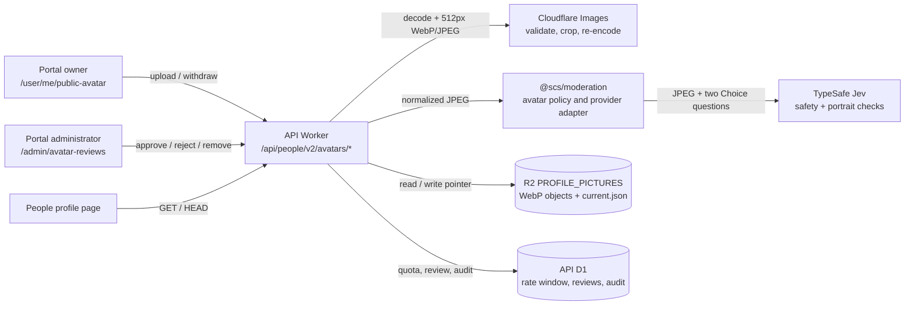
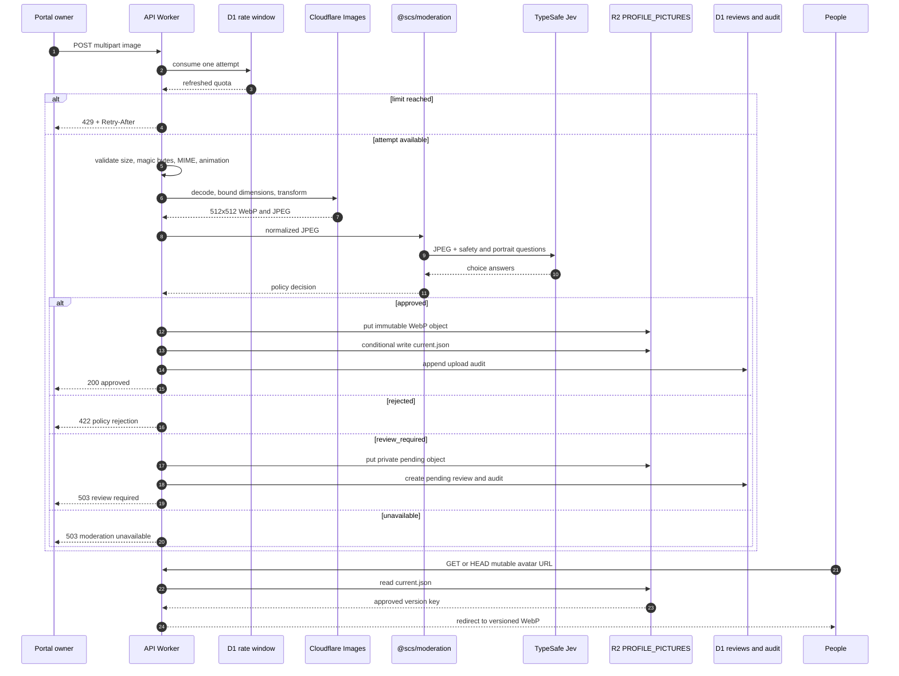
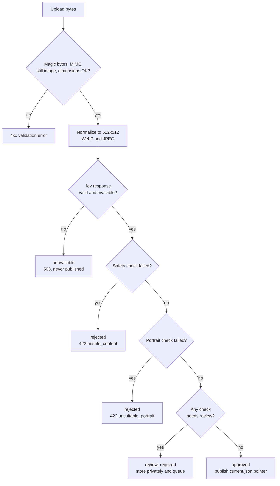
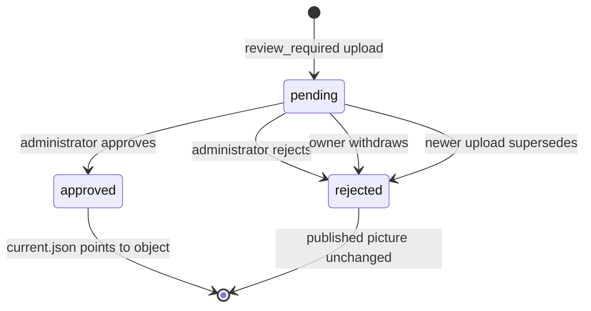

# Public profile avatars

People public profile JSON has no image URL or avatar metadata. Public profile edits
continue through the GitHub App PR workflow. Avatar writes use the API Worker and
never change GitHub profile data or Portal private profile records.
Owners upload, replace, and remove their picture at
`/user/me/public-avatar` in Portal. People profile pages display the approved
picture. While an upload is awaiting review, the owner sees the published
picture beside the pending candidate and can replace or withdraw the candidate
without removing the published picture.

## Publication flow

The API Worker is the only writer of avatar state. Portal and People call it
over HTTP; neither application receives R2 credentials or writes avatar objects
directly.

## Worker resources

Enable R2 on the Cloudflare account, create one Standard bucket named
`scs-profile-pictures`, and apply the API Worker configuration. The native
`PROFILE_PICTURES` R2 binding stores immutable WebP objects and `current.json`
pointers in the same bucket. The `IMAGES` binding decodes, resizes, and
re-encodes upload bytes. Apply `0006_public_avatar_rate.sql` and
`0007_public_avatar_moderation.sql` to the API D1 database before deployment. Set
the Worker secret `TYPESAFE_API_KEY` to a TypeSafe API key. No S3 credentials or
second metadata database are used.

The API uses [`@scs/storage`](STORAGE.md) for these objects. Native R2 remains
the default; an S3-compatible provider can be selected with Worker configuration.
Provider switching requires an explicit object migration before cutover.

The API requires a published public profile whose email matches the signed-in
member. Owners can `POST` one multipart field named `image` to
`/api/people/v2/avatars/me` (JPEG, PNG, WebP, at most 4 MiB), `GET` that route
for their canonical identity and current URL, or `DELETE` it. Public `GET` and
`HEAD` requests use `/api/people/v2/avatars/:username` and
`/api/people/v2/avatars/:username/:sha256.webp`. Missing images return 404.
The mutable URL redirects to the active content-addressed URL. All public image
responses use `Cache-Control: no-store`, including versioned URLs, because
deletion and moderation revocation must take effect without cross-region cache
purging. The immutable objects remain private in R2 and version reads are
authorized against the current pointer. The service does not claim a transaction
across image and pointer writes; an interrupted or conflicted write may leave an
unreferenced private object, which must be cleaned up only after checking all
current pointers. Pointer changes use R2 ETag conditional writes and concurrent
updates return 409. Uploads are limited to six attempts per owner per hour.

The authenticated `GET /api/people/v2/avatars/me` response includes the current
canonical identity, published URL, a nullable `pending` review candidate, and a
`quota` object with `limit`, `used`, `remaining`, `windowStartedAt`, `resetsAt`,
`retryAfterSeconds`, and `available`.
`GET /api/people/v2/avatars/me/pending?id=:reviewId` returns the private
candidate image to its signed-in owner only, and
`DELETE /api/people/v2/avatars/me/pending` withdraws the owner's pending
candidate. Withdrawal keeps the published picture and pointer unchanged.
Reading the quota never consumes an attempt. `POST` consumes one attempt before
it parses or validates the multipart body, so malformed files, oversize images,
validation failures, moderation rejections, and service failures all count
toward the hourly window. Successful uploads, validation errors, moderation
errors, and 429 responses include the refreshed quota; 429 also sets
`Retry-After`. `DELETE` does not consume an attempt. Windows start on fixed UTC
hour boundaries. Stored attempts are capped at six when reported so the UI never
shows more than the permitted limit.

An upload then moves through validation, normalization, and AI moderation before
any pointer changes:

The Worker verifies magic bytes, checks for PNG and WebP animation, uses the
Images binding to decode, bounds dimensions and pixel count, and re-encodes a
512 by 512 WebP without source metadata. It sends a JPEG rendering of the same
image through `@scs/moderation/avatar` to Jev `jev-latest` with
`TypeSafe-Danger-Zone-Images: true`. Separate
Choice questions classify safety and single-person portrait suitability in one
request. A high-confidence unsafe or unsuitable choice is rejected; uncertain
or low-confidence results need review, while malformed, timed-out, or unavailable
responses fail closed. None are published automatically. The API returns
structured moderation metadata with a `status`
of `approved`, `rejected`, `review_required`, or `unavailable`, a stable code,
a user-facing message, and per-check outcomes for safety and portrait
suitability. It does not expose raw model probabilities, confidence values, or
provider payloads. Policy rejections use HTTP 422. Review-required and
unavailable checks use HTTP 503; `unavailable` identifies a technical failure
such as a timeout, missing credential, HTTP error, or malformed provider
response and is not a policy rejection.

The moderation result is derived from the two checks as follows:

A failed check is a high-confidence negative result. An uncertain or
low-confidence check needs manual review; a malformed, timed-out, or unavailable
provider response returns `unavailable` and is neither queued nor published.
Rejections never change the published pointer.

`@scs/moderation` owns the avatar classification contract, decision policy, and
TypeSafe HTTP adapter. The API Worker injects the adapter with its
`TYPESAFE_API_KEY`; the package has no access to Worker bindings, D1, R2, or
authentication. The API retains upload validation, image transformation,
publication, audit, and administrator review. A future avatar provider implements
the exported `AvatarProvider` interface and explicitly maps its evidence to the
avatar classification contract. Its confidence and probability scores must be
reviewed against this policy before use. Other moderation domains can add their
own contracts and policies without changing avatar decisions.

## Review queue and audit history

A `review_required` upload is stored privately in R2 and registered in
`public_avatar_review` with status `pending`. It is never published until an
administrator decides it. Super administrators can:

- list pending reviews at `GET /api/admin/avatar-reviews/page`;
- preview the private pending image at
  `GET /api/admin/avatar-reviews/:id/image`;
- approve or reject at `POST /api/admin/avatar-reviews/:id` with
  `{"action":"approve"|"reject","note":"..."}`;
- inspect a member's current picture, pending reviews, upload quota, and change
  history at `GET /api/admin/users/:email/avatar`;
- remove a published picture at `DELETE /api/admin/users/:email/avatar`;
- reset a member's hourly upload count at `POST /api/admin/avatar-rate/reset`
  with `{"username":"..."}`.

Approval publishes the stored pending object through the same R2 pointer rule as
an automatic approval. If the object is missing or the pointer cannot be written,
the review returns to `pending` so the administrator can retry or reject it;
approval never publishes a pointer to an absent object. Rejection keeps the
current published picture in place. Both decisions store `reviewed_by`,
`reviewed_at`, and an optional note on the review row. Portal exposes the queue at
`/admin/avatar-reviews` and the same controls on each admin user page. Both
admin review views preview candidates with the same circle, square, and rounded
styles and expandable dialog as the owner page. Administrators can also reset a
member's hourly upload count from those views. An admin
user's public profile also links to `/admin/users/:email/public-avatar`, a
remove-only picture page where an administrator can inspect and remove the
current published picture but cannot upload a replacement.

A member has at most one pending candidate per username: a newer upload that also
needs review supersedes older pending candidates, and a newer approved upload
supersedes them as well. Only candidates submitted before the superseding request
started are cancelled, so a concurrently completing newer upload is never
discarded. The owner can keep viewing the candidate beside the published picture
until a decision is recorded. Withdrawing the candidate marks the review rejected
with the owner as the actor and records a `Withdrawn by the profile owner.` note;
the private object is deleted and the published picture is untouched.

Every owner upload, owner removal, administrator removal, review submission, and
review decision appends an immutable row to `public_avatar_audit`. Each row
records the target username, acting owner or administrator email, actor kind,
action, previous and resulting SHA-256 values, review identifier, optional note,
and timestamp. The admin user page reads the bounded history so an administrator
can see who allowed or removed a picture. Superseded pending reviews are marked
`rejected` with an audit note rather than left in the queue. Private objects are
deleted on a best-effort basis once no pointer or pending review references them.

Jev image support is experimental; its accuracy, latency, and production
reliability require live evaluation before opening uploads widely.
The official JavaScript SDK documents Node.js 22+ and optional zstd compression.
The Worker therefore uses the documented typed multipart HTTP endpoint directly,
without a Node-specific dependency or a text-only gateway.

TypeSafe's image limits currently require still PNG or JPEG, 280–1568 pixels
per side, and at most 16 MiB per image; the Worker sends a 512-pixel JPEG.
The [image documentation](https://docs.typesafe.ai/images) calls this feature
experimental. The [November 2026 price](https://help.typesafe.ai/articles/5187202169-how-much-does-jev-cost)
is $0.042 per million input tokens with output tokens free. The default account
rate limits are 100,000 tokens and 80 requests per second. These provider values
can change; the Worker enforces its own six-attempt hourly owner limit and a
15-second moderation timeout.
