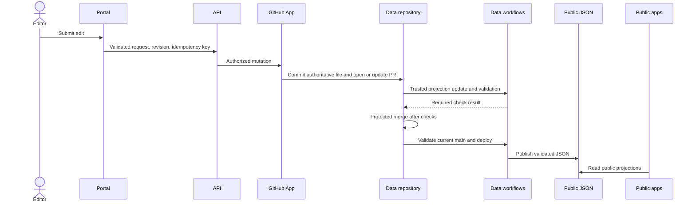

# Public data

Published records live in a separate Git repository and are served as public
JSON. This monorepo owns the schemas, readers, editing UI, API orchestration,
and GitHub automation, but not the data repository checkout itself.
See [Public data repository](PUBLIC_DATA_REPOSITORY.md) for that repository's
layout, validation, GitHub workflows, and recovery procedures.

## Read path

The People, Projects, Portal, and Web applications fetch only the collections
they own. Base URLs come from typed environment configuration. Data is parsed at
the boundary with schemas from `@scs/schemas`; malformed records should fail
clearly instead of being silently coerced into a misleading UI.

## Write path

Portal submissions are validated by the API and sent to the GitHub App. The
automation service reads current repository state, checks revisions, writes the
canonical record layout, and creates or updates a pull request. Durable
operations expose progress without holding a browser request open.
For the departmental profile, an operator promotes a validated public-data
commit to the Caddy snapshot; merging a pull request alone does not update that
snapshot. See [departmental deployment](DEPARTMENTAL_DEPLOYMENT.md).

The PR can remain open, fail validation, or close without merging. A successful
GitHub App operation means the proposed repository change completed; it does
not prove that the public JSON was deployed. The operation status reconciles
trusted PR, validation, merge, and deployment evidence. See
[Public data repository](PUBLIC_DATA_REPOSITORY.md#github-automation) for the
workflow policy and [API contracts](API_CONTRACTS.md#durable-mutations) for
status semantics.

## Rules

- Do not add compatibility readers for retired shapes; migrate canonical data
  when a contract intentionally changes.
- Do not import the separate data repository into this workspace or modify it
  unless the task explicitly includes that repository.
- Preserve optimistic concurrency and operation idempotency for retried writes.
- Keep collection reads bounded and paginated where the API exposes lists.
- Update [Schemas](SCHEMAS.md), [API contracts](API_CONTRACTS.md), and the owning
  workspace guide together.
