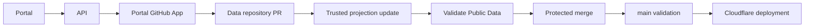

# Public data repository

The separate [data.scs.pdn.ac.lk repository](https://github.com/csc3213-2026-group-b/data.scs.pdn.ac.lk)
holds approved public JSON for people, projects, courses, and offerings. Its
Cloudflare Worker serves the published files. The monorepo owns the schemas,
editing UI, API, and GitHub App that submit changes. See [Public data](PUBLIC_DATA.md)
for the application read and write paths.

## Data layout and validation

Entity files in `public/people/v2/users`, `public/projects/v2/projects`, and the
academic `courses` and `offerings` directories are authoritative. Collection,
search, manifest, staff, student, and `by-person` files are deterministic
projections. Special-programme files retain membership while the generator
refreshes member records from authoritative users. Avatars are stored and
moderated by the API Worker in R2; public records must not contain
`profileImageUrl`.

From the data repository root, run `bun run check` for typechecking, tests,
projection freshness, data validation, formatting, and a Worker build. After
editing an authoritative entity, run `bun run generate` to refresh projections.
Focused checks are `bun run generate:check`, `bun run validate:people`,
`bun run validate:projects`, and `bun run validate:academic`.

### What the checks do

The **Validate Public Data** workflow runs on pull requests, merge-queue
candidates, selected pushes to `main`, and manual dispatch. It installs the
locked dependencies with lifecycle scripts disabled, then runs the same checks
as `bun run check` in this order:

| Check                       | Purpose                                                                                                    |
| --------------------------- | ---------------------------------------------------------------------------------------------------------- |
| `bun run typecheck`         | Typecheck the Worker, scripts, and test code.                                                              |
| `bun run test`              | Exercise data validators, projection generation, project index synchronization, and workflow trust rules.  |
| `bun run generate:check`    | Regenerate projections in check mode and fail if committed output is stale. It does not update the branch. |
| `bun run validate:people`   | Check authoritative people records and their public aggregates, search entries, and placement rules.       |
| `bun run validate:academic` | Check course and offering records and their references.                                                    |
| `bun run validate:projects` | Check project records, aggregates, people indexes, and course references.                                  |
| `bun run format:check`      | Check formatting of source, JSON, Markdown, and workflow files.                                            |
| `bunx wrangler build`       | Compile the Worker and verify its asset configuration without deploying.                                   |

The privileged projection updater is separate from this required check. It
verifies the PR author and changed paths, regenerates projections using trusted
base-branch code, formats the changed public JSON with trusted tooling, and
commits only the resulting public-data files. The recovery
workflow runs `bun run check` after generating a proposed repair. Deployment
reruns the full validation sequence for the selected current `main` commit
before publishing the Worker.

## Schema package

The data repository pins the compiled private
`@csc3213-2026-group-b/scs-schemas` package exactly in `package.json` and
`bun.lock`. After a verified monorepo `packages/schemas` change publishes a new
version, update both pins and run `bun run check`. The data repository needs
package Actions access; its workflows install with `packages: read` and a
short-lived repository token. Local installation requires `NODE_AUTH_TOKEN`
with `read:packages`. See [Schemas package](PACKAGE_SCHEMAS.md) for shell-specific
installation commands. Do not use the retired academic-domain package, a Git
URL, or a submodule as a substitute.

## Project repository indexes

Project records may include `source.indexUrl` for a repository-root
`.docs/index.json`. Public project pages can read this index dynamically, but
that does not update the data repository's projections. The manual **Sync
Project Repository Indexes** workflow scans registered indexes, applies valid
fields except `id` and `slug`, regenerates projections, and opens a validated
pull request. A missing index is skipped; other fetch or validation errors
stop the run before project files are written. Index authors can use
`"$schema": "https://api.scs-pdn.space/api/projects/v2/schemas/index.json"`
for editor validation and must omit `id` and `slug`.

```sh
gh workflow run sync-project-indexes.yml --repo csc3213-2026-group-b/data.scs.pdn.ac.lk --ref main
```

## GitHub automation



`Validate Public Data` is the stable required check for pull requests and
merge-queue candidates. It is read-only, checks generated output, and does not
rewrite a contributor's branch. The privileged **Update Public Projections**
workflow accepts only same-repository PRs opened by the portal GitHub App and
rejects changes outside the public v2 data trees. It runs generator code from
the protected base, with candidate data checked out separately. Installation
credentials are limited to the install step, and dependency lifecycle scripts
are disabled.

The App uses installation tokens for projection commits, recovery PRs, and
auto-merge. Operation-specific labels trigger auto-merge independently. If
strict branch protection marks a trusted PR behind, the App updates it using
the head SHA it already verified. An unexpected head change stops that update.
The repository's default workflow token remains read-only, apart from package
read access.

After merge, deployment accepts a successful `Validate Public Data` run for
`main` only when its SHA is still the live `main` commit. Both deployment jobs
use that immutable SHA; superseded validation events are skipped. A serialized
recovery workflow opens one `automation/public-projections` PR if `main`
contains stale projections.

## Operations and recovery

- Keep `main` protected with the required `Validate Public Data` check and
  auto-merge enabled. The existing portal GitHub App needs Contents and Pull
  requests write permission. Workflows use the repository variable
  `SCS_PORTAL_GITHUB_APP_CLIENT_ID` and secret
  `SCS_PORTAL_GITHUB_APP_PRIVATE_KEY`.
- If an eligible App PR remains open, verify its operation and `auto-merge-*`
  labels and reapply the auto-merge label to create a fresh event. Do not bypass
  the required check.
- If projections on `main` are stale, manually run **Publish Public
  Projections**. It converges on one recovery branch and PR.
- If the current validated `main` commit was not deployed, manually run
  **Deploy Public Data to Cloudflare**. It validates the selected current commit
  before deployment. A skipped superseded run is expected; inspect the newer
  validation and deployment runs.
- If private-package installation fails, check package Actions access,
  `packages: read`, the npm scope, and the exact published version.
