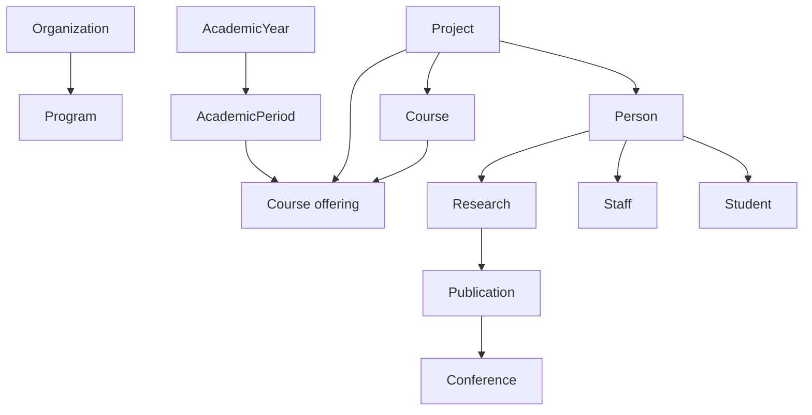
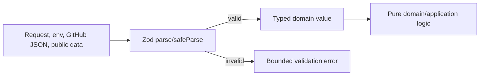

# Schemas

`@scs/schemas` is the shared runtime-contract package. It uses Zod so the same
definition validates external values and provides inferred TypeScript types.

## What Belongs Here

The package owns contracts shared by more than one workspace or repository:

- academic years, periods, organizations, programs, courses, and offerings;
- people identifiers, profiles, students, staff, research, and publications;
- projects and their people/course relationships;
- API errors, pagination, durable operations, and mutation control.

Provider credentials, Worker bindings, component props used by one app, and
internal implementation state stay with their owner.

## Package Layout

```text
packages/schemas/
  src/
    schemas/       domain and transport schemas
    index.ts       supported public exports
  tests/           accepted and rejected examples
  tsconfig.json
  tsconfig.test.json
```

Consumers import only the public package API:

```ts
import { CourseSchema, ProjectSchema, type Project } from '@scs/schemas';
```

Do not deep-import package source or create a parallel interface for the same
record. Infer types from the schema whenever the runtime and TypeScript shape
must remain identical.

## Domain Map



Dedicated identifier schemas prevent arbitrary strings from crossing domain
boundaries. Person records validate student and staff variants; staff variants
cover academic teaching, academic support, and non-academic roles.

An undergraduate `HONOURS` student must declare `honoursProgramme`. The shared
programme maps determine department ownership and any public student-directory
projection; general and postgraduate profiles cannot carry that field.

## Validation Boundaries



Validate at entry points:

- API request bodies and query values;
- GitHub-backed files and provider responses;
- public JSON loaded by applications;
- generated projection inputs and outputs;
- environment configuration;
- tests and fixtures representing external data.

Do not repeatedly parse an already validated value inside pure functions. Do
not replace runtime validation with a TypeScript assertion.

## Adding or Changing a Schema

1. Find all producers and consumers with `rg`.
2. Decide whether the change is compatible, versioned, or requires migration.
3. Add the smallest schema in the relevant domain folder.
4. Export it intentionally from `src/index.ts`.
5. Infer and export a type only when consumers need it.
6. Add accepted canonical examples and rejected boundary cases under `tests`.
7. Update API/data producers before relying on the new field in consumers.
8. Run the package gate and all affected workspace gates.
9. Update [API Contracts](API_CONTRACTS.md) or
   [Environment Variables](ENVIRONMENT_VARIABLES.md) if the boundary changed.

## Compatibility Rules

| Change                      | Typical treatment                                          |
| --------------------------- | ---------------------------------------------------------- |
| new optional field          | additive; consumers must tolerate absence                  |
| field with a safe default   | additive if every producer/consumer agrees                 |
| required field              | coordinated producer migration before consumer requirement |
| renamed or removed field    | versioned migration; do not silently reinterpret           |
| narrower enum or validation | verify all published records before rollout                |
| transport meaning change    | new version or documented compatibility window             |

Published data may outlive one application deployment. A schema change is not
safe merely because TypeScript compiles in the monorepo.

## Projection Schemas

Individual people, project, course, and offering files are authoritative.
Aggregates, manifests, search indexes, and `by-person` lists are projections.
Projection generators should validate authoritative inputs and generated
outputs, sort deterministically, remove stale derived files, and pass an
idempotence check.

## API Transport Schemas

Shared API contracts include:

- `ApiErrorEnvelopeSchema` for stable machine-readable errors;
- `PaginationRequestSchema` and page metadata for bounded lists;
- `MutationControlSchema` for idempotency and expected revisions;
- `MailerSendRequestSchema` for raw messages and named transactional templates;
- `ProxyUrlSchema` and `ProxyUpdateRequestSchema` for the Portal/API proxy boundary;
- profile, project, and course editor response and pull-request schemas;
- GitHub automation request schemas used by both the API producer and Worker;
- accepted/status/outcome schemas for durable operations.

Keep provider-specific GitHub or Cloudflare payloads behind adapters rather
than exposing them as public contracts. Environment parsing and Durable Object
storage records remain in the owning workspace because they are runtime-local,
not cross-workspace transport contracts. Consumers import shared contracts
directly from `@scs/schemas`; do not create pass-through re-export modules.

## Verification

```powershell
bun --filter '@scs/schemas' lint
bun --filter '@scs/schemas' typecheck
bun --filter '@scs/schemas' typecheck:test
bun --filter '@scs/schemas' test
bun --filter '@scs/schemas' build
```

The public-export test must change with intentional exports. After changing a
shared schema, run lint, typecheck, tests, and builds for every affected
consumer, then the root gate.
