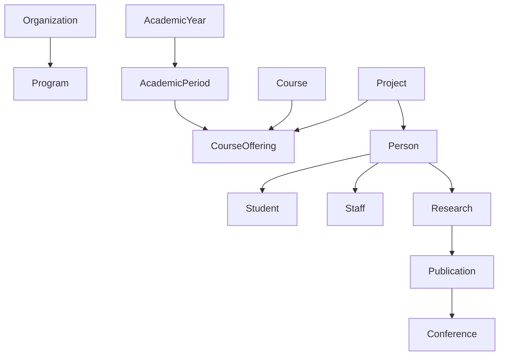

# Schemas

## Ownership

`@scs/schemas` owns shared Zod schemas and inferred TypeScript types used across
applications, services, and data validation. It is private to the monorepo in
the current baseline and exported from `packages/schemas/src/index.ts`.

The package covers:

- academic years, periods, programs, and organizations;
- people identifiers, profiles, social links, students, and staff subtypes;
- courses, course codes, staff assignments, and offerings;
- projects and their people/course relationships;
- research records, publications, and conferences.

## Import Pattern

```ts
import { CourseSchema, ProjectSchema, StaffSchema } from '@scs/schemas';
```

Use inferred types from the schema package rather than maintaining a parallel
interface for the same cross-workspace record.

## Domain Relationships



People schemas form discriminated or validated unions for student and staff
records. Staff variants include academic teaching, academic support, and
non-academic staff. Identifiers such as academic usernames and student numbers
have dedicated schemas instead of free-form strings.

Project schemas validate identity, people, status, classification, links, and
optional course-project relationships. Course offerings connect a course to an
academic period and delivery metadata.

## Validation Boundaries

Validate untrusted JSON at its entry point:

- API request bodies;
- GitHub-backed record reads;
- generated aggregate/projection inputs;
- public data consumed by applications;
- tests and fixtures.

Do not repeatedly parse already validated data inside pure domain functions.
Do not use TypeScript assertions as a substitute for runtime validation at an
external boundary.

## Compatibility

Additive compatible changes may extend schemas with optional or defaulted
fields. A change that rejects previously valid published data or alters a
required field needs a versioned migration across producers and consumers.

Shared transport contracts for errors, operations, pagination, and mutations
will also live in this package. Provider-specific environment/configuration
schemas stay within their service.

## Package Verification

```powershell
bun --filter '@scs/schemas' lint
bun --filter '@scs/schemas' typecheck
bun --filter '@scs/schemas' test
bun --filter '@scs/schemas' build
```

The public-export test must be updated when intentional exports change. Domain
fixtures should exercise both accepted canonical records and rejected boundary
cases.
