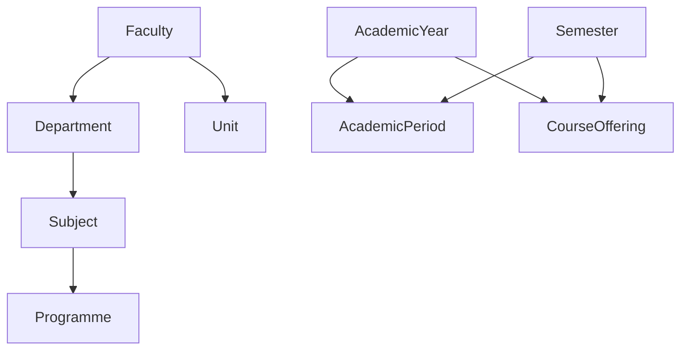

# Academic schemas

Academic schemas define canonical institutional identifiers and the rules that
connect subject selections to programmes. They are reused by people, courses,
and projects.

| Schema                           | Responsibility                                                                           |
| -------------------------------- | ---------------------------------------------------------------------------------------- |
| `FacultyCodeSchema`              | Supported faculty codes.                                                                 |
| `AcademicDepartmentCodeSchema`   | Canonical department codes.                                                              |
| `AcademicUnitCodeSchema`         | Canonical faculty-unit codes.                                                            |
| `HonoursProgrammeCodeSchema`     | Canonical honours programme codes.                                                       |
| `AcademicSubjectCodeSchema`      | Canonical subject and subject-combination codes.                                         |
| `AcademicSubjectSelectionSchema` | Unique two- or three-subject selection.                                                  |
| `AcademicDepartmentSchema`       | Department name, faculty, and honours programmes.                                        |
| `AcademicUnitSchema`             | Faculty unit identity and name.                                                          |
| `AcademicSubjectSchema`          | Subject identity, display name, and owning departments.                                  |
| `HonoursStreamSchema`            | Public alias for an honours programme code.                                              |
| `ProgramSchema`                  | Discriminated general, honours, applied-sciences, and SOR programmes with subject rules. |
| `AcademicYearSchema`             | A numeric year or consecutive `YYYY/YYYY` range.                                         |
| `SemesterSchema`                 | First or second semester identifier reused by periods and offerings.                     |
| `AcademicPeriodSchema`           | Academic year plus first or second semester.                                             |

The organization module also exports canonical maps for programme ownership,
student-directory streams, subject ownership, and the current Science faculty
department, unit, and subject lists. Those maps are data constants rather than
runtime schemas.
