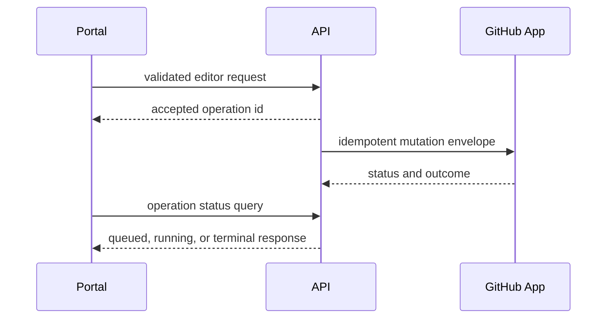
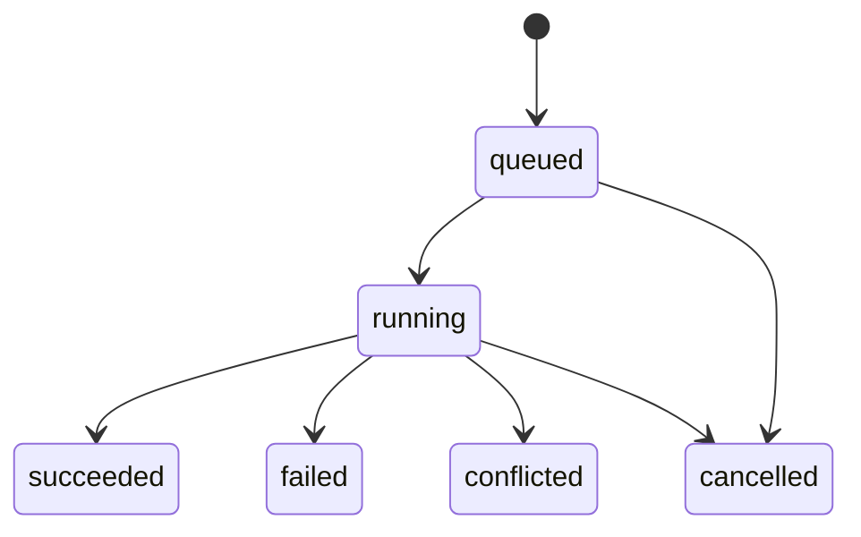

# API transport schemas

These schemas define data crossing application and service boundaries. Domain
schemas validate the records inside a request; transport schemas add actor,
revision, idempotency, status, and response semantics.

## Editor responses

| Schema                              | Responsibility                                                         |
| ----------------------------------- | ---------------------------------------------------------------------- |
| `EditorPullRequestStatusSchema`     | Pull-request and checks state exposed to editors.                      |
| `PublicProfileKindSchema`           | Editable public profile variant.                                       |
| `StudentPlacementResponseSchema`    | Locked canonical placement for undergraduate or postgraduate students. |
| `PublicProfileSchemaResponseSchema` | Profile editor permissions, identity, locked fields, and guidance.     |
| `PublicProfilePrSchema`             | Profile pull-request state and editable draft metadata.                |
| `PublicProfileResponseSchema`       | Current profile record and owning data paths.                          |
| `PublicProjectSchemaResponseSchema` | Project editor permissions, identity, and locked fields.               |
| `PublicProjectPrSchema`             | Project pull-request state, revisions, paths, and draft.               |
| `PublicProjectResponseSchema`       | Current project record, revision, and owning paths.                    |
| `PublicCourseSchemaResponseSchema`  | Course editor permission and identity response.                        |
| `PublicAcademicPrSchema`            | Course or offering pull-request state, revision, paths, and draft.     |

`createPullRequestResultSchema` validates the GitHub App's success and
pull-request envelope while preserving the specific PR schema supplied by the
caller.

## Student placement administration

| Schema                           | Responsibility                                                       |
| -------------------------------- | -------------------------------------------------------------------- |
| `StudentPlacementMetadataSchema` | Placement, alumni, postgraduate programme, and stream configuration. |
| `StudentPlacementPrStatusSchema` | Draft pull-request state for placement metadata.                     |
| `StudentPlacementPrSchema`       | Placement pull-request state, revision, and edit permission.         |

## Shared permissions

| Schema                          | Responsibility                                                        |
| ------------------------------- | --------------------------------------------------------------------- |
| `AppRoleSchema`                 | Person category used by portal authorization.                         |
| `AccessLevelSchema`             | Independent management grant, separate from person role.              |
| `ProfilePictureModeSchema`      | Supported profile picture sources.                                    |
| `CurrentUserResponseSchema`     | Authenticated `/api/me` response, including nullable provider fields. |
| `AdminUserListItemSchema`       | One administrative user list entry.                                   |
| `AdminUserPageSchema`           | Bounded administrative user list response.                            |
| `AdminUserDetailResponseSchema` | User permission detail with provider connection flags.                |

## Errors

| Schema                   | Responsibility                                                      |
| ------------------------ | ------------------------------------------------------------------- |
| `ApiErrorCodeSchema`     | Stable machine-readable error code.                                 |
| `CorrelationIdSchema`    | Opaque identifier connecting client and service diagnostics.        |
| `ConflictDetailsSchema`  | Resource and expected/actual revisions for optimistic conflicts.    |
| `ApiErrorSchema`         | Bounded error message, code, correlation id, and optional conflict. |
| `ApiErrorEnvelopeSchema` | Versioned error response envelope.                                  |

## GitHub-backed automation requests

| Schema                                         | Responsibility                                                               |
| ---------------------------------------------- | ---------------------------------------------------------------------------- |
| `getPublicProfileQuerySchema`                  | Query for one public profile by username.                                    |
| `getPublicProjectQuerySchema`                  | Query for one public project by slug.                                        |
| `getPublicAcademicRecordQuerySchema`           | Query for one course or offering by registry id.                             |
| `updateStudentPlacementMetadataRequestSchema`  | Replace canonical placement, alumni, postgraduate, and stream configuration. |
| `discardStudentPlacementMetadataRequestSchema` | Discard a placement metadata draft.                                          |
| `updatePublicProfileRequestSchema`             | Upsert one validated profile and its exact aggregate paths.                  |
| `submitPublicProfileOperationRequestSchema`    | Profile mutation plus actor, idempotency, and correlation context.           |
| `discardPublicProfilePrRequestSchema`          | Close a profile pull request at an expected head revision.                   |
| `updatePublicProjectRequestSchema`             | Upsert a project and verify its canonical record paths.                      |
| `deletePublicProjectRequestSchema`             | Delete a project using canonical paths and expected revision.                |
| `submitPublicProjectOperationRequestSchema`    | Discriminated project upsert/delete operation envelope.                      |
| `updatePublicCourseRequestSchema`              | Upsert a course at its canonical registry path.                              |
| `deletePublicCourseRequestSchema`              | Delete a course at its canonical registry path.                              |
| `updatePublicCourseOfferingRequestSchema`      | Upsert an offering at its canonical registry path.                           |
| `deletePublicCourseOfferingRequestSchema`      | Delete an offering at its canonical registry path.                           |
| `submitPublicAcademicOperationRequestSchema`   | Discriminated course/offering upsert/delete operation envelope.              |

## Mail, mutation, and operations

| Schema                          | Responsibility                                                           |
| ------------------------------- | ------------------------------------------------------------------------ |
| `MailerSendRequestSchema`       | Raw HTML/text mail or the named portal sign-in OTP template.             |
| `MailerSendResponseSchema`      | Success or bounded mailer failure response.                              |
| `IdempotencyKeySchema`          | Client key for safely retried mutations.                                 |
| `EntityRevisionSchema`          | Opaque resource revision used by optimistic concurrency.                 |
| `MutationControlSchema`         | Idempotency key and optional expected revision.                          |
| `MutationAcceptedSchema`        | Versioned asynchronous-operation acceptance response.                    |
| `OperationIdSchema`             | Durable operation identifier.                                            |
| `OperationResourceTypeSchema`   | Resource kinds handled by durable operations.                            |
| `OperationResourceSchema`       | Operation target type and identity.                                      |
| `OperationActorSchema`          | User or service actor reference.                                         |
| `OperationStatusSchema`         | Queued, running, or terminal operation state.                            |
| `OperationOutcomeSchema`        | Success, failure, conflict, or cancellation outcome.                     |
| `OperationStatusResponseSchema` | Complete status response with lifecycle timestamps and terminal outcome. |

## Pagination and proxy configuration

| Schema                                | Responsibility                                                          |
| ------------------------------------- | ----------------------------------------------------------------------- |
| `OpaqueCursorSchema`                  | Bounded opaque pagination cursor.                                       |
| `PageLimitSchema`                     | Coerced list limit from 1 through 100.                                  |
| `PaginationRequestSchema`             | Optional cursor and defaulted page limit.                               |
| `PageInfoSchema`                      | Next cursor, `hasMore`, and optional total with consistency validation. |
| `createPageSchema`                    | Factory for versioned item arrays and page metadata.                    |
| `ProxyUrlSchema`                      | Public-host HTTP(S) URL without embedded credentials.                   |
| `ProxyUsernameSchema`                 | Normalized username accepted by personal-site routes.                   |
| `ProxyResolutionResponseSchema`       | Minimal validated internal resolver response.                           |
| `ProxyUpdateRequestSchema`            | Strict proxy activation and target configuration request.               |
| `AdminProxySettingsSchema`            | Administrative proxy row, including inactive empty URLs.                |
| `AdminProxyPageSchema`                | Bounded administrative proxy page with required total.                  |
| `ProxySettingsMutationResponseSchema` | Updated proxy settings returned by successful mutations.                |

Provider SDK objects, Worker bindings, and Durable Object storage records are
service-private and are not part of this shared transport surface.
