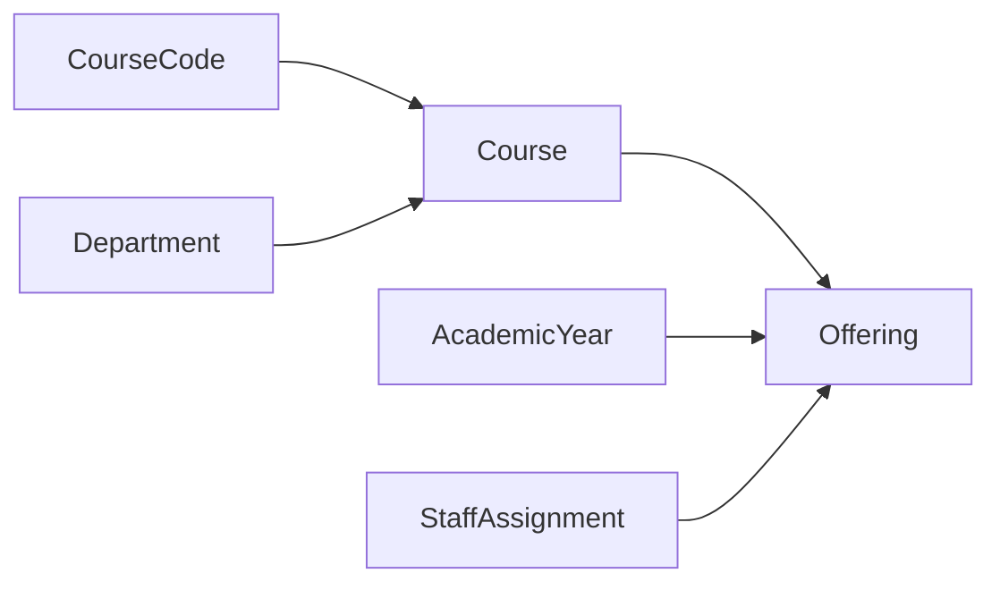

# Course schemas

| Schema                   | Responsibility                                                            |
| ------------------------ | ------------------------------------------------------------------------- |
| `CourseCodeSchema`       | Normalized department-style course code.                                  |
| `CourseIdSchema`         | Stable kebab-case course record identifier.                               |
| `CourseSchema`           | Course identity, codes, title, credits, and departments.                  |
| `CourseOfferingIdSchema` | Stable kebab-case offering identifier.                                    |
| `CourseStaffSchema`      | Academic username and teaching role assignment.                           |
| `CourseOfferingSchema`   | Course, academic year, semester, staff, and departments for one offering. |

Course records are stable catalog entries. Offerings add time and staffing
context without duplicating the course definition. A course can exist without
an offering. Its primary code is editable in the course catalog; changing it
adds the new code to the catalog's codes while previous codes remain available
as alternate codes.
