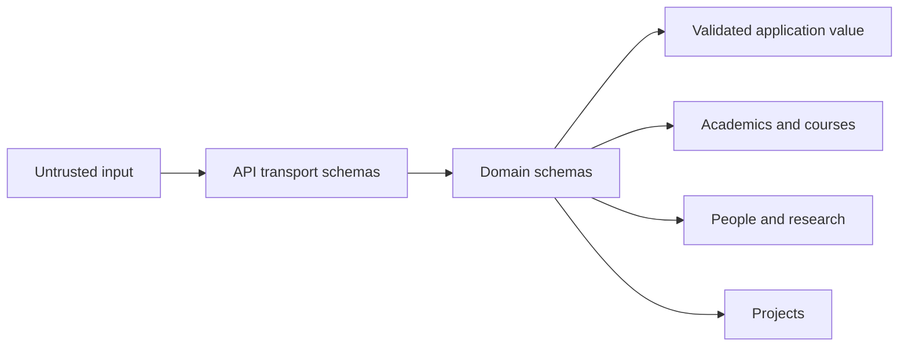

# Schema reference

This section catalogs the public runtime contracts exported by
`@scs/schemas`. Use it to find the owning domain and understand relationships;
use the source in `packages/schemas/src/schemas` for exact fields, enum values,
defaults, refinements, and inferred TypeScript types.

## Browse by domain

| Area                              | Contents                                                                                |
| --------------------------------- | --------------------------------------------------------------------------------------- |
| [Academics](ACADEMICS.md)         | organizations, subjects, programmes, periods, and years                                 |
| [People](PEOPLE.md)               | identities, students, staff, social links, and search projections                       |
| [Courses](COURSES.md)             | course records, offerings, staff assignments, and identifiers                           |
| [Research](RESEARCH.md)           | research activities, publications, and conferences                                      |
| [Projects](PROJECTS.md)           | showcase records, people roles, course context, links, media, and provenance            |
| [API transport](API_TRANSPORT.md) | editor, automation, errors, mail, mutations, operations, pagination, and proxy requests |

The catalog intentionally lists public runtime schemas, not every exported
constant or inferred type. Static organization maps and helper functions remain
documented by their owning source modules.
