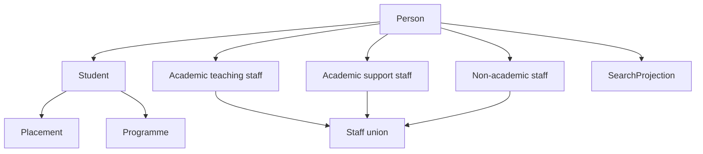

# People schemas

## Identity, profiles, and search

| Schema                        | Responsibility                                                      |
| ----------------------------- | ------------------------------------------------------------------- |
| `AcademicUsernameSchema`      | Normalized institutional username.                                  |
| `SNumberSchema`               | Canonical undergraduate or special-programme registration number.   |
| `PersonSchema`                | Common name, title, contact, and profile image fields.              |
| `PeopleSearchEntryTypeSchema` | Student or staff search-result kind.                                |
| `PeopleSearchEntrySchema`     | Search projection with identity, route, label, and keywords.        |
| `PeopleSearchIndexSchema`     | Complete array of people search entries.                            |
| `SocialIconSchema`            | Built-in icon identifier or validated external icon URL.            |
| `SocialLinksSchema`           | Normalized social-profile collection with platform detection rules. |

## Staff

| Schema                          | Responsibility                                                                        |
| ------------------------------- | ------------------------------------------------------------------------------------- |
| `AcademicRankSchema`            | Teaching-staff academic rank.                                                         |
| `AcademicTeachingStaffSchema`   | Teaching profile with department or unit, research, publications, courses, and links. |
| `AcademicSupportPositionSchema` | Supported academic-support designation.                                               |
| `AcademicSupportStaffSchema`    | Support profile with designation and department or unit.                              |
| `NonAcademicPositionSchema`     | Supported non-academic designation.                                                   |
| `NonAcademicStaffSchema`        | Non-academic profile with designation and department or unit.                         |
| `StaffSchema`                   | Discriminated union of all three staff profile variants.                              |

## Students and directory configuration

| Schema                                      | Responsibility                                                               |
| ------------------------------------------- | ---------------------------------------------------------------------------- |
| `StudentTypeSchema`                         | Undergraduate or postgraduate student kind.                                  |
| `StudentTrackSchema`                        | General or honours undergraduate track.                                      |
| `StudentLevelSchema`                        | Undergraduate level from 1000 through 4000.                                  |
| `StudentStatusSchema`                       | Current-student or alumni status.                                            |
| `PostgraduateProgrammeSchema`               | Supported postgraduate qualification route.                                  |
| `SlqfLevelSchema`                           | Supported Sri Lanka Qualifications Framework level.                          |
| `StudentStreamSchema`                       | Public directory stream code.                                                |
| `StudentPlacementSchema`                    | Batch, track, and level placement rule.                                      |
| `StudentPlacementListSchema`                | Placement rule collection.                                                   |
| `AlumniBatchSchema`                         | Alumni batch and its included tracks.                                        |
| `AlumniBatchListSchema`                     | Alumni-batch rule collection.                                                |
| `PostgraduateProgrammeDefinitionSchema`     | Programme label and framework level.                                         |
| `PostgraduateProgrammeDefinitionListSchema` | Postgraduate programme definitions.                                          |
| `StudentStreamDefinitionSchema`             | Directory label, path, and visibility for a stream.                          |
| `StudentStreamDefinitionListSchema`         | Student-stream definition collection.                                        |
| `StudentSchema`                             | Person-based student profile with programme-specific cross-field validation. |

Honours programme is required only for honours undergraduates. Special-degree
subjects are restricted to honours students at the applicable levels; the
schema is the authority for these rules, not UI inference.
