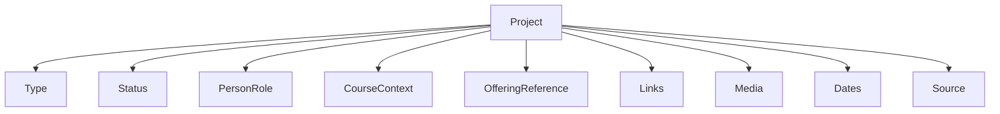

# Project schemas



| Schema                        | Responsibility                                                                      |
| ----------------------------- | ----------------------------------------------------------------------------------- |
| `ProjectTypeSchema`           | Showcase classification such as course, research, open-source, or collaboration.    |
| `ProjectStatusSchema`         | Planned, active, completed, or archived lifecycle state.                            |
| `ProjectPersonRoleSchema`     | A person's project-specific role.                                                   |
| `ProjectPersonSchema`         | Contributor identity with one explicit project role.                                |
| `ProjectLinksSchema`          | Optional repository, site, documentation, demo, data, publication, and video links. |
| `ProjectSourceSchema`         | Manual, GitHub repository, or template-index provenance.                            |
| `ProjectMediaSchema`          | Default icon and optional cover image.                                              |
| `ProjectDatesSchema`          | Start, completion, and last-update dates with ordering validation.                  |
| `ProjectCourseSchema`         | Denormalized course context displayed with a project.                               |
| `ProjectCourseOfferingSchema` | Reference to a canonical course offering.                                           |
| `ProjectSchema`               | Complete showcase record and cross-field rules.                                     |
| `ProjectIndexJsonSchema`      | JSON Schema published for repository index editor validation.                       |

A course project must reference a stable catalog course. It may also reference
one offering when it belongs to a particular academic year and semester. The
offering carries the teaching staff for that run of the course. People roles
are per project; the schema does not infer a permanent role from a person's
global profile.

Project links, the repository index URL, and the cover image require complete
absolute URLs. Relative paths such as `/images/cover.png` are invalid in
both registry records and repository indexes.

`TEMPLATE_INDEX_JSON` stores `repositoryOwner`, `repositoryName`,
`metadataPath: ".docs/index.json"`, and an optional `indexUrl` for older
records. New portal submissions persist the exact GitHub contents API URL. A
repository index is a partial project object: values absent from it stay in the
registry record. `ProjectIndexSchema` rejects `id`, `slug`, and unknown fields.
The public JSON Schema at
`https://api.scs-pdn.space/api/projects/v2/schemas/index.json` is generated
from the same Zod schema and may be used as the index's `$schema`:

```json
{
  "$schema": "https://api.scs-pdn.space/api/projects/v2/schemas/index.json",
  "title": "Example project",
  "people": [{ "name": "Example Student", "role": "contributor" }]
}
```

The index is validated on public page reads and portal previews. Its partial
fields are merged with the registry record, then the complete project contract
is checked. This final check catches cross-field rules such as required course
offering context.
