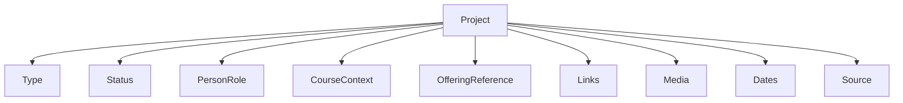

# Project schemas

| Schema                        | Responsibility                                                                      |
| ----------------------------- | ----------------------------------------------------------------------------------- |
| `ProjectTypeSchema`           | Showcase classification such as course, research, open-source, or collaboration.    |
| `ProjectStatusSchema`         | Planned, active, completed, or archived lifecycle state.                            |
| `ProjectPersonRoleSchema`     | A person's project-specific role.                                                   |
| `ProjectPersonSchema`         | Contributor identity with one explicit project role.                                |
| `ProjectLinksSchema`          | Optional repository, site, documentation, demo, data, publication, and video links. |
| `ProjectSourceSchema`         | Manual, GitHub repository, or template-index provenance.                            |
| `ProjectMediaSchema`          | Required icon and optional cover image.                                             |
| `ProjectDatesSchema`          | Start, completion, and last-update dates with ordering validation.                  |
| `ProjectCourseSchema`         | Denormalized course context displayed with a project.                               |
| `ProjectCourseOfferingSchema` | Reference to a canonical course offering.                                           |
| `ProjectSchema`               | Complete showcase record and cross-field rules.                                     |

A course project must reference an offering. People roles are intentionally
per project; the schema does not infer a permanent role from a person's global
profile.
