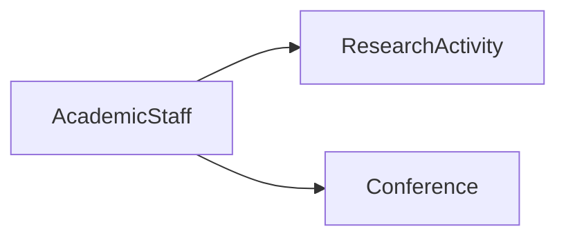

# Research schemas

| Schema             | Responsibility                                                |
| ------------------ | ------------------------------------------------------------- |
| `ResearchSchema`   | Named research activity with dates and optional public links. |
| `ConferenceSchema` | Conference name, date, location, description, and icon.       |

These are embeddable profile records. They do not model the separate project
showcase or API mutation lifecycle.
