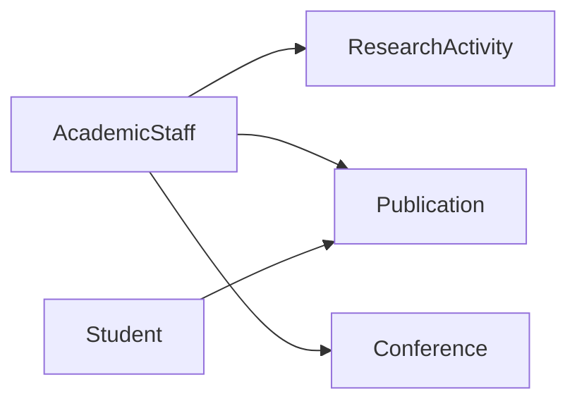

# Research schemas

| Schema              | Responsibility                                                |
| ------------------- | ------------------------------------------------------------- |
| `ResearchSchema`    | Named research activity with dates and optional public links. |
| `PublicationSchema` | Publication metadata, co-authors, DOI, and public links.      |
| `ConferenceSchema`  | Conference name, date, location, and presentation metadata.   |

These are embeddable profile records. They do not model the separate project
showcase or API mutation lifecycle.
