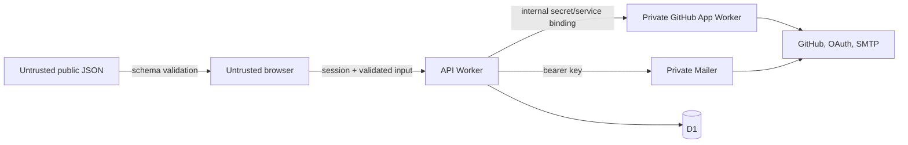

# Security

Security is a boundary property, not a final review step. This guide documents
the current trust model, required safeguards, and incident response process.

## Trust Boundaries

- Browsers and public data are untrusted.
- API authentication does not replace per-action authorization.
- The GitHub App may mutate only configured repositories through validated
  requests.
- OAuth, SMTP, GitHub, D1, queues, and hosting platforms are external
  systems whose responses and failures must be bounded.

## Data Classification

| Class    | Examples                                          | Handling                                         |
| -------- | ------------------------------------------------- | ------------------------------------------------ |
| public   | published profiles, projects, courses             | validate before rendering; no secrets            |
| internal | operation IDs, repository metadata, bounded logs  | expose only to authorized users/services         |
| private  | permission records, unpublished profile edits     | least-privilege access; do not log whole records |
| secret   | OAuth secrets, private keys, cookies, bearer keys | secret stores only; never commit or log          |

## Authentication

Better Auth is the sole Portal authentication provider. Its state lives in D1.
Enabled flows are email OTP, passkeys, Google, and GitHub. Email/password and
parallel custom JWT, OAuth, magic-code, or WebAuthn routes are not enabled.

Required properties:

- trusted origins are explicit;
- CSRF and origin checks remain enabled;
- session cookies are HTTP-only and use environment-appropriate secure and
  same-site settings;
- OAuth sign-in may link an exact email match only when both the existing local
  identity and the provider email are verified. No provider bypasses email
  verification, different-email linking remains disabled, and other links
  require an authenticated user action;
- passkey registration requires a session, user verification, allowed origin,
  and correct relying-party ID;
- verification identifiers and OTP values are not stored as reusable plaintext;
- rate limits use durable D1 state;
- protected requests re-read current permission/blacklist state.

## Authorization

- UI visibility is not authorization.
- Services verify roles, access levels, ownership, and blacklist status for
  every protected action.
- Super-admin operations guard against self-lockout and removal of the last
  super-admin where applicable.
- The API derives the actor for GitHub operations; clients do not choose an
  arbitrary operation owner.
- Internal GitHub App requests require `X-Internal-Secret`, compared in
  constant time.
- Operation reads/cancellations require the owning actor subject unless the
  authenticated API marks a trusted admin request.

## Input, Output, and Browser Safety

- Parse untrusted JSON and query values with the owning Zod schema.
- Validate entity IDs, repository paths, branch names, revisions, cursors,
  redirect targets, and operation IDs before use.
- Reject unknown route suffixes instead of turning them into file paths.
- Escape or safely render user-controlled content; do not inject raw HTML.
- Keep CORS origins and allowed headers explicit.
- Return stable bounded error codes/messages, never provider dumps or stacks.
- Keep lists paginated and request bodies size-bounded.

See [API Contracts](API_CONTRACTS.md) for status and response contracts.

## Secrets

Never commit or expose:

- OAuth client secrets;
- `BETTER_AUTH_SECRET`;
- GitHub App private keys or installation tokens;
- internal service secrets;
- mailer API keys or SMTP credentials;
- session cookies or populated environment files.

A secret removed from source or Git history is still compromised. Revoke or
rotate it at the provider, update deployment stores, and invalidate dependent
sessions or credentials.

Use [Environment Variables](ENVIRONMENT_VARIABLES.md) for configuration names.
Do not print values to prove they are configured.

## GitHub Automation

- Use an installation token with minimum repository permissions.
- Bind updates and deletes to an expected entity revision.
- Make retries idempotent before queue redelivery.
- Serialize changes to the same logical resource.
- Never force-push after a stale reference or compare failure.
- Treat branch names, labels, and PR text as signals, not authorization.
- Verify repository owner/name, base branch, actor, and mutation metadata.
- Never run untrusted pull-request code with write credentials.
- Preserve a reviewed PR/audit trail for repository changes.

## Dependencies and CI

- Use the frozen Bun lockfile and pinned Bun version.
- `bunfig.toml` enforces a minimum package release age with narrow documented
  exceptions.
- Keep GitHub Actions permissions least-privileged and use supported runtimes.
- Review dependency changes rather than applying automated updates blindly.
- Do not bypass lint, typecheck, test, or build failures with broad ignores.

## Logging and Audit

Log correlation IDs, operation IDs, bounded resource identities, state
transitions, durations, attempt counts, and provider request IDs. Redact:

- tokens, cookies, private keys, and secrets;
- raw OAuth or passkey payloads;
- complete private profiles and mutation bodies;
- email content and SMTP credentials.

GitHub PR comments are useful audit context but are not an authoritative or
private database. Durable operation state is authoritative for execution.

## Security Review Checklist

For authentication, authorization, API, or automation changes, verify:

1. trust boundary and actor identity;
2. runtime validation of every external value;
3. authorization on the service, independent of UI;
4. secret storage and log redaction;
5. idempotency and revision conflict behavior;
6. rate and size limits;
7. safe error responses;
8. tests for unauthorized, forbidden, malformed, stale, and replayed requests;
9. least-privilege provider permissions;
10. recovery and documentation updates.

## Vulnerability Reporting and Incident Response

Report suspected vulnerabilities privately to repository maintainers. Do not
open a public issue containing exploit details, secrets, or personal data.

For a suspected exposure:

1. stop further publication without destroying evidence;
2. revoke or rotate the value at the provider;
3. update deployment secret stores;
4. invalidate related sessions, tokens, or credentials;
5. inspect logs, Git history, provider audit logs, and affected operations;
6. contain or roll back the vulnerable deployment;
7. add regression tests and document the remediation without reproducing the
   secret;
8. notify affected maintainers/users through the appropriate private channel.

Operational recovery procedures are in [Operations](OPERATIONS.md).
