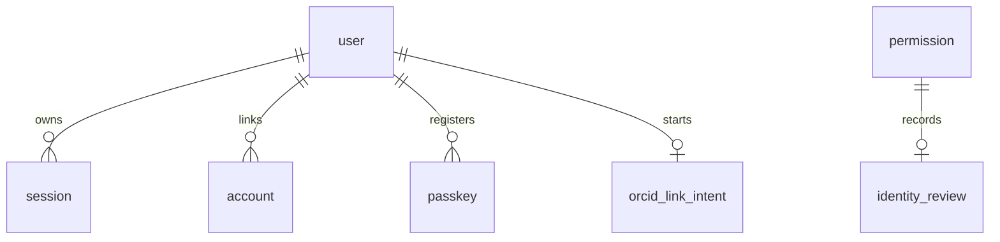
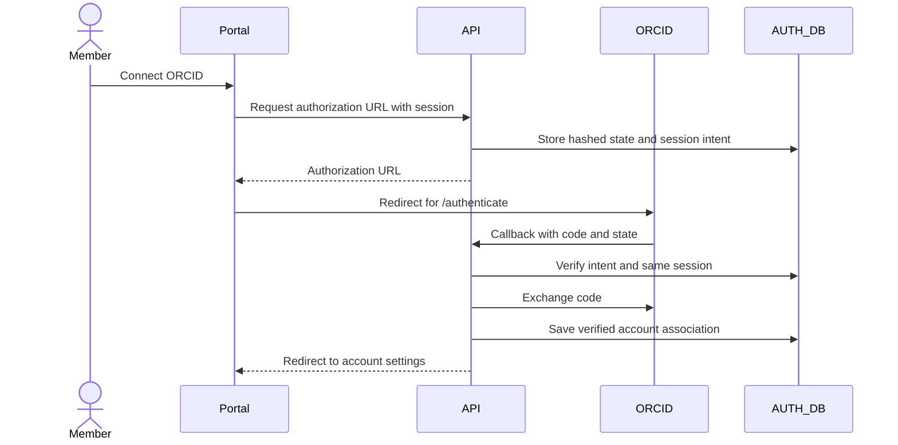

# API identity and state

The API has two related identity layers. Better Auth proves the browser
session; the `permission` table determines what that verified identity may do.
Neither provider profile data nor a session cookie alone grants an application
role.

## Authentication configuration

`createAuth` constructs Better Auth per request so it can use request-scoped
bindings, origin-derived passkey settings, and Cloudflare background tasks. It
configures:

- Google and GitHub OAuth;
- email sign-in OTPs delivered by Mailer;
- passkeys whose registration requires a session;
- encrypted OAuth tokens and database-backed OAuth state;
- hashed verification identifiers and OTP values;
- database-backed global and OTP-specific rate limits;
- secure cross-subdomain cookies in HTTPS deployments; and
- restricted account linking that requires a verified local email and does not
  allow different-email linking.

New identities must use an allowed University of Peradeniya email domain. A
linked GitHub sign-in is deliberately exempt from re-qualifying the identity
against GitHub's returned primary email, because that provider email must not
replace the established university identity.

## Session resolution

Protected handlers resolve the Better Auth session from the request cookies,
lowercase the email, then read its permission record. Missing records produce
`404`, blacklisted records produce `403`, and invalid or expired sessions
produce `401`. The normalized application role and access level are derived
from the permission record, not accepted from the browser.

An `X-Client-Id` is required where the session verifier is used. It identifies
an allowed first-party client; it is not a credential and does not replace the
session.

## D1 ownership

Migrations are append-only. The Cloudflare D1 sequence currently has nine
files; the PostgreSQL sequence has eight files with equivalent identity and
ORCID state but different numbering. See
[database portability](../../DATABASE_PORTABILITY.md) before changing either
runtime.

| Migration                           | Owned state                                                                          |
| ----------------------------------- | ------------------------------------------------------------------------------------ |
| `0001_better_auth.sql`              | users, sessions, provider accounts, verification records, passkeys, and rate limits  |
| `0002_auth_identity_uniqueness.sql` | unique provider-account and passkey credential identities                            |
| `0003_proxy_settings.sql`           | per-user proxy destination, attempt budget/window, audit fields, and revision        |
| `0004_permissions.sql`              | normalized role/access fields plus the complete JSON permission record               |
| `0005_proxy_username_lookup.sql`    | indexed username lookup for internal Web resolution                                  |
| `0006_public_avatar_rate.sql`       | hourly public-avatar upload attempt window per username                              |
| `0007_public_avatar_moderation.sql` | pending avatar reviews, reviewer identity, and append-only avatar audit history      |
| `0008_identity_review.sql`          | identity decisions and audit; Honours submission intent, history, and recovery state |
| `0009_orcid_link.sql`               | short-lived ORCID OAuth intent and one-ORCID-per-user account constraint             |

The diagram shows database foreign keys, not every query join:

`permission` is keyed by case-insensitive email rather than a foreign key to
`user`; the API resolves the signed-in email to that record on protected
requests. `identity_audit` and `honours_operation_history` retain actor and
change history without foreign keys to the Better Auth user. The ORCID account
row uses `providerId = 'orcid'` in the existing `account` table; the intent is
temporary and is removed on connect or disconnect.

The relational role and access columns support filtering and constraints; the
JSON column preserves the complete application permission shape. Repository
functions normalize stored values before exposing them.

An absent identity or Honours table is a deployment error. These routes return
`503` with `DATABASE_MIGRATION_REQUIRED`; they do not report an empty account
list or history. Apply the pending migration to the correct database before
retrying. [Operations](../../OPERATIONS.md) describes the protected migration
workflow.

## Account classification and Honours

The API derives an immutable `STUDENT` role for recognized student email
patterns. Other registered accounts start as `OTHER`. The identity review
routes list verified accounts, accept super-admin decisions with an expected
current role, and expose audit history. `PENDING` for an unreviewed `OTHER`
account and `NOT_REQUIRED` for an unreviewed non-`OTHER` account are display
states; neither is stored as a review decision. Optional Jev suggestions use
submitted evidence and do not assign roles. See
[Authentication](../../AUTHENTICATION.md) for the policy.

Honours preview reads current published profiles and verified accounts. Apply
checks a fresh matching preview, reason, confirmation, department scope, and
idempotency key. The API stores the request in `AUTH_DB` before GitHub App
acceptance. Its scheduled recovery retries pending acceptance with the same
key; history and the GitHub App operation status remain distinct. A successful
repository operation can still await PR merge and public-data deployment. See
[API contracts](../../API_CONTRACTS.md) for states and permissions.

## ORCID association

An authenticated, verified university user starts linking from an allowed
Portal origin. The API stores a hash of a one-time state, the initiating user
and session, Portal origin, and a ten-minute expiry. The callback requires that
same session, exchanges the code with ORCID, validates `/authenticate` and the
identifier, then updates the account association. OAuth access tokens are not
persisted. A failed replacement leaves the previous association in place;
disconnect removes the association and pending intent. The public username
lookup returns only the current verified identifier, with `no-store` caching.

The [People application](../../APPLICATION_PEOPLE.md) asks the API for this
association by public username and then retrieves public works from ORCID.
Legacy ORCID URLs in editable profile JSON do not prove account ownership.

## Permission invariants

- Roles describe a person's domain relationship; access levels grant
  administrative capability. Do not infer one from the other.
- A newly created Better Auth user receives a permission record only when one
  does not already exist. The default role is derived from the verified email
  policy and the default access level is `NONE`.
- Administrative updates normalize patches before persistence.
- The service protects the last super-admin boundary when updating or deleting
  permission records.
- Notification preferences are stored through the permissions repository;
  they are not auth-provider settings.

## Personal-site redirect settings

Personal-site redirect settings are D1 application state, not public-data records. Each email
has a stable username, active flag, URL, bounded remaining attempts, reset
window, audit identity, and monotonically updated revision. The service checks
the current session, target eligibility, administrator requirements, and
attempt budget before saving. Admin list routes use bounded cursor pagination.
The internal Web resolver accepts a shared server credential, returns only one
active validated HTTPS destination, and treats ambiguous usernames as not found.

## Public avatar state

Public avatar images live in R2. D1 keeps only the hourly upload window, pending
review rows, and the audit history. A review row stores the candidate SHA-256,
private object key, moderation result, status, and the administrator who decided
it. Audit rows are append-only and identify whether the owner or an administrator
performed the upload, removal, submission, or decision. The service never accepts
a reviewer identity from the request body; it derives it from the verified
super-admin session. An owner can read their own pending candidate image until a
decision is recorded and can withdraw it; withdrawal updates the review row and
audit history but leaves the published R2 pointer unchanged. Super administrators
can inspect a member's current hourly upload quota and clear the stored rate row
so the member can upload again immediately; the reset is idempotent.

## Safe schema changes

Add a new numbered migration; never rewrite an applied migration. Update the
repository mapping, environment/provider instructions when bindings change,
and characterization tests that prove old and new rows are interpreted
correctly. Deployment and rollback boundaries are documented in
[Operations](../../OPERATIONS.md).
