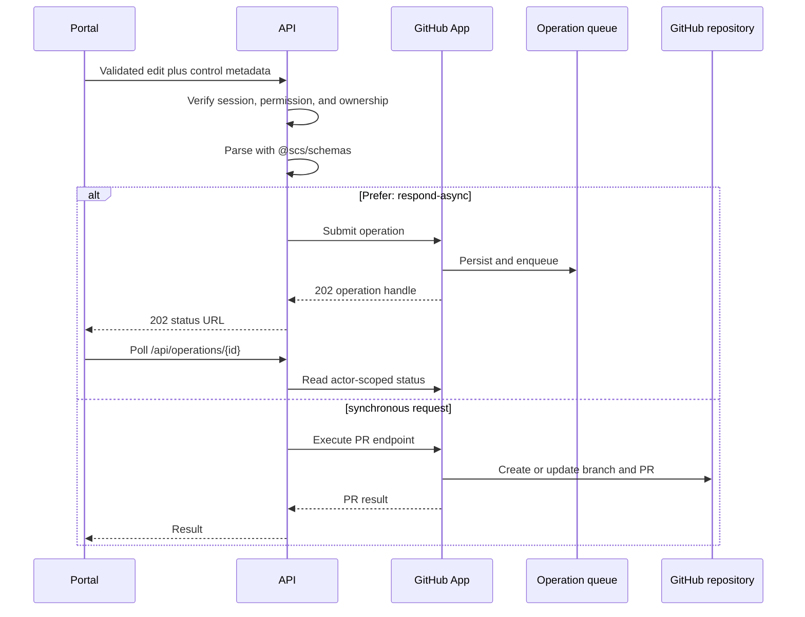

# API public-data mutations

Public data is repository-owned. The API reads published JSON for display and
validation, but sends all Git mutations to GitHub App. This keeps browser
sessions, GitHub App credentials, and repository writes in separate trust
zones.

## Common mutation flow

The asynchronous path is selected by `Prefer: respond-async`. The API uses an
explicit caller idempotency key when supplied, otherwise creates one. It hashes
the normalized actor email into an opaque subject ID and sends a fresh
correlation ID. Raw email is not used as the durable operation actor identity.

## Concurrency controls

Mutation bodies may include an `expectedRevision`. The API passes it through
to GitHub App, where it is compared with the current authoritative file
revision. A mismatch becomes a conflict that tells the editor to refresh; the
service must not silently overwrite a newer repository version.

An idempotency key identifies one actor's logical request. Reusing it with the
same input returns the existing operation; reusing it for different input is a
conflict. These controls solve different problems and should be preserved
together.

## Domain rules

| Domain                | Read and selection behavior                                                                     | Mutation authorization                                                                                                          |
| --------------------- | ----------------------------------------------------------------------------------------------- | ------------------------------------------------------------------------------------------------------------------------------- |
| profiles              | resolves published profile plus placement metadata and derives fields the editor may not choose | users edit their allowed profile kind; admins may target other users; kind-specific identity and placement fields remain locked |
| student placement     | interprets programme, stream, department, batch, alumni, and postgraduate registries            | administrative placement workflows own registry metadata rather than trusting a profile form                                    |
| projects              | lists bounded records and checks published or draft membership                                  | a non-super-admin must be a recognized project person; only super-admins delete registry projects                               |
| courses and offerings | reads individual files and bounded registries                                                   | academic users and super-admins may edit; the record `id` is locked to the route identity                                       |

The schema-description endpoints return capabilities, identity context, locked
fields, and explanatory notes so Portal can build a truthful editor. They do
not replace server authorization.

## Published reads

Published JSON URLs are constructed from `DATA_PUBLIC_BASE_URL` and fixed path
families. Services parse fetched data before using it for authorization or
metadata interpretation. A public endpoint returning malformed data is an
upstream failure, not permission to accept an unvalidated edit.

## Operation status and cancellation

`/api/operations/{id}` proxies GitHub App status and cancellation. The API
derives the actor subject from the current session and forwards it in a trusted
internal header. GitHub App uses that subject to prevent one user from reading
or cancelling another user's operation. Terminal status and outcome shapes are
defined in `@scs/schemas` and described in
[API contracts](../../API_CONTRACTS.md).

## Adding a new mutable domain

Define the shared transport and domain schema first, then add API authorization
and validation, a GitHub App resource/action and repository implementation,
operation compatibility tests, and Portal handling for queued, running,
succeeded, conflicted, failed, and cancelled outcomes. A browser route must
never bypass the API to reach GitHub App.
