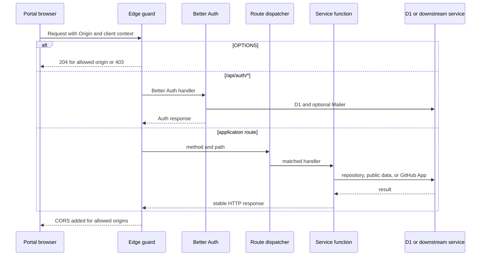

# API request lifecycle

Every request enters `src/index.ts`. The Worker first associates the request
with its Cloudflare `ExecutionContext` so Better Auth background work can use
`waitUntil`. `handleWorkerRequest` then handles preflight policy and contains
uncaught errors.

## Edge and dispatch rules

- Allowed origins and client identifiers are central constants in
  `src/config/client.config.ts`.
- Preflight accepts only configured origins. Normal responses receive CORS
  headers only for configured origins.
- Better Auth owns `/api/auth` and every path below it before the application
  route table is consulted.
- The application dispatcher compares the HTTP method and then an exact or
  prefix path. A known path with a wrong method is `405`; an unknown path is
  `404`.
- An uncaught handler error is logged server-side and becomes a generic `500`.
  Provider details and secrets are not returned to the browser.

The exact public route families remain in
[Route reference](../../ROUTE_REFERENCE.md); `src/routes/index.ts` is the final
authority when routes change.

## Handler responsibilities

A service function normally performs these steps in order:

1. Resolve and verify the Better Auth session.
2. Load the permission record and reject missing or blacklisted identities.
3. Enforce role, access-level, ownership, and resource-specific rules.
4. Parse path, query, and JSON input with the owning shared schema.
5. Read D1/public JSON or call an internal service.
6. Convert the result into the established response contract.

Moving authorization after a provider call would expose timing and consume
provider capacity for a request that should have been rejected locally.

## Pagination

Bounded list endpoints use the helpers in `src/pagination/cursor.ts`. The
cursor is an opaque, versioned base64url payload containing the last sort key.
The parser bounds page size and rejects malformed cursors. The paginator sorts
by a stable key, returns only the requested window, and emits the next cursor
when more data remains. Callers must treat cursors as opaque; changing their
payload is a versioned contract change.

## GitHub App transport

`callGithubApp` adds the internal secret and a correlation ID, applies a
10-second default timeout, and prefers the private service binding when one is
present. It recognizes versioned and plain error bodies returned by the
service, then maps transport failures to:

| Condition                    | API response                                  |
| ---------------------------- | --------------------------------------------- |
| upstream timeout             | `504` with `github_app_timeout`               |
| network or binding failure   | `502` with `github_app_unavailable`           |
| non-JSON successful response | `502` with `github_app_invalid_response`      |
| upstream non-success         | same status with a sanitized message and code |

Application handlers never expose `GITHUB_APP_INTERNAL_SECRET` or construct
GitHub credentials.

## Change checklist

When adding a route, update the route table, validate at the service boundary,
reuse a shared schema when data crosses workspaces, add success and rejection
characterization tests, and update
[API contracts](../../API_CONTRACTS.md) in the same commit.
