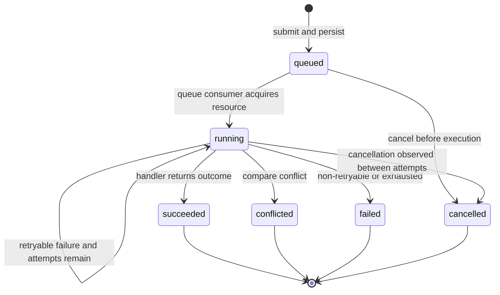

# GitHub App durable operations

The durable operation layer separates accepting a change from completing its
GitHub calls. It persists enough information to return status, detect duplicate
submissions, recover queue delivery, and prevent concurrent edits to the same
logical resource.

## Submission and identity

An operation command contains an idempotency key, actor, resource, action,
payload, and correlation ID. `OperationExecutor.submit` derives:

- `operationId` from a canonical SHA-256 digest of actor plus idempotency key;
  and
- `idempotencyHash` from actor, action, resource, and payload.

The canonicalizer sorts object keys recursively before hashing. Repeating the
same logical command therefore resolves to the existing record. Reusing the
same actor/key pair for different input raises an idempotency conflict instead
of executing a different mutation under the old identity.

## State storage

In Cloudflare, each operation ID names one `OperationStateDurableObject`. Its
SQLite table stores one schema-validated operation JSON record. Creation is
first-write-wins, every save is revalidated, and an already requested
cancellation is preserved across later saves.

The stored record includes attempt counts, maximum attempts, timestamps,
outcome, last error category, and cancellation intent. Terminal records must
have both `completedAt` and an outcome before they can be converted to the
public status response.

Local Bun execution uses the same `OperationStore` interface with an in-memory
implementation. That mode is for development: process restarts discard status,
and it is not a durability substitute.

For a self-hosted profile, `PostgresOperationStore` implements the same
interface using the existing `pg` driver. The dedicated migration
`services/github-app/migrations/postgres/0001_operation_state.sql` creates a
PostgreSQL table with a primary key on operation ID and a JSONB record. Apply
it once to a dedicated schema before starting workers; the application does
not create tables at runtime. The PostgreSQL adapter is not imported by the
Cloudflare Worker or the current local Bun entry point.

PostgreSQL creation uses `INSERT ... ON CONFLICT DO NOTHING`; the unique index
decides the winner across processes. Saves and cancellation requests use row
locks in transactions. A save also preserves the database's cancellation flag
in its conflict update, including a race with a previously absent row. Reads
and writes validate records with the existing `OperationRecordSchema`.
Operation status, attempts, outcome, timestamps, and metadata persist across
store and process recreation. Job delivery remains a separate responsibility.
The self-hosted composition must construct the store with
`{ dispatchOutbox: true }` after applying `0002_operation_dispatch_outbox.sql`.
Each first creation then inserts one outbox row in the same transaction as
the operation. Without that option, the store retains the Phase 3
persistence-only behavior and cannot provide durable dispatch.

To move existing Cloudflare operations to PostgreSQL, stop new submissions and
queue consumers, export the validated operation JSON for every operation ID,
and import each ID and JSON record into the new table in a reviewed migration.
Check record counts, IDs, statuses, cancellation flags, outcomes, and a sample
of pending and terminal operations before enabling the new profile. The
Durable Object namespace does not expose a global list of operation IDs, so
the handover needs an authoritative ID inventory or a separate export path.
Changing the store configuration alone does not migrate records.

Live tests require `POSTGRES_TEST_URL` for an isolated PostgreSQL 17 database.
They create and drop a random schema, exercise two independent pools, and
skip when no test URL is provided. Do not point this variable at production.

## Resource serialization

Execution uses the canonical key `{resource.type}:{resource.id}`. One
`MutationCoordinatorDurableObject` exists per key and owns a single lease row.
The production coordinator requests a lease of at most five minutes, runs the
handler, and releases only a lease owned by that operation. An unexpired lease
makes the consumer retry shortly; unrelated resource keys proceed in parallel.

This resource lock complements Git compare-and-swap. The lock orders work
inside this service, while the Git ref check detects a writer outside the
service or a stale branch head.

For a self-hosted profile, `PostgresMutationCoordinator` uses a
session-level PostgreSQL advisory lock per canonical resource key. It hashes
the key to a signed 64-bit lock ID. A hash collision can cause unrelated
resources to contend, but cannot let two writers hold the same lock. The
coordinator checks out one dedicated `pg` connection for the whole task,
immediately returns `MutationResourceBusyError` on contention, and unlocks on
success or an ordinary task error. PostgreSQL releases the lock when a session
ends, including a process crash. There is no lease expiry during a long task
and no new schema migration. Use direct database sessions or session pooling;
transaction pooling cannot preserve a session-level lock across the task.

The coordinator monitors connection errors and sends periodic queries on the
same connection, by default every five seconds with a five-second query
timeout. It aborts the task signal and rejects with
`MutationCoordinationLostError` if the session fails. `OperationExecutor`
checks that signal before each attempt and before and after state writes, and after a handler
returns, so it does not record a false success after observed lock loss.
Pool connection acquisition should have a deployment-specific timeout; a
held resource lock itself never waits because acquisition uses
`pg_try_advisory_lock`.

An already-running GitHub request cannot be cancelled or fenced by the current
`runExclusive()` and handler interfaces. If the database session disappears
mid-request, PostgreSQL releases the advisory lock and a second process may
start work while the first request is still in flight. The first coordinator
reports failure, but the external call may have taken effect. GitHub writes
therefore retain the existing expected-ref check and non-forced ref update;
workers must preserve those revision checks and treat a lost lock as a retryable
delivery failure, not proof that no side effect occurred. A lease table without
a downstream fencing token would have the same gap and would add expiry races.
Strict prevention of all overlapping external side effects requires a
provider-enforced fencing mechanism beyond this phase.

## Queue and retry behavior

`OperationDispatcher` is the narrow producer contract used by the executor.
Cloudflare Queues and the local development microtask retain their existing
delivery behavior through this contract.

On the first successful create, the executor dispatches the operation ID to
`OPERATION_QUEUE`. The queue consumer reconstructs the production executor and
processes a batch concurrently:

- resource-busy failures retry after one second;
- other consumer failures are logged by category and returned to Queue retry;
- a completed executor call acknowledges the message; and
- Wrangler sends repeatedly failed messages to the configured dead-letter
  queue after the queue retry limit.

Inside an operation, classified retryable GitHub errors use exponential delay
starting at 250 milliseconds, respect a larger provider `Retry-After`, and cap
the delay at 30 seconds. The executor default is three attempts. Provider queue
retries and operation attempts are separate layers; the terminal operation
record prevents already completed work from running again.

### Self-hosted PostgreSQL queue

The self-hosted adapter uses pg-boss 12 and PostgreSQL 17. pg-boss owns job
claims, retries, retention, heartbeats, dead-letter routing, and its own
schema. The application owns only `operation_dispatch_outbox`, which closes
the operation-create/dispatch gap. `OperationDispatcher` remains the only
producer dependency of the executor; handlers do not import pg-boss. The
Cloudflare Worker does not import the PostgreSQL queue module.

Apply the two reviewed application migrations and the pg-boss schema before
starting the runtime. The deployment migration command applies the two SQL
files and invokes pg-boss's official migration CLI. Grant its database role
schema migration privileges; runtime workers need only operational rights.
The runtime calls `preparePostgresOperationQueues` before accepting submissions
or starting `PostgresOperationWorker`. Review pg-boss schema upgrades
independently of the two application migrations. Use direct PostgreSQL sessions or session pooling
for the operation coordinator. Queue workers need network access to both
PostgreSQL and GitHub. The Bun entry point now composes the PostgreSQL store,
session advisory-lock coordinator, pg-boss producer and worker, and outbox
recovery. It checks the two reviewed operation migrations before marking
`/readyz` ready.

The producer publishes immediately after an operation is committed. A
publish failure is returned to the caller and leaves a pending outbox row.
The worker scans pending rows on startup and every five seconds, up to 100
per pass. Each row is locked before publishing. A stable UUID for the
operation prevents a second live job when a publish succeeds but the outbox
commit fails. If pg-boss has already purged that UUID, a later publish is
safe because the executor skips terminal operations. Multiple workers may
scan the outbox concurrently; the row lock serializes each publish. Monitor
pending outbox age and worker health, since an absent worker means no recovery.

The queue retries thrown execution failures, including resource contention,
up to 20 times with backoff capped at 30 seconds. Heartbeats are expected
every 30 seconds and the active job expiration is 15 minutes. Exhausted jobs
go to `github-operations-dead-letter`; inspect the job and operation record
before using pg-boss `redrive`. A handler that records a terminal application
failure completes the queue job, matching Cloudflare behavior. A cancelled
operation is also a harmless terminal delivery. Job delivery is at least
once, so operation status checks, PostgreSQL coordination, and GitHub revision
checks remain required. If a worker dies, pg-boss retries its active job after
expiration or a missed heartbeat. The operation may have completed a GitHub
call before the crash; the existing GitHub expected-ref check limits stale
writes. An in-flight call cannot be strictly fenced after connection loss.

To migrate existing PostgreSQL operations into this delivery path, stop
producers and old consumers, apply the outbox migration, and review all
nonterminal operation records. Insert one outbox row for each operation that
still needs execution, using `ON CONFLICT DO NOTHING`; verify counts and
statuses before starting workers. Do not backfill terminal records. Retain
the old queue until all its in-flight deliveries are accounted for. Moving
Cloudflare Durable Object records or Cloudflare Queue messages requires a
separate inventory/export process; changing configuration does not move them.

## Cancellation

Cancelling a queued operation moves it directly to terminal `cancelled` state.
Cancelling a running operation records `cancellationRequested`; the executor
observes that flag between attempts. It cannot interrupt a GitHub API call that
is already in flight, so cancellation means “stop at the next safe boundary,”
not transactional rollback of a completed provider call.

## Structured observability

Executor logs include event, operation ID, correlation ID, resource type and
ID, action, attempt, and error category where relevant. Payload content,
credentials, and actor email are deliberately absent. Use the correlation ID
to connect API and GitHub App evidence without logging sensitive fields.
