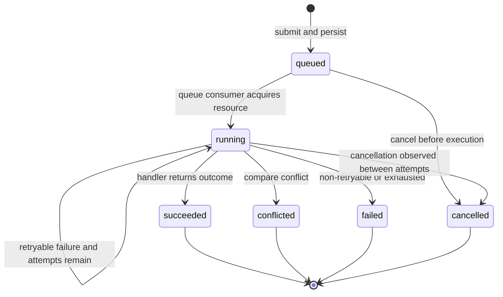

# GitHub App durable operations

The durable operation layer separates accepting a change from completing its
GitHub calls. It persists enough information to return status, detect duplicate
submissions, recover queue delivery, and prevent concurrent edits to the same
logical resource.

## Submission and identity

An operation command contains an idempotency key, actor, resource, action,
payload, and correlation ID. `OperationExecutor.submit` derives:

- `operationId` from a canonical SHA-256 digest of actor plus idempotency key;
  and
- `idempotencyHash` from actor, action, resource, and payload.

The canonicalizer sorts object keys recursively before hashing. Repeating the
same logical command therefore resolves to the existing record. Reusing the
same actor/key pair for different input raises an idempotency conflict instead
of executing a different mutation under the old identity.

## State storage

In Cloudflare, each operation ID names one `OperationStateDurableObject`. Its
SQLite table stores one schema-validated operation JSON record. Creation is
first-write-wins, every save is revalidated, and an already requested
cancellation is preserved across later saves.

The stored record includes attempt counts, maximum attempts, timestamps,
outcome, last error category, and cancellation intent. Terminal records must
have both `completedAt` and an outcome before they can be converted to the
public status response.

Local Bun execution uses the same `OperationStore` interface with an in-memory
implementation. That mode is for development: process restarts discard status,
and it is not a durability substitute.

## Resource serialization

Execution uses the canonical key `{resource.type}:{resource.id}`. One
`MutationCoordinatorDurableObject` exists per key and owns a single lease row.
The production coordinator requests a lease of at most five minutes, runs the
handler, and releases only a lease owned by that operation. An unexpired lease
makes the consumer retry shortly; unrelated resource keys proceed in parallel.

This resource lock complements Git compare-and-swap. The lock orders work
inside this service, while the Git ref check detects a writer outside the
service or a stale branch head.

## Queue and retry behavior

On the first successful create, the executor dispatches the operation ID to
`OPERATION_QUEUE`. The queue consumer reconstructs the production executor and
processes a batch concurrently:

- resource-busy failures retry after one second;
- other consumer failures are logged by category and returned to Queue retry;
- a completed executor call acknowledges the message; and
- Wrangler sends repeatedly failed messages to the configured dead-letter
  queue after the queue retry limit.

Inside an operation, classified retryable GitHub errors use exponential delay
starting at 250 milliseconds, respect a larger provider `Retry-After`, and cap
the delay at 30 seconds. The executor default is three attempts. Provider queue
retries and operation attempts are separate layers; the terminal operation
record prevents already completed work from running again.

## Cancellation

Cancelling a queued operation moves it directly to terminal `cancelled` state.
Cancelling a running operation records `cancellationRequested`; the executor
observes that flag between attempts. It cannot interrupt a GitHub API call that
is already in flight, so cancellation means “stop at the next safe boundary,”
not transactional rollback of a completed provider call.

## Structured observability

Executor logs include event, operation ID, correlation ID, resource type and
ID, action, attempt, and error category where relevant. Payload content,
credentials, and actor email are deliberately absent. Use the correlation ID
to connect API and GitHub App evidence without logging sensitive fields.
