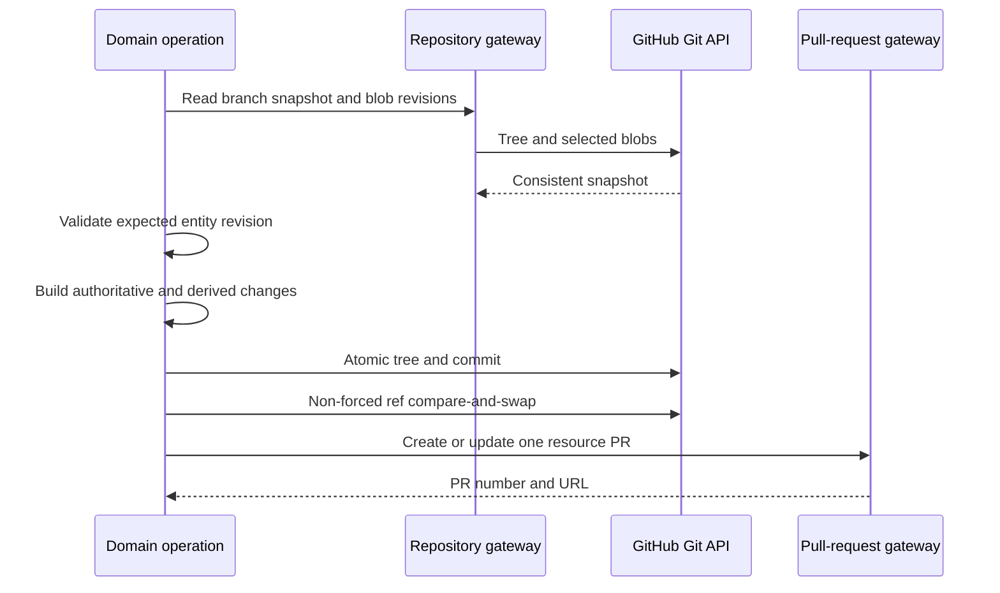

# GitHub App repository mutations

The mutation layer treats the default branch as published state and a
resource-specific branch plus pull request as the editable draft. A successful
operation returns the new authoritative file revision and, when review is
needed, pull-request identity.

## Git primitives

`RepositoryGateway` reads the default branch and takes a recursive tree
snapshot. It fetches only requested blobs and returns both decoded content and
blob SHAs. A truncated recursive tree is rejected because silently treating a
missing entry as absent could delete or overwrite valid data.

`createAtomicCommit` applies its requested paths through one Git tree and one
commit, then advances the branch ref with `force: false`. It first verifies the
branch still equals `expectedParentSha` and translates a failed non-forced ref
update into `RepositoryConflictError`. The current durable profile, project,
course, and offering repositories request their authoritative record only.

## Entity revisions

The revision exposed to callers is the authoritative file's blob SHA, or the
explicit `missing` sentinel when no file exists. Before changing content, a
domain repository compares the caller's `expectedRevision` with the snapshot.
A mismatch becomes a typed conflict and ultimately a terminal `conflicted`
operation with expected and actual revisions.

If an existing open draft already contains the requested content, the service
updates PR metadata and labels without creating a redundant commit. A delete of
an already missing academic record is similarly a successful no-op.

## Pull-request discovery

Current domain repositories embed an `scs-operation` metadata block in the PR
body. The shared gateway parses operation ID, resource type, and resource ID,
then searches bounded pages of open PRs newest first. Some established
repository workflows also recognize their canonical branch prefixes so an
existing resource PR is reused rather than duplicated.

Pull requests receive domain and action labels used by the separate data
repository's review and automation policy. This service creates or updates the
proposal; source control and repository rules decide whether and when it is
merged.

## Authoritative and derived files

The service currently contains two controller paths with different write
scope. Their distinction is part of the behavior and must be preserved or
removed deliberately:

| Domain             | Durable operation repository                                                       | Direct PR repository                                                                                        |
| ------------------ | ---------------------------------------------------------------------------------- | ----------------------------------------------------------------------------------------------------------- |
| profile            | commits only the authoritative person file; lists target aggregates in PR metadata | writes the person file, reconciles kind, department, and batch aggregates, and regenerates the search index |
| project            | commits or deletes only the authoritative project file                             | writes or deletes the project and reconciles the aggregate, manifest, and affected per-person indexes       |
| course or offering | commits or deletes the authoritative academic record                               | manages the corresponding course or offering PR workflow                                                    |
| student placement  | no durable operation handler                                                       | coordinates the placement registry files                                                                    |

Profile and project projection functions are pure and independently tested.
The direct repositories use them to normalize keys, remove stale membership,
add current membership, and sort output deterministically. Project
reconciliation covers the union of previous and next usernames so removed
contributors do not retain stale index entries.

Do not assume an accepted durable operation has already regenerated derived
indexes. Repository automation or a later service change must own that step
explicitly, and its verification belongs with that owner.

## GitHub error classification

Provider errors are classified before the executor decides whether to retry:

| Category                     | Typical condition                              | Retry behavior                  |
| ---------------------------- | ---------------------------------------------- | ------------------------------- |
| `not_found` or `missing_ref` | missing provider object or ref                 | terminal                        |
| `compare_conflict`           | branch head changed or non-fast-forward update | terminal conflict               |
| `validation`                 | other GitHub `422`                             | terminal                        |
| `primary_rate_limit`         | exhausted primary quota                        | retry, respecting `Retry-After` |
| `secondary_rate_limit`       | abuse or secondary limit                       | retry, respecting `Retry-After` |
| `transient_server`           | GitHub `5xx`                                   | retry                           |
| `unknown`                    | unclassified error                             | terminal                        |

Never classify all `422` responses as retryable: missing refs, compare
conflicts, and invalid input require different operator or caller actions.
