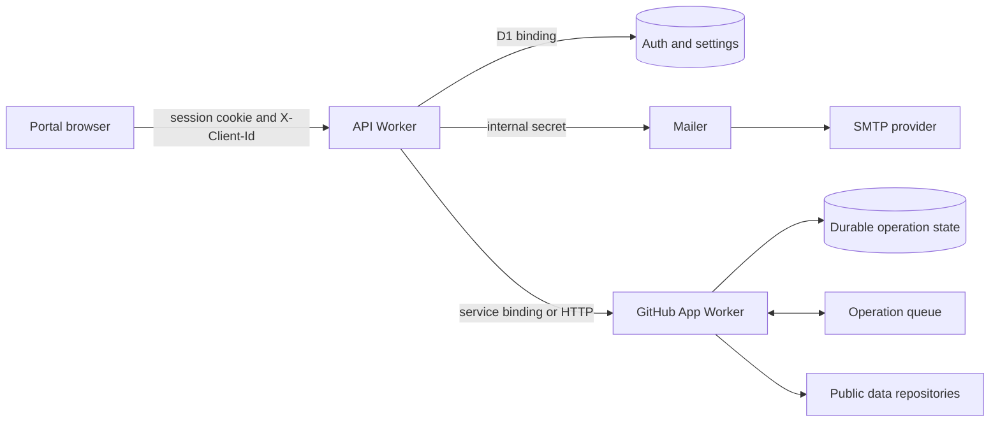

# Service internals

The three backend services form a trust chain, but each remains independently
deployable and owns a different kind of state.

| Service                           | Public trust boundary                  | State it owns                                 | Main downstream dependency |
| --------------------------------- | -------------------------------------- | --------------------------------------------- | -------------------------- |
| [API](API/INDEX.md)               | authenticated Portal requests          | Better Auth, permissions, proxy settings      | GitHub App and Mailer      |
| [GitHub App](GITHUB_APP/INDEX.md) | internal API requests only             | durable operation records and resource leases | GitHub repositories        |
| Mailer                            | internal bearer-authenticated requests | no application database                       | SMTP provider              |

The [API contracts](../API_CONTRACTS.md) page is the canonical transport
reference, [Environment variables](../ENVIRONMENT_VARIABLES.md) is the
configuration inventory, and [Operations](../OPERATIONS.md) owns deployment and
recovery procedures. These service guides explain how the implementation joins
those pieces together.
