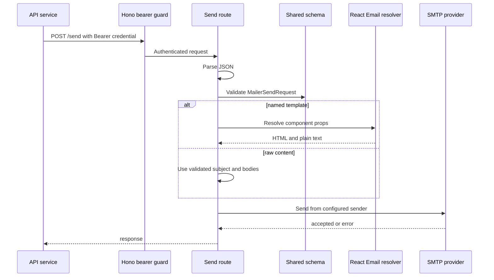

# Mailer delivery pipeline

The only mail mutation route is `POST /send`. Hono applies bearer
authentication to the entire `/send` path before the route parses content.
`MAILER_API_KEY` is a service credential shared with the API, not an end-user
token.

## Boundary order

1. The bearer middleware rejects an invalid internal credential.
2. The route parses JSON; malformed JSON returns `400`.
3. `validateSendBody` applies `MailerSendRequestSchema.safeParse` and replaces
   the input object's fields with normalized schema data.
4. `resolveMailMessage` selects the named template or accepts the already
   validated raw message.
5. `sendMail` adds the configured sender and awaits Nodemailer.

Validation occurs before template rendering or SMTP work. The first schema
issue becomes the bounded client error. Unknown routes use the shared Mailer
response shape with `404`.

## Transport reuse

The Nodemailer transporter is created once when the module loads. Warm requests
reuse it rather than constructing a new transport for every message. Port is
derived from `SMTP_SECURE`: secure transport uses `465`, otherwise `587`.
Authentication uses `SMTP_USER` and `SMTP_PASS`; the sender is `SMTP_FROM` or,
when omitted, `SMTP_USER`.

This is transport reuse, not a durable delivery queue. A successful response
means the SMTP transport accepted `sendMail`; it does not prove inbox delivery.
The service currently makes one send attempt and owns no retry database.

## Error behavior

| Failure                                       | Response                                    |
| --------------------------------------------- | ------------------------------------------- |
| invalid bearer credential                     | Hono bearer-auth rejection                  |
| invalid JSON                                  | `400` and `Request body must be valid JSON` |
| schema rejection                              | `400` and the first schema issue            |
| SMTP or rendering exception in the send block | `502` and `Failed to send email`            |
| unknown path                                  | `404` and `Not found`                       |
| other uncaught exception                      | `500` and `Internal server error`           |

The service logs the server-side exception for SMTP and uncaught failures. Do
not add recipient content, OTP values, credentials, or rendered email bodies to
those logs.

## API caller behavior

The API constructs the named OTP payload, adds `Authorization: Bearer`, and
posts JSON to `{MAILER_API_URL}/send`. A non-success response becomes an auth
delivery failure in the API's Better Auth OTP callback. The browser never
receives the Mailer credential and never calls this route directly.
